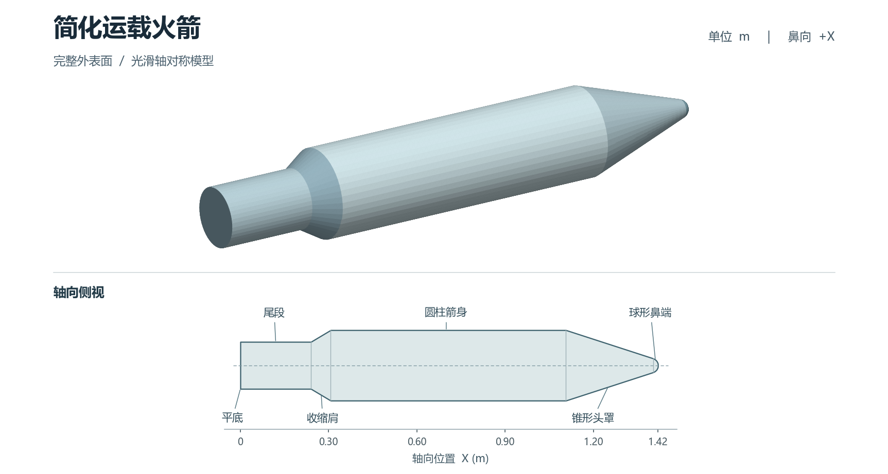
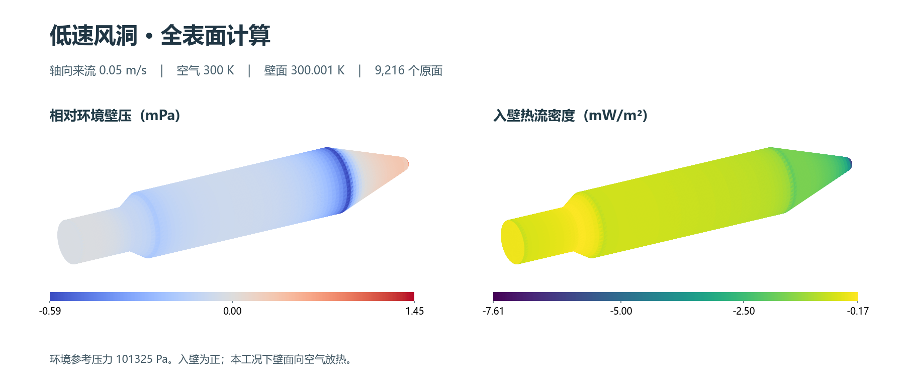

# 简化运载火箭



模型长 1.42042 m，最大直径 0.240 m。原点位于平底中心，鼻端指向 +X。外表面沿轴向由球形鼻端、锥段、圆柱箭身、收缩肩、较细尾段与平底闭合。这一版采用光滑轴对称外形。分区表中的面号从 1 开始，与发布 STL 的三角形顺序一致。[米制 STL](launcher-m.stl) · [分区和面积](geometry.json)

在 MATLAB 中运行项目的 `main`。工作台已经选好这个 STL 及单位系数 1。点击 **加载当前模型 → 确认主轴 X、鼻尖 +X → 核对全表面原网格 → 设置风洞边界 → 确认风洞工况**。计算页可重新独立计算，也可直接查看已算的同工况结果。重新计算使用项目内 SU2 8.6.0、Gmsh 4.15.2 及 Python 的 NumPy、SciPy、Matplotlib 和 psutil。查看已算结果只需 MATLAB 与项目文件。

风洞来流沿 −X，速度 0.05 m/s，空气 300 K，壁温 300.001 K。程序对六区的 9,216 个原面都输出绝对壁压与有符号入壁热流。正热流入壁，本工况整件向空气放热 0.87352 mW。逐面方法与单位可用探针、截面和 CSV 核对。风洞试验段按开域、无支撑、零攻角、层流和恒物性空气近似，实测精度待验证。[工况](tunnel.json) · [数值对照与限制](../../docs/validation/v350/RESULTS.md) · [全表面结果 ZIP](wind_tunnel.zip)



点击平底后，展开壁压的算法与适用范围，可查看同一流场的底心静压及三个半径处的点值。彩色三角面上的主数值覆盖整个扇片。球形鼻端的探针给出所选面元距鼻尖的轴向范围。[测点、面积平均与文献对照](../../docs/validation/v351/RESULTS.md)

在物理量列表选择“入壁热流 · 全周热网复核”，可查看同一等温边界在 48 个方位分别求解的热流。与主热流对比时可用统一色标，点选面元或截面可核对相同位置的数值和来源。[全周求解、内存及非均匀给温试验](../../docs/validation/v353/RESULTS.md)

项目的原生几何生成器可用以下调用重建等价表面（单位 m）。交付文件使用单精度二进制 STL。

```matlab
[mesh,meta] = buildRocketTestBody(struct('resolution',48,'protrusionEnabled',false));
```

在另一台 Windows 电脑上从头计算时，可从项目根目录运行 `python scripts/installSU2Runtime.py` 和 `python scripts/installGmshRuntime.py` 准备项目固定的工具版本。MATLAB 的 `createCaseConfig('simpleLauncher')` 选择当前风洞试件；旧脚本的无参数配置继续指向原自绘模型。
