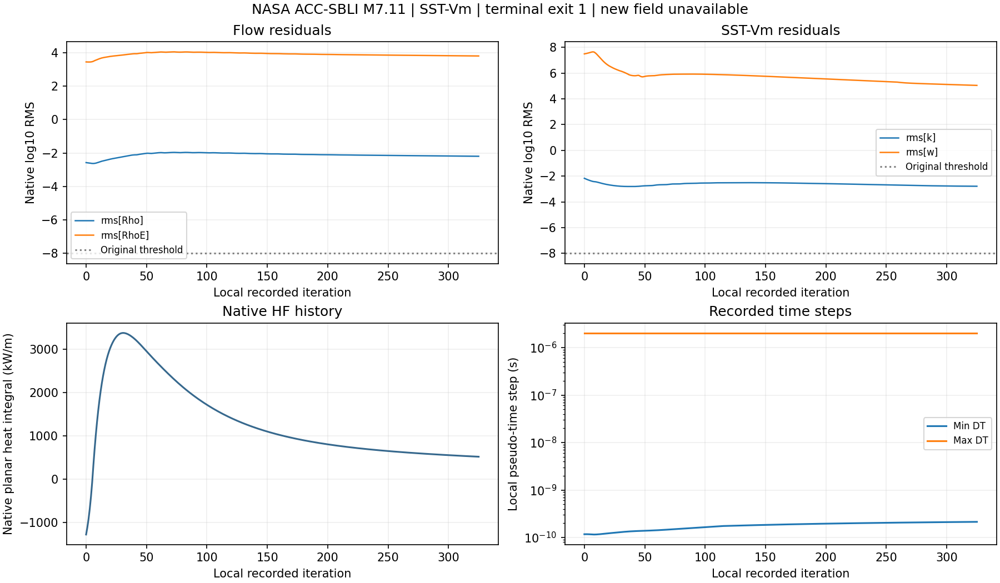

# v150 公开压缩拐角实际收敛试验与工作台记录

2026-11-05，承接v149。此次执行了一项公开完整域计算，补充独立轴对称后处理，并把实际运行记录接回统一工作台。原生求解发散，新增气动热合格面积为0。总目标继续进行。

## 实际计算

使用NASA ACC-SBLI零攻角、20°压缩拐角的原两块81×101网格，共16,261节点、16,000四边形。原SST-Vm、定比热空气、M7.11、给定Tw311K及边界条件沿用v149。该基准与真实20°攻角箭体分别登记。

固定官方SU2 8.6.0，从v149局部1的正状态逐字重启动。事前上限为12,000更新、720秒、两线程、4GiB、120MiB文件长度。控制差异仅为重启动、输出和总步数。执行计划和原配置均保留。[事前计划](validation/v150/PLAN.md)

| 项目 | 实际结果 |
| --- | --- |
| 原生任务数 | 1 |
| 运行时间及退出码 | 13.563秒，exit1 |
| 原生日志 | `SU2 has diverged (NaN detected)` |
| 有限历史 | 局部0—325，共326行 |
| 新体场及表面检查点 | 0 |
| 可用的源场 | v149局部1 |
| 进程族峰值RSS | 83,869,696字节 |
| 运行期间峰值文件长度 | 8,951,313字节，包含硬链接输入 |
| 原生10项源及输入 | 全部稳定 |

最后记录的密度、能量、k、omega的logRMS分别为−2.195885034、3.795681213、−2.784146784、5.045583518，原−8门槛均未通过。原生日志只报告NaN，缺少故障节点、方程和失败状态。局部325仅用于标识历史行，当前没有对应保存场。[原生日志和历史](validation/v150/evidence/acc_sbli01/engine.log)

原生HF按平面壁线积分，单位为W/m。整周热功率按半径加权积分，单位为W。图中保留原生HF定义。表面每1000、体场每3000更新的事前输出间隔覆盖不到此次早期发散，下一试验须提前保存状态。

## 后处理及已测试范围

`scripts/su2AxisymmetricAnalysis.py`实现原四边形中位控制面积和旋转体积、棱边邻接WLS梯度、线段半径加权积分、边界质量/能量通量、壁面弧长测站、有符号壁剪及上游剖面。控制体残差采用二维积分RHS尺度化，RMS按旋转体积加权。边界通量后处理与原生离散RHS分别记录。

解析小例已执行，0.946秒exit0。旋转体积0.7539822368615504m³，常量轴向净通量−8.88e−16，线性温度梯度及导热净积分−17.592918860102845W通过。该时间来自当时工具回报，未补造原生进程回执。

原场处理覆盖24个独立压力测点、27个热流测点及21个上游剖面位置。第一份审核3.119秒exit0。所有场量统计明确放在`sourceInitialFieldAssessment`中。源场同阶段EOS误差7.77e−16、热梯度误差1.76e−15，源场壁面流体温度1212.03—1214.64K，给定壁温311K，原启动温度失败仍保留。源场质量及能量积分缺口约9.96%和13.98%，记录其启动状态。

代码复核补充了审核范围标记。当前交付为诊断量和终态身份处理，`convergenceAcceptanceImplemented=false`。跨帧1000更新稳定性、完整预设验收执行器、网格和外域敏感性仍待实现或执行。新保存场分支尚无真实运行覆盖。新检查点出现时也会保留待验清单，防止空清单被读成全部通过。修订后只读审核2.583秒exit0，源场统计和历史图字节一致。[最终审核](validation/v150/evidence/review02/report.json)

## 统一工作台

原五步骤工作台在模型页和内嵌计算页提供“公开算例验证记录”。中央结果区显示真实退出状态、源局部1、历史局部325、新场缺失、给定壁温、模型方法和定量历史图。可导出原审核JSON和PNG，返回模型页后继续操作当前箭体。

- 首次MATLAB测试55秒exit1。主入口、失败状态和图像控件已运行，`exportapp`随后报告`Export unsuccessful`。准确测试源、初版计划和原文已归档。
- 修订观察方式后的只读功能测试84.672秒exit0，1,668项源码和显式输入运行期间稳定。输入状态保持、原报告及图像导出、伪造局部325保存场拒绝、返回模型页通过。独立SHA复核导出JSON和PNG逐字相同。
- 单独布局观察任务206.719秒exit0，源锁稳定。窗口激活和获取状态曾成功，但截图返回未完成可视复核，观察窗口已关闭。因此`nativeScreenshotObserved=false`。科研PNG已查看，实际窗口布局的视觉验收待后续相关UI修改时完成。

数值任务执行一次。两项功能测试及一项布局观察均已终态，后续仅只读核对。首次独立交付核对因CSV表头尾空格触发KeyError，修正表头解析后通过，准确旧源保留。[独立交付复核](validation/v150/delivery_verification.json)

## 路线判断

完整域计算、公开验证和统一UI仍是合适主线。本轮把计划推进为实际收敛尝试，但尚未获得稳定的公开基准壁压和热流。当前最直接的缺项是可稳定推进的边界相容启动、早期检查点和可执行的完整验收协议。

既有源场显示无滑移处理后保存的壁面流体温度远高于给定Tw。下一项受控改动选为公开二维域的守恒初场相容性，复用已有C1速度/总焓和SST正状态初始化思路。其是否能改善当前NaN仍须实际验证。失败状态缺失，暂不能归属唯一病因。[下一决策](validation/v150/NEXT_DECISION.md)

原19,752面三维箭体的工程压力计算覆盖50.2710%、热流计算覆盖66.5626%继续作为既有基线，物理合格面积单独记录。高效变比热、真实20°分离再附、底面、突起及科研UI仍为最高优先级，累计热量和轨迹后置。

## 交付和存储

准确执行源码、失败、小型审核、原生历史和目标同步公开GitHub。大型输入场和网格保留在本地。当前本轮输出路径文件长度合计10,428,657字节，含输入硬链接及导出副本，磁盘分配未实测。此次没有生成工程包或删除独有数据，OpenCode及共享历史由原任务管理。运行时依赖仍按固定来源和散列恢复。[证据目录](validation/v150/)
