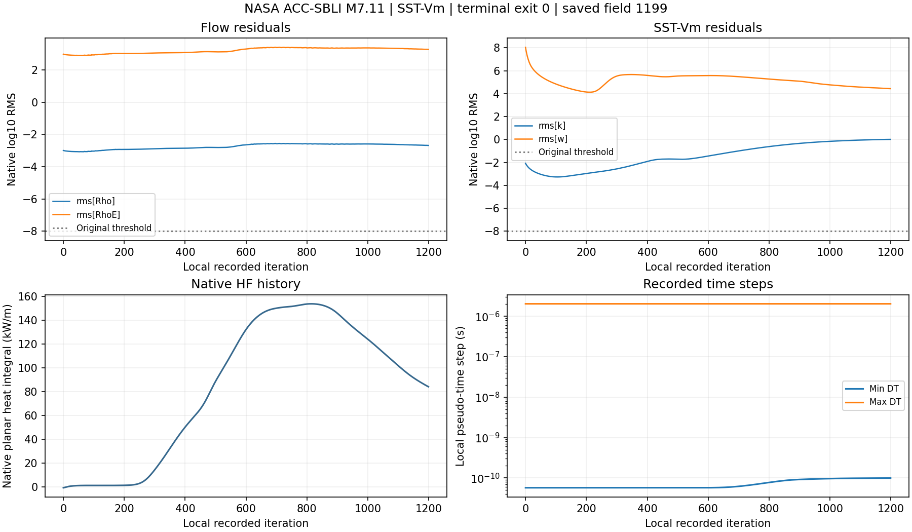

# v151 公开轴对称相容初场、完整验收与工作台对照

2026-11-05开始，2026-11-06完成。本轮从v150的早期NaN进入了一项完整公开域实际计算。原16,261节点/16,000四边形、SST-Vm及离散参数保留，唯一任务正常完成1200更新。26项预设检查有5项通过、21项未通过，新增物理合格面积0。总目标继续进行。

## 相容初场与边界

二维精确闭线段投影确定壁距和脚点。过渡尺度采用固定的0.37l/(Re_unit l)^0.2启动规则，l取入口至脚点的轴向距离，最大厚度16.8053mm。该尺度用于初始化，最终收敛、边界和网格误差分别验收。当前采用C1速度/总焓及正SST初态，含k总能量、入口/顶部非壁节点和全部壁面共同核对。

原生调用顺序先处理超声速入口通量，再施加壁面零速度残差。共享入口/壁面节点0按壁初态赋值，原生入口外侧状态按给定条件进入通量。给定Tw311K、保存壁面流体T和未知固体求解Tw分别保存。准确源码范围和散列已归档。[边界与黏性源码摘录](validation/v151/source_review/manifest.json)

一个独立小例0.944秒exit0，线段内部/端点投影、守恒能量/线性总焓、正SST、共享节点和26项验收规则通过。能量误差1.11e−15。整域初场读回EOS误差3.77e−15，全部初始温度80.005—414.215K。后续独立原CSV核对壁温最大差1.14e−13K、压力相对差4.00e−15。

## 唯一实际求解

原生SU2 8.6.0运行52.047秒exit0，局部0—1199，共1200更新。原模型、AUSM、二阶/WLS、CFL0.4和物性/边界均按源配置比对。初场构造单列。原生10项输入及初场实现的11项依赖在运行期间稳定。

保存了局部100、200、…、1100、1199的12个完整状态，以及相应表面场。首个具名帧的实际局部号为100。计划使用最多1200更新和192MiB，便于保留早期状态及跨度1000更新的审核窗口。原v150发散及325历史行继续保留。[事前计划](validation/v151/PLAN.md)

原生局部号从0开始，首帧局部100对应第101次更新。事前“首100更新内”的严格次数要求相差一次，记录为未满足。后续计划将原生局部号和已执行更新次数分别列明。

| 项目 | 实际结果 | 预设要求 |
| --- | --- | --- |
| 密度/能量logRMS | −2.68201 / 3.26806 | 各<−8 |
| k/omega logRMS | 0.017707 / 4.44176 | 各<−8 |
| 归一化密度/能量RMS | 10.6981 / 10.6176 | 各<1e−5 |
| 旋转质量/能量缺口 | 5.713% / 5.152% | 各<1% |
| y+99 | 2.8295 | ≤1 |
| 压力测站相对RMS | 28.053% | ≤10% |
| 热流测站相对RMS | 421.428% | ≤20% |
| 上游参考压力差 | 2.576% | ≤5%，通过 |
| 上游参考热流差 | 75.181% | ≤20% |
| 跨帧最大p/q/功率变化 | 92.986% / 186.464% / 98.813% | <1% / <2% / <2% |

跨帧窗口为局部100—1199，跨度1099更新，含12帧。同阶段EOS误差9.99e−16、热梯度误差6.75e−14通过。保存壁面流体T为311.195—448.813K。最终整周热功率73,826.95W，具有研究身份，公开热流精度仍未通过。热流最大测站偏差1259.1%，原残差与实验门槛原样记录。[完整26项结论](validation/v151/evidence/review01/report.json)

当前正常终止证明候选在这1200更新内可以继续推进。初始瞬态仍明显，完整数值和实验验收未完成。局部700附近功率约142.0kW，1100至1199由89.23降至73.83kW。同一段密度/能量log残差降低约0.0580/0.0627，整段相对最初100仍未收敛。由保存primitive计算的cpT+U²/2与对应来流参考值之比，末次最大约1.096。此项单列其定义，含k总能量通过守恒字段和阶段审核核对。温度和热流变化均须继续审核。[逐检查点数据](validation/v151/evidence/checkpoint_trend.json)

## 验收程序及独立核对

新增可执行的26项数值/测站检查，门槛沿用v150事前协议。缺场、与最后历史不匹配、时间跨度不足或中间缺帧均保留待验原因。网格、外域和物性/模型适用性继续作为后续物理资格要求。

轴对称物理通量按线性半径与线性边通量在过零点分段，流入/流出分别积分。壁面正负热流采用同一规则。解析r=1+t、f=−1+2t给出净积分π/3、流入7π/12、流出11π/12，小例通过。固定引擎常规黏性分支使用分子与涡黏性应力和总导热，独立积分保留其约定及轴对称速度散度，原生RHS另列。

独立程序直接读取原边界线段、原CSV和工作台CSV，51个测站最大相对差3.48e−15。密度/能量原RHS复算log与历史差1.66e−10。首次只读交付核对因编码名`utf8-sig`触发LookupError，改为标准`utf-8-sig`后通过，原源保留，求解次数为1。[独立交付核对](validation/v151/delivery_verification.json)

## 工作台实际结果

统一中央结果区增加“压力与热流对照”和“验收指标”标签。压力用Pa、热流曲线用kW/m²，CSV保存Pa/W/m²及原弧长、方法、局部1199和验收状态。独立初场与旧源步号各自显示，标题显示5/26通过。原审核JSON、历史PNG和51行测站CSV可一并导出。

两项只读MATLAB主入口任务分别148.578/153.156秒exit0，每次1,671项源/输入运行期间稳定。主流程、当前字段身份、26项状态、伪造通过拒绝、旧v150兼容、导出和返回原输入通过。实际窗口显示了两条测站曲线，并使用鼠标切换验收页。

首次观察发现UITable把微小非零误差显示成0.0000，已改为六位有效数字。第二次实际窗口已看到9.99201e−16、6.74996e−14及5/26摘要。末次自动截图确认文件晚于120秒等待窗口，因此测试JSON的`nativeScreenshotObserved=false`保留，工具中实际观察结果单独记录。此次没有保存截图文件，原生窗口观察与科研PNG复核分别登记。[显示修正](validation/v151/UI_CORRECTION.md)

## 后续与交付

下一项选定同模型的有限收敛续算，依据当前正状态、阶段审核通过、1200步正常终止和仍在消退的启动变化作事前决策。最多再10,800更新，整个相容初场系列总上限12,000更新。当前21项失败继续保留，续算资格只用于研究推进。具体输出节奏、窗口和预算必须在下一任务前登记。[下一决策](validation/v151/NEXT_DECISION.md)

真实20°原19,752面全区域、适用变比热、分离再附/底面/突起和科研UI继续为最高优先级。累计热量和轨迹后置。本轮输出路径长度155,666,552字节，含硬链接输入和别名，磁盘分配未实测。源码、小证据和目标同步公开GitHub，完整场本地保留。本轮没有生成工程包或删除独有数据，OpenCode和共享历史由原任务管理。
