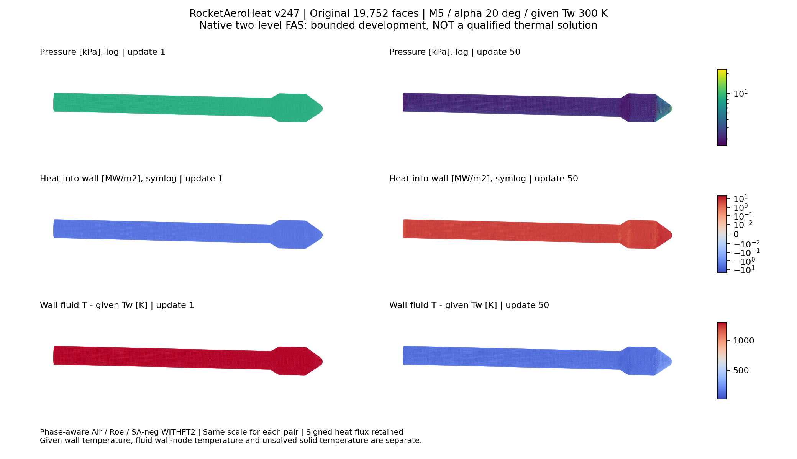
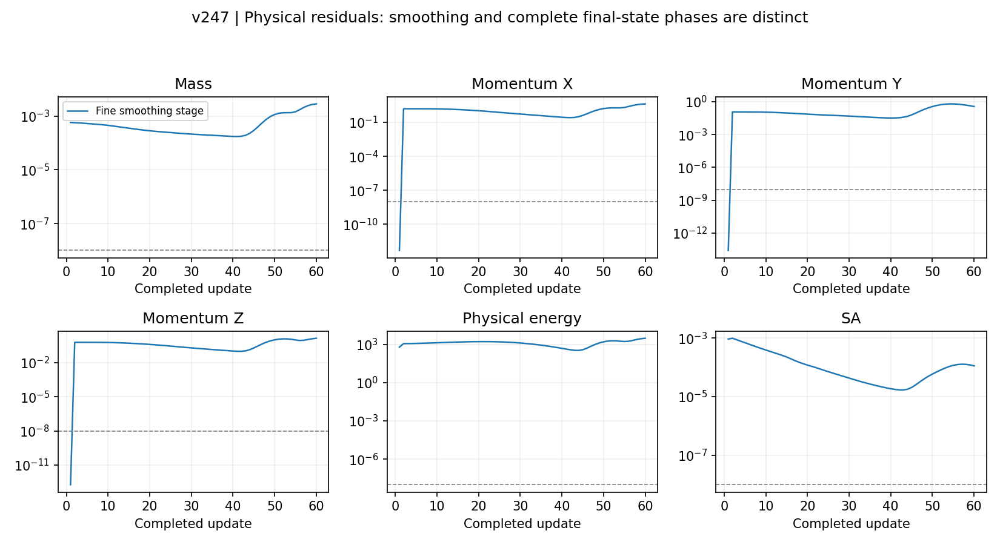

# v247 真实两层FAS有限发展与实际拒绝

**原完整箭体完成60次flow-SA更新，第61次因观察器合同停止。** 原生已经成功恢复合法旧态；这不是求解器不可恢复崩溃，也没有触及资源上限。200步收益判断及正常终态空间残差评估均未到达，新增合格热面积仍为0。

## 真实计算与保留范围

335726细点、44484粗点、705490单元、19752壁面和1.9646292565715553m²原责任面积保持；32层2µm、历史19层/尾缘和真实下游同域反馈不变。固定相态Air身份15、Roe/隐式Euler/SA-neg WITHFT2、两层V-cycle，M5/30km/α20°/给定Tw300K。相容均匀新初场，不读取任何旧场续算；成熟数值对象零重编。

唯一真实任务270.468秒，exit86，采样进程组峰值1968996352B，1CPU；没有时间/内存/容量触发。960完整细层阶段加第61次10个部分阶段，全部60个完成记录无前次末预处理拒绝。异常发生时没有完整60/61末场或原生末CSV，不能补造。完整体场只保存0/1，壁面表0/1/50。

## 实际拒绝：发生了什么，哪些仍未知

细层全局点329559（内部号42372），坐标(-2.8283246891,-0.0949321905,0.0308398997)m，原壁距33.5183µm。最后观察标签为prolong_out，准确原生调用次序是延拓修正后、无后平滑、细层预处理刷新。

| 核对量 | 实际结果 |
|---|---:|
| 试探物理内能 | −257956.386010 J/kg |
| 原物性60K下界内能 | −256002.637199 J/kg |
| 低于允许下界 | 1953.748811 J/kg |
| 合法旧态温度 | 74.17981310 K |
| 合法旧态压力 | 65.33826496 Pa |
| 原生returned与old五量 | 逐位相同 |

独立Cv积分/Brent和原点号核对通过。CNSVariable完成合法旧态物性反算和p/T设置后调用观察器；观察器按本轮预设规则抛出FAS_REAL_STATE_REJECTED，后续原生焓/输运刷新及完整flow-SA没有完成。不能把该回调位置的五量恢复当作完整循环接受。

Solution_Old不等于本次延拓前状态。本轮没有保存第61次完整细层延拓前五量及对应修正，不能把trial−old称粗层修正，也不能证明延拓是唯一根因。当前同fine阶段残差先降后升，但未完成规定的两窗，不能称原收益规则已经停止。

## 审核和科研出口

671452保存状态/26个独立Brent点、原壁热梯度及19752原面映射/面积变化通过。初0十一列逐位同v246；初1六状态最大缩放差7.575e−16，坐标/体积相同，**不是逐位同**。跨薄入口差异的唯一机制未定位，原严格比较失败保留。

新RAH247LE列名明确标识FAS修正；RAH247RS终态空间残差读取器有8个正常/损坏拒绝测试。原生终态评估入口已编译，但由于异常停止未实际执行，因此不授终态残差、全域收支或正常末保存资格。

本地`outputs/v247_validation/workbench01/index.html`含0/1/50三阶段14字段：压力、带符号热流、壁节点流体温度、与给定Tw之差、给定Tw和未知固体Tw。237024研究数值回读及既有前端纯函数通过，共同色标科研图已查看。共享WebGL未修改，无浏览器交互/MATLAB验收。所有启动过渡值均不得作为工程热环境结论。

第二图只有已完成的细层平滑阶段趋势；无末循环空间残差点，迭代号不是物理时间。六式−8、全域质量/物理能量1e−8、稳定/空间/外域/近壁/实验门槛均未通过。

## 成熟方法取舍

下一项采用现有SU2合法旧态恢复，recovered=true时观察器记录但不再主动中止；非法旧态仍拒绝。必须在同一次必要真实发展中核对完整返回、层间接受、SA阶段及恢复质量/物理能量扰动账。原生恢复不是守恒或收敛保证；不把局部状态扰动当全域边界通量账。

已核对[PETSc FAS源码](https://github.com/petsc/petsc/blob/main/src/snes/impls/fas/fas.c)中的粗层修正线搜索，以及[SECANT](https://github.com/petsc/petsc/blob/main/src/snes/linesearch/impls/secant/linesearchsecant.c)和[BT](https://github.com/petsc/petsc/blob/main/src/snes/linesearch/impls/bt/linesearchbt.c)。三源按Git blob绑定；这只是公开默认分支能力，不是已锁定发布版本或已安装能力。SECANT无需直接Jacobian乘方向；BT的普通残差路径需要，不能用带伪时间项的矩阵冒充。FAS也不自动支持变量bounds或本项目相态域。当前不安装或仿写另一套线搜索；其为原生恢复停滞后需完整适配的具名备选。

## 保留的失败与交付

首准备1.719秒因新chrono头未绑定失败，改用已绑定omp_get_wtime后1.453秒恢复；薄构建7.234秒通过。首审核1.922秒为初1严格逐位比较失败，第二审核2.859秒误把wall_stages.csv当壁点表，第三审核3.391秒通过，无CFD重跑。源审查首0.250秒发现工具文本落盘多一个换行，原副本保留，恢复精确Git blob后0.250秒通过。8项读取器测试2.672秒、科研出口3.421秒；源获取/开发定向阅读与归档另记，不伪称全部任务监督。

所有真实失败及执行源保留，大场留E盘，不打包、不删除独有结果；并发web、29项保护、engineering54、候选及用户本地补充保持。代码、小证据和目标同步GitHub。总目标active，[下一执行点](validation/v247/NEXT_DECISION.md)已写明，不把本轮关闭等同于全面积目标完成。

文档写入脚本首次被Python3.7报非UTF8解析错误，尚未执行；独立UTF8解码实际通过。原源保留，增加明确UTF8声明后完成文档写入，不推断为文件损坏，也未改动已有计算结果。
