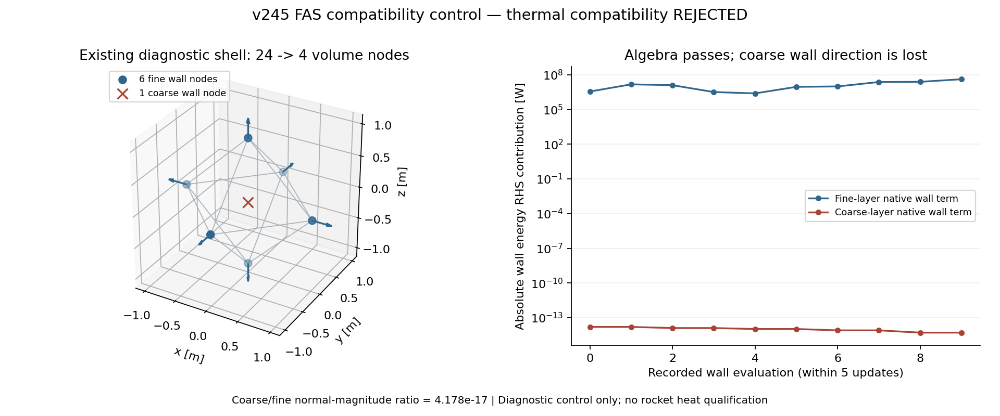

# v245 两层FAS整体控制与粗层热壁拒绝

原生两层FAS实际完成观察开/关各5次完整flow-SA更新，层间代数、相态联合域和观察中性通过；**当前24点小壳的整体热壁相容性未通过，不准入真实箭体生产，也不增加热资格面积。** 这不是整个FAS方法不可用的证明。

## 实际实现

新增`native/su2PhaseAwareAir/fasCompatibilityV245.cpp`按实际细/粗层几何与求解器指针保存完整状态；`FASHooksV245.hpp`给出只读层间接口。`scripts/runFASCompatibilityV245.py`绑定准确归档、准备唯一固定配置、监督一个必要观察对象构建和完整原生调用；`scripts/auditFASCompatibilityV245.py`独立验证真实输出。代码采用中文模块注释，没有修改MATLAB调用或主工作台。

仅编译增加只读回调的CMultiGridIntegration与薄入口，其余成熟数值/物性/SA/边界/几何对象逐SHA复用。原生CSinglezoneDriver/CFluidIteration完整执行，未重写通量或Jacobian。观察器按层保存限制前后、粗层预处理、强迫、修正、延拓及flow/SA阶段；当前守恒量与缓存原始量分列，初始RHS不用于科学验收。

采用原v235 observe02的24点40单元三维小壳、相同初场/边界、相态Air身份15、Roe、SA-neg-WITHFT2，给定Tw300 K。一个粗层V-cycle，限制/延拓阻尼0.5，关闭MG自适应平滑；原CFL自适应仍沿用原配置。原生有效预平滑(1,1)、后平滑(0,0)、修正平滑(0,0)，细层后平滑由准确CConfig第5154行强制置0，原请求(1,0)保留。默认最小粗层500点会取消小壳粗层，本软件控制显式设1；不能沿用这个小壳尺度授生产精度。

公开TMR v149/v150/v158/v159及已有Run14失败继续保留。TMR二维轴对称与当前三维相态15边界不同，需要额外适配；本次未把TMR改成平面，也未开展新的公开CFD或声称实验验证。

## 已核对的结果

| 项目 | 真实结果 |
|---|---|
| 聚合 | 24细点→4粗点，真实两层 |
| 运行 | 开/关各5次完整flow-SA，正常exit0 |
| 状态/观察 | 232观察帧；开关初始及逐次终态、原生history/restart逐位同 |
| 独立联合域 | 3548个保存状态，Cv积分＋Brent反解，原p/T相态域全部通过 |
| 层间代数 | 3272项对照；最大缩放差3.6379788e−12，出现在近消去的修正差 |
| 粗层物性 | 温度/压力、Cp、声速、物理H、8项secondary及线性输运通过 |
| SA与壁面 | 细层SA求解；粗层SA与涡黏度限制、无滑移及20次热壁增量独立核对 |
| 读取拒绝 | 4种魔数/尺寸/截断/非有限状态拒绝 |

每节点物理能量转换为`E内部−300000ρ`后核对限制、强迫和延拓。这里只证明本次实际层间算子的线性能量身份，没有执行另一能量零点的完整轨迹或证明所有非线性求解对坐标变换完全不变。粗层SA是限制值、不是独立求解的SA方程；粗层壁涡黏度置0，不能把它误写成粗层SA也独立强制为0。

## 为什么整体热壁仍拒绝

6个不同方向的整壳壁节点全部聚成一个粗节点。原子壁法向模之和约4 m²，粗法向模仅1.6711069443220838e−16 m²，比值4.17776736080521e−17，方向已不能与舍入噪声区别。对应粗层热壁能量贡献约5.18e−15～1.61e−14 W，而细层仍有实际热壁贡献。代数照原公式运行并不能证明该粗层仍能表达壁热响应。

审核用64ε乘子法向模之和判定方向数值不可辨识；这是发现后的拒绝诊断，不伪称事前预定的工程热精度门槛。不通过裁法向、补热流、改变聚合参数或补迭代把当前控制改成成功。科学拒绝保存为`integratedThermalCompatibilityPassed=false`，审核脚本exit0只表示审核完成。

## 资源、交付与下一步

准备3.219秒，单观察对象/薄构建10.547秒，观察/关闭运行1.125/0.563秒，独立审核1.078秒；图和归档另计。最大采样进程组RSS724656128字节，1CPU，未触发资源停止；短任务采样峰不等同精确峰。全部原控制和准确源保留，无重跑失败场、无新原箭体CFD、无原面新增资格，无MATLAB/共享WebGL/浏览器操作。

下一次直接复用本层感知观察器及已构建对象，在**原335726点/705490单元完整真实物理域上做一次无流动的原生聚合预检**，采用生产默认最小粗层500，检查真实边界法向、父子责任/体积、无滑移/SA、近壁和相态初场。先零流动拒绝不可用层级，满足后才另预算一个固定、有限的完整真实控制/发展；不是原300/199或其它旧场续算，也不扫网格/聚合/通量/CFL。原小壳不再作为热兼容通过的入口，TMR额外边界开发不成为无界前置。详见[下一执行点](validation/v245/NEXT_DECISION.md)。

完整原壁19752面/1.9646292565715553m²、32层2µm与历史19层尾缘保持，真实下游仍在同一物理域。工程外缘/工程热和科研UI独立最高；未知/给定/研究/合格身份保持，累计后置。小证据公开GitHub、大数组留E盘，用户并发本地补充不发布。
