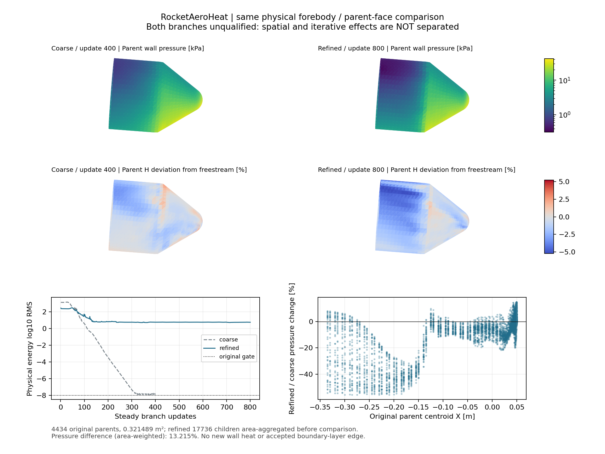

# v243：前体源场分解、一次空间对照与原面研究出口

2026-11-16。**已完成一次真实细网格对照，但没有取得新的外缘或壁热资格。** 本版确认质量通量后处理不能单独修复现有供体热状态；一次区域细化在预算内运行800次更新，压力稳定，但残差、净收支和总焓偏差没有改善。后续转向有真实边界条件依据的局部黏性方案，不继续叠加Euler细化或盲续迭代。总目标active，单工况全面积气动热与统一科研UI并列最高。

## 1. 本版实际回答的问题

针对v242已保存四管的210个实际经过单元和6个停止壁面，分开计算节点总焓的线性插值与守恒量插值后求总焓。共同中心前缀的最大沿程漂移如下；各列为各自最大值，不能相加成误差上界。

| 管号 | 总焓漂移 | 节点总焓插值的漂移 | 混合状态附加漂移 |
|---|---:|---:|---:|
| 1 | 2.1424% | 1.8532% | 0.2892% |
| 2 | 2.9470% | 2.8152% | 0.3746% |
| 3 | 1.3582% | 1.0516% | 0.3139% |
| 4 | 3.5714% | 3.5969% | 0.2719% |

供体节点H本身随位置变化，已经是主要问题。P1质量场的无量纲散度中位0.03828、最大0.22848，真实停止面P1法向质量比例0.00223—0.15044；它们不是原生Roe面通量或原生残差。准确归档的BC_Sym_Plane对节点法向约束旧态及动量残差，不保证三角面内部P1切向相容。

已核对scikit-fem 11.0.0官方最低阶四面体RT、Piola映射及混合Poisson例，固定提交和BSD许可证在[来源清单](validation/v243/research/sources.json)。未安装、未执行RT投影。**拒绝将质量投影直接作为本版工程热入口**：它不提供原相态Euler热状态或原生Roe通量，修改质量速度也不自动保持原动量、能量和熵。这个结论不否定具备完整供体时的保守后处理用途。净节点RHS不能唯一反演每个面通量，不为补日志重跑旧400。

## 2. 一次区域细化及有限几何修正

在[事前方法合同](validation/v243/METHOD_DECISION.md)中明确允许计算壁面细分，原用户4434前体面、原19752全模型面、面积分母和黏性近壁资产保留。固定Gmsh4.15.2只调用一次refine，无优化器、无Netgen。每母tet分为8个子tet，每母壁面分为4个严格共面子面，所有新增坐标都是原边中点；物理出口平面、46段原环及外域不变。

原Gmsh结果162216tet/34956点，最低SICN0.0885032，有8个单元未达0.1，**该候选拒绝并保留**。有限枚举定位4个母单元的中心八面体；追加事前合同只允许这4处选择三条内部对角线中的最大最小质量方案。修改16个中心tet，其余162200个单元、全部坐标与边界不变。这是项目有限几何适配，不冒称Gmsh直接输出或通用成熟优化器。

独立母体积/边界/凸包/连通审核及Gmsh只读质量对照通过，最低SICN0.10256284557，无低于0.1；质量算法最大差1.3434e−14、母体积最大相对差2.9976e−15。流体体积108.28154703940442m³保持，计算壁面17736个按面积回到4434父面。原前体面积0.3214887716893075m²、全模型1.9646292565715553m²保持。网格通过不授物理资格。

## 3. 真实800更新及独立结果

[CFD合同](validation/v243/CFD_PLAN.md)先登记后执行。同相态Air/Euler16/Roe/原完整二阶、限制器及CFL，复用全部成熟数值对象；只构建父面观察薄驱动5.875秒。新的相容均匀初场，不插值或续算v242400。配置只改总更新上限800及原生输出频率；停止规则先聚合子面压力，再比较原父面。

唯一运行287.359秒，退出0，1CPU，采样峰264503296字节。**正常达到800预算终点，不是收益规则触发停止。** 完整保存0、1、每50及800共18帧；强制原生末CSV的全部坐标、五个守恒量与观察场逐位一致。3022实际出口点累计2417600次调用、12088000个分量逐位核对，最小法向Mach2.11143。末预处理拒绝最大519、终点3；不含全部子阶段或准确拒绝ID，不能将其认作唯一故障原因。

| 检查 | v242粗网格400 | v243细网格800 | 结论 |
|---|---:|---:|---|
| 物理能量log10 RMS | −7.84267 | 0.746576 | 均未达原−8门槛 |
| 五式全部达−8 | 否，四式通过 | 否，五式均未过 | 不授稳态 |
| 净质量缩放残差 | 1.3023e−16 | 1.3055e−7 | 细网格未达1e−8 |
| 净物理能量缩放残差 | 6.9565e−16 | 4.5863e−7 | 细网格未达1e−8 |
| 末原面压力面积变化 | 1.0282e−13 | 1.3906e−5 | 稳定门槛通过，不能代替守恒和收敛 |
| 壁邻H相对来流面积均差 | 0.8610% | 1.6823% | 未改善 |
| 壁邻H最大偏差 | 4.7061% | 5.2177% | 未改善 |

细网格五式末log10 RMS依次为−5.720699、−2.588386、−3.504648、−3.124609、0.746576。能量残差仍先逐节点减去300000倍质量分量后再求范数。

相同4434原父面，粗细压力面积加权差13.21488%、单面最大相对差55.66226%，H差相对来流的面积均值1.33035%。**两支都没有通过完整稳态门槛，空间误差与迭代误差没有分离，不能称网格无关检验通过，也不能把差值当作严格空间误差。** 本对照足以拒绝“细化后可直接升级为可信外缘”的具体结论，并未证明黏性缺失是唯一根因。全域同阶段动量、空间外域和真实工程外缘仍未验收。

## 4. 结果显示与可核对交付

本地`outputs/v243_validation/workbench01/index.html`及`forebody_research.json`提供0/400/800三阶段、21字段；79812个研究数值逐值回读及前端真实纯函数通过。显示仍以原19752面为对象，4434父面有研究字段，其他区域保持未知。Euler不提供壁热流；给定Tw300K与未知固体Tw分开。

科研图已实际查看：两支共用压力色标和H偏差色标，附物理能量残差及原面压力差曲线，明确标注均未合格。没有修改并发共享WebGL、没有MATLAB运行或浏览器交互验收。源码、来源、局部几何证明、监督回执、原面差值及图放GitHub，大网格、执行文件、完整体场与重复网页载荷留E盘并登记SHA。

## 5. 失败、资源及下一步

两次执行失败完整保留：首inspect错用薄驱动依赖表查成熟inl来源，0.968秒退出1；改绑定v229真实构建回执的同SHA源后0.844秒通过。首流动审核遗漏Mach父面聚合，1.859秒退出1；改用同父面积聚合后10.078秒通过，未重跑CFD。另有原Gmsh细化科学质量拒绝，进程本身正常；不能与执行失败混淆。

文档更新首文件调用另出现Python源码编码SyntaxError，脚本体未执行；原文件整体UTF-8解码和文本/字节compile检查均通过，文件调用故障原因未证。改为显式UTF-8读取后compile/exec完成文档更新，原文件及失败说明保留，不涉及任何数值重跑。

归档首预检因另一项工程算法报告脚本在两次读取间变化而拒绝，未创建交付证据目录；保留当时归档源和失败说明，改为记录并发报告的实际观察SHA并排除出本轮交付。原29项、engineering54、候选及固定并发Web保护仍严格核对，不改变任何科学验收。

14项监督任务都有终态、输入稳定、进程组清空。含失败的监督离线5.968秒、网格1.579秒、薄构建5.875秒、CFD287.359秒、审核及科研出口21.219秒；归档另计。最大监督采样RSS727855104字节来自构建。交互开发、定向读取及网络调研未全部计入上述监督时间，不能把它们当总人工墙钟时间。早期网格合同256MiB保留，CFD前已明确将后续整版输出预算提高到384MiB。

当前固定CLI关闭，不自动准入任何新CFD/构建/查询。按[下一执行点](validation/v243/NEXT_DECISION.md)复用真实近壁区域索引，决定单区成熟黏性边界和下游反馈后直接实施。不盲续本800或旧400/200/199/92，不扫描细化/CFL/通量，不重做物性/小壳/冻结整域，不把研究值或补零计为已解面积。新合格面积与新壁热面积均为0；工程/UI独立最高，总目标保持active。
