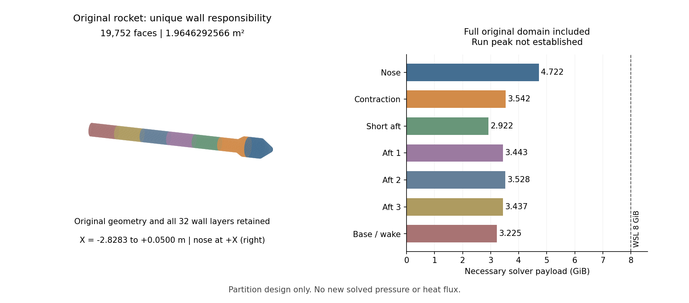

# v216：完整七域设计与数值接受决定

2026-11-08。本轮取得**完整原域的七个连通区域索引设计**，不是新增流动或气动热结果。原19,752面、1.9646292565715553 m²、32层/2微米首层、尾缘扇及所有原母单元保持；前三域原壁责任与v212逐项相同。v214整体导数差分仍未通过，原外边界的混合入出流、实际运行峰值及生产调度尚未闭合，**当前没有新构建、原生查询、网格或CFD准入**。总目标active。

## 1. 完整域与责任

复用v144 `hybrid_volume.mat`，SHA256 `22b35b72396c1a7d14195af9bd24d3c6328138484d4009638c1ab48cddec1d6c`。实际335,726点、634,916棱柱＋70,574四面体，共705,490单元、1,741,600唯一面、6,572原外边界三角。母文件没有pyramids字段。632,064个规整壁柱单元对应全部原面各32层，另2,852个尾缘扇棱柱原样保留。

完整底面棱边具有额外列节点，不能按当前节点编号直接取模。设计使用`sourcePreparedNodeIDsOneBased`、准确v133扇报告的`baseNodeIDs/rimNodeIDs`及v144来源SHA恢复原柱身份。每个母单元至少在一个求解域内、具有唯一主责任；每个原壁面恰有一个主责任。重叠求解域不重复计算壁面面积和最终功率。

| 区域 | 主责任原面 | 主责任面积m² | 求解单元（含原外域） | 必要载荷GiB |
|---|---:|---:|---:|---:|
| nose | 4434 | 0.3214887717 | 173326 | 4.721865 |
| contraction | 2760 | 0.3325150204 | 129114 | 3.541507 |
| afterbody | 2484 | 0.2540157655 | 106207 | 2.922430 |
| aft_1 | 2484 | 0.2540066261 | 125472 | 3.443214 |
| aft_2 | 2576 | 0.2634001155 | 128590 | 3.527897 |
| aft_3 | 2484 | 0.2539749783 | 125246 | 3.437490 |
| aft_4（底面/尾迹） | 2530 | 0.2852279792 | 117417 | 3.225427 |

责任切分X为−0.3397934891、−0.7895219858、−1.1942776328、−1.5990332799、−2.0187798768、−2.4235355238 m。后三维求解范围与主责任不同；实际完整单元列表为准，不能只凭轴向边界重建。

首次design03中afterbody有106205与1两个分量。按事前[单次拓扑决定](validation/v216/TOPOLOGY_DECISION.md)，现成母图最短路径为`635870 → 675194 → 693959`，只将已有四面体675194加入该域，未生成单元、移动点或删孤点。这里母单元ID为零基。该单元不增加物理壁面，其他六域和全部主责任不变；独立图距离核对为2，最终七域均连通。原不连通设计仍拒绝。

最终可复用索引在`outputs/v216_validation/connected01/partition.npz`，SHA256 `fb5825f933cad62bf466c43c12a96f7ab216ac894e0cd06a2932d7f32315c1a2`。大索引保留E盘；[独立审核](validation/v216/evidence/final01/report.json)公开。

图中颜色是责任区域，不是压力/热流。首图刻度拥挤原样留档，当前图仅修排版，已实际查看。无MATLAB或主UI变动。

## 2. 资源与文件接口

复用v211准确复数六变量SA、ILU0、GMRES50资源公式，逐域实际统计单元、面、节点、ghost及整数连接数，独立整数公式逐项一致。**2.922—4.722 GiB只是必要载荷，不是运行峰值**；尚未计齐GC/分配器容量、临时点云/Jacobian、边界对象、文件/JSON解码、快照、运行库和映射等，也不含下述候选新增外壳。不能据此保证8 GiB可运行。

contraction至aft_3的一整个v2文件，仅位串下界就超过16 MiB。保持原文件上限，改为按实际供体主责任域拆自然patch，不能假定只有左右两个邻区：外域存在少量非紧邻供体面。每patch须绑定母面集、源帧、构建和同一交换轮次。每面140个实虚部位串、紧凑行格式及元数据≤64 KiB的合同下，最大文件估算上界10,305,352字节。**没有实际生成/导入这些大文件或验证生产峰值**；v215软件小控制可复用，不能直接转授规模或流动资格。

全壁距仍须以完整原壁为定义，不能在独立子域中只对局部热壁重算而改变SA模型。本轮保留母映射，没有生成新全壁距或验证其生产分派。

## 3. 数值检查的可反驳结论

不运行原生控制，复用v214 `nk_samples.csv`（SHA256 `203f15dbe95e8f293baa5138efbbec91adda811704121eef8e9c74701d23e150`）、方向和原几何。h=1e−4、尺度及1e−5门槛保持。

按原生距离权重θ=distance^(−0.75)独立SVD，点云矩阵条件数1.3261—8.5809、中位3.2193，最小奇异值0.0446951。矩阵并非高度病态；梯度对输入的最大绝对增益约859432 m⁻¹，说明薄层放大输入误差的可能性，但不证明当前差异的唯一原因。

所有原失败分量都无法仅由**最终输出双精度量化区间**覆盖。对前五式，基于已经舍入并保存的积分通量，用标准γ₇=7u/(1−7u)、u=2⁻⁵³约束组装：保存正负扰动残差均在条件性界内，最大占界比例0.44613/0.21546/0.32233。该界不包含上游梯度、通量、EOS的评估误差、差分截断或SA源项，不能撤销原差分失败。

用70位Decimal完成积分通量求和、体积除法、正负相减和除以2h，最后才转double，前五式仍分别有826/811/1065个分量失败，最大缩放差0.02444953649/0.03280738887/0.00943028577。numerical01提前转double的分析保持，numerical02修正全程差分顺序；没有新原生数据。[最终数值报告](validation/v216/evidence/numerical02/report.json)与失败逐量CSV公开。

最小缺失证据是实际primitive cell/face stencil、真实原生权重及上游计算误差，或独立完整方向参考/截断界。已定位的代表点为regime0 cell23 eq1、regime1 cell22 eq1、regime2 cell5 eq5（SA）；ID沿原CSV零基。不能再次照搬三组Jv/FD或扫扰动。**整体数值接受false；唯一根因未知。**

成熟误差分析依据：Higham (1993), *The Accuracy of Floating Point Summation*, SIAM J. Sci. Comput. 14(4), 783–799，[原文](https://nhigham.com/wp-content/uploads/2023/10/high93s.pdf)§1标准模型、§2递归求和；Higham & Mary，[DOI 10.1137/18M1226312](https://epubs.siam.org/doi/10.1137/18M1226312)摘要核对γn定义。本轮只用确定性界，没有以概率分析放宽门槛。实际梯度与组装来源绑定在报告中。

## 4. 物理外边界决定

原方盒X为[−8.5849598448, 2.9283199367] m，Y/Z为±2.8783199454 m。M5/α20°均匀初态下，1984面法向超声速入流、1984面超声速出流、2604面混合/非超声速法向传播，法向Mach范围±4.6984631。**混合标签只说明初态法向特征，不能称为实际分离或回流。** 既有Ambient符号复制、SimpleFlux封堵和短后体p∞都不能自动解决此物理合同。

提出一个待审查的连续外包络候选：沿下游扩张的40°截锥包住原完整方盒，在旧外边界之外增加外壳，把原混合侧面变成内部面。鼻前X=3.2161519312 m、后端X=−8.5849598448 m、前半径4.2740870588 m、后半径14.1763955975 m。均匀初态侧面法向Mach为−5sin60°至−5sin20°，即−4.3301至−1.7101；前端−4.6985、后端+4.6985。

**这只是连续几何候选，未生成任何网格，也不是已批准的物理边界。** 包络很大，新增体积/单元可能消耗资源优势，必须先定量评估。需要实际离散法向/闭合外壳/原单元保持、初态与发展场条件、扰动与边界距离、出口回流/亚声速拒绝及外域敏感性；不能仅凭初态normal Mach授资格。InOutFlowBC_DualState按空间位置选择upwind状态，不能改称完整特征边界。

## 5. 执行与历史保护

原计划累计120秒离线预算，无原生/构建/网格/CFD。10项离线任务累计18.868656秒；另图修复2.187秒，总21.055656秒，采样峰490,520,576字节。所有已结束进程输入稳定、进程树清空、无资源停止；29保护文件保持。Windows使用现有SciPy和psutil，无硬RLIMIT_AS。首WSL回执的通用cpuCountLimit=2不等于实际命令：实际`taskset -c 0`绑定1CPU；该历史字段原样保留。

首WSL缺SciPy、inventory2缺pyramids假设、design结构view及底面编号假设、design03不连通、numerical01精度顺序及首图排版问题均保留，不追改为成功。前两次inventory没有即时保存worker副本、首WSL入口也未即时保存；SHA和日志保留，不宣称其完整文本已绑定。后续实际执行副本与回执逐一核对。绘图事前细分15秒，监督器仍记录通用90秒上限；实际2.187秒未超15秒，但没有声称监督器实施了15秒硬限制。见[环境恢复](validation/v216/ENVIRONMENT_RECOVERY.md)、[绘图恢复](validation/v216/PLOT_RECOVERY.md)及归档审核。

首归档在完成保护/源码核对及关闭入口后，清单生成因相对`__file__`处理失败；准确入口与失败保留，另做只读清单恢复，没有重算或重复关闭，见[归档恢复](validation/v216/ARCHIVE_RECOVERY.md)。

本轮无新热面积/物理资格，不修改工程66.5626%等历史覆盖；小源码/证据公开，大索引留E盘，无工程包或独有资产删除，并发Web工作未计入本轮。下一步按[有限组合决定](validation/v216/NEXT_DECISION.md)推进，工程与科研UI仍独立并列最高。
