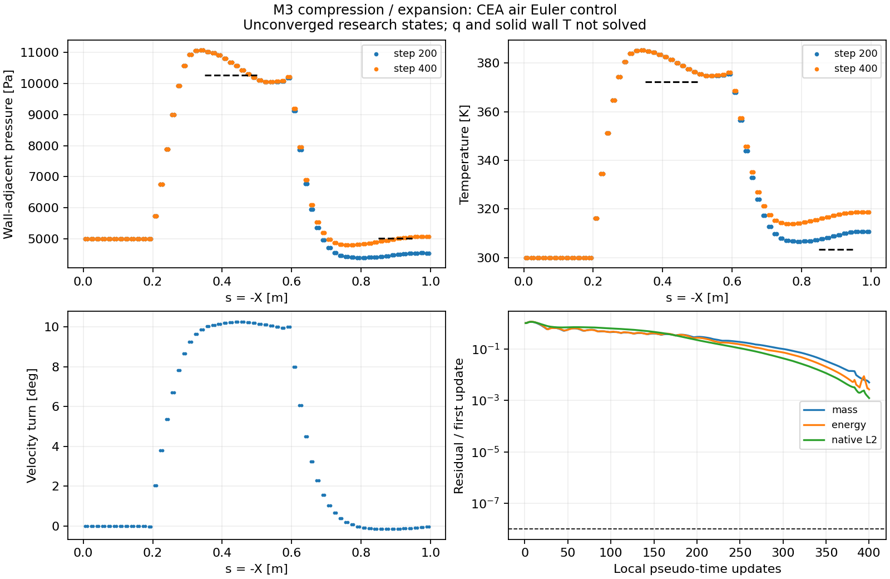

# v191：原生Euler控制与同EOS壁邻接口

2026-11-07。接续v190，完成一次真实原生Euler控制及生产读场。**小控制在本机可运行，同EOS与壁面身份通过；尚未收敛，没有新增箭体热流或物理资格。** 新路线已从离线输入进入原生计算，不重开旧整箭OOM/NACA/Run14。

## 实际完成

- `prepareHybridEulerNative.py`核对v190/interface02的输入，使用固定Eilmer5准备气体、非结构网格、实际配置及初场。独立回执禁止覆盖；不借用Wilcox旧准入。
- `eilmerAirThermo.py`绑定准确生成气体；`queryHybridEulerGas.py`用原生Lua查询19个p/T状态，覆盖200—6000K、800—1200K混合区及本控制压缩/膨胀参照。密度、内能、焓、熵、声速、cp、黏度、导热最大相对差4.14e−15，6项温域/来源拒绝通过。
- `hybridEulerReference.py`以同EOS的Rankine–Hugoniot方程求10°弱斜激波，以广义简单波积分求−10°膨胀；质量/法向动量/总焓、熵和独立cp积分检查通过。所有参照静温在200—800K内，不用定gamma表。它是二维无黏理论对照，不是公开热实验。
- `readHybridEulerNative.py`按原连接关系将120壁四边形对应到240原控制三角面和唯一相邻体单元；读取p/T/rho/三维速度/e/h/h0/s。发展帧绑定真实运行退出、准确二进制与保存场SHA；异常、过期、未清点来源拒绝。q及求解固体Tw均null，`attachedEdgeQualified/engineeringHeatReady/physicalQualification`均false。
- `runHybridEulerControl.py`在准备/物性/参照通过并另登记预算后，只执行一次400更新。`auditHybridEulerControl.py`分别审核完成、发展、平台对照、边界、稳定性，并生成科研图和全控制壁CSV。

## 物性与资源的实际身份

`prep-gas`实际生成**CompositeGas→ThermPerfGasMixture**，不是旧同名ThermallyPerfectGas类。固定源f53f460、R=8.31451/.02896，保留官方CEA焓与熵参考；300K内能为负来自参考零点，不裁成正数。s(298.15K,101325Pa)也不是0。原生800—1200K系数混合使cp不严格等于dh/dT；900/1100K实测相对差约+5.21e−5/−7.18e−5。回调复现原生行为，但这一范围核对不授予M5高温热验证。工程NASA7尚未完成相容转换，不能直接将这批外流状态塞入旧工程边界层。

新控制为三维挤出的二维流动：M3、p5000Pa、T300K、来流−X，10°压缩/−10°回转。2400六面体/3843顶点/8560面/2720外边界，每外边界一个ghost，共5120单元对象；原生体积0.022307260985198737m³，解析一致。壁/跨距滑移、入口超声速、出口Simple、顶部Ambient；无黏、无湍流、无反应、二阶AUSMDV/TVD RK3、CFL.3、局部伪时间。

实际5守恒变量、4保留时间层，两个密集数组组1638400字节；正常梯度/工作区各5120项，五类备份0，2400内部单元隐式对象0。初始化日志heap已用54MB/总74MB，过程采样组RSS峰70,217,728字节（66.97MiB），完整算例约2.47MB。此为小控制实测，不能按比例宣称真实整箭峰值或加速倍数。原8GiB完整域失败仍保持。

## 真实400更新结果

原生监督10.438秒、入口11.364秒、Windows父13.094秒；正常exit0，0/200/400三帧完整，输入稳定、自有进程清点为空。末场299.891—385.244K，三帧EOS回算最大缩放差3.54e−15；末总焓相对来流最大差0.26488%、体积平均绝对差0.01187%。这不是原生边界通量守恒证明；局部伪时间也不能当飞行时间。

| 壁邻平台 | 同EOS p / 原生均值，Pa | p偏差 | T偏差 | 方向误差 |
|---|---:|---:|---:|---:|
| 压缩s=.35—.5m | 10268.790 / 10654.574 | +3.7569% | +2.3652% | .17775° |
| 膨胀s=.85—.95m | 5012.281 / 4994.797 | −.3488% | +4.5928% | .13076° |

满足预设p/T各5%、方向2°粗筛选。后50相对首50质量/能量残差几何平均分别下降1.7271/1.9905个十进数量级。200→400壁邻p/T/速度面积L1变化2.1083%/.7358%/.9397%，压力未过1%。末原生有量纲L2=1,734,587，除首步后=.00122440，**未收敛**。

RUN_PLAN中的“global残差”未事前写明归一化；原生字段实际是有量纲L2。这里同时报告原值和首步归一化值，两者均不满足原文字门槛，不追改为通过。下一候选须事前明确分量/单位/尺度，保持原−8要求而不跨求解器直接横比。

顶部邻单元p约5000Pa、跨距速度逐点为0；末出口总Mach最低2.5446。此为诊断，不代替法向特征/域扩大敏感性。当前相邻单元采样也不是壁面重构或已认证外缘。粗网格膨胀温差与压缩超调须经过收敛和网格对照，不能由压力误差小就忽略。

## 独立复核与记录

`verifyHybridEulerControl.py`直接读取原始double和独立规则网格索引，240面p/T/三速度与CSV逐字数值差0；独立Heron面积最大差1.36e−19m²，总焓最大相对差2.16e−16。12项错误/过期/失败来源拒绝通过。29项并发保护全部保持。

本轮正式检查无失败。发展帧来源锁定在final01前完成，非负整数序号检查在final02前完成；最终final02按最终读取器重新导出，没有重跑CFD。两张科研图SHA相同，已目视核对。运行/初场与最终读取器分别归档，不能用当前文件替换旧执行源。无MATLAB/主UI/computer-use/构建/新整箭任务。

八个父监督总24.940秒，其中准备2.860秒/90，唯一运行13.094秒/120，其他核验8.986秒/120；读源、开发和协调另计。PLAN/独立RUN_PLAN及实际回执均保留。所有输出只位于本轮目录，未删除独有数据，没有工程包。

下一项见[决定](validation/v191/NEXT_DECISION.md)。本轮原19752面/面积与工程默认完全保持，新增热流面积0、物理资格0。小源码与证据公开同步，大场/运行库仍仅本地。

## 来源

固定[GDTk源](https://github.com/gdtk-uq/gdtk/tree/f53f4609a0331d48efee69a4e4f3c3598378cc03)的`composite_gas.d`、`thermo/therm_perf_gas_mix.d`、`cea_thermo_curves.d`、`species-database/air.lua`、`physical_constants.d`及Lua气体API；准确SHA见原生gas01回执。[许可与适配说明](../third_party/eilmer_thermo/NOTICE.md)保留上游署名与GPLv3或以后许可。理论参照使用守恒方程与超声速简单波关系，本轮未新增或冒用实验数据；热验证来源选择仍按v189执行。
