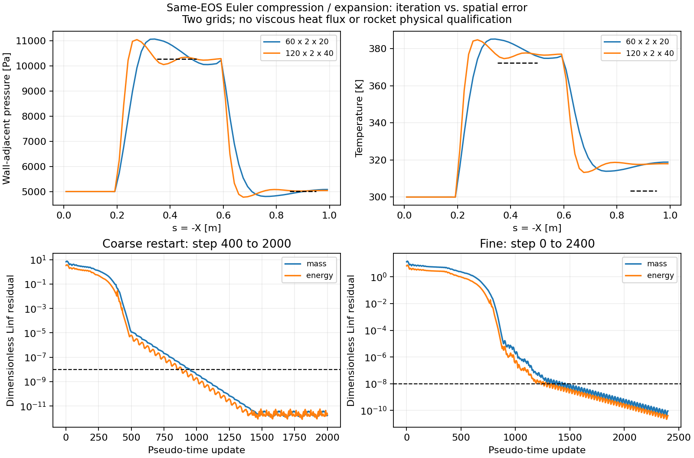

# v192：Euler数值收敛与空间误差已经分开

2026-11-07，接续d2a36a7。**粗细控制均达到事前无量纲残差/状态稳定指标；压缩段改善，膨胀温度偏差没有随加密下降。** 关闭继续统一加密或追加步数。下一项转真实20°全局Euler网格准备，同时限定外缘/滑移壁接口；不把本控制的数值收敛当箭体热资格。

## 交付的软件与实际计算

`hybridEulerEvolution.py`支持具名同场重启与唯一细网格合同，`prepareHybridEulerRefinement.py`复用准确气体、只准备新网格/初场。旧v191合同保持，`readHybridEulerNative.py`增添新合同分派，`prepareHybridEulerCase.py`仅增加明确两种网格规模。当前不允许旧完整域借此自动准入。

官方`--snapshot-start=2`恢复保存400步的场、time与dt；原瞬态历史逐字作为前缀继续，第一新步401。原v191目录始终只读，新目录的输入/保存场与实际运行包逐字绑定。重启会重建工作区，未声称与无中断逐步位等价。

| 项目 | 粗网格同场发展 | 独立细网格 |
|---|---:|---:|
| 流向×跨距×法向 | 60×2×20 | 120×2×40 |
| 内部单元/ghost | 2400 / 2720 | 9600 / 10240 |
| 起止步 | 400→2000 | 0→2400 |
| 原生监督时间 | 39.027 s | 275.282 s |
| Windows父时间 | 41.094 s | 277.578 s |
| 采样组RSS峰 | 67.37 MiB | 228.35 MiB |
| 末50最大无量纲分量残差 | 4.62e−12 | 1.15e−10 |
| 质量不平衡/来流质量流率 | 3.35e−17 | 7.28e−15 |
| 实际末两帧压力面积L1变化 | 1.386e−5（400→2000） | 5.68e−16（2351→2400） |

实际5守恒量/4保留时间层；细网格两个密集组载荷6,348,800字节。粗71/细41项运行输入稳定，两个任务均exit0、各自进程组清点为空。没有引擎构建、整箭CFD或新的系统资源设置。

细网格独立六四面体分解全正、解析体积一致，完整壁面积仍0.04024682579017192m²；原生体积/边界/均匀同EOS初态检查通过。实际保存为0/403/795/1184/1200/1573/1962/2351/2400，时间间隔检查通过。

## 残差定义与原失败保持

准确原生`compute_Linf_residuals`为dU/dt各守恒分量最大绝对值。本轮事前固定L=1m、rho∞=.058051125883144844kg/m³、U∞=1041.7259569202704m/s：质量尺度rho U/L，三动量rho U²/L，总能rho U³/L。末50步每个分量均≤1e−8；横流零值使用来流尺度，不以零初始残差作分母。原生混合有量纲L2仍输出，不拿它直接与SU2的−8横比。现有箭体/热流/y+及公开验证门槛没有放宽。

本轮有两项准确失败，均保留：

1. PLAN错误地将`write_flow_solution_at_step=400`理解为每400步保存。源码实际是`step==指定值`，因此粗任务只有原0/200/400与新2000场，缺800/1200/1600。coarse_audit01断言失败；coarse_audit02只读恢复实际数值评估，**scheduledSamplingPassed=false、planAcceptancePassed=false**仍保持。数值指标按实际400→2000长窗通过，不补造缺帧，不重跑粗任务。
2. fine_audit01计算后写JSON时遇到NumPy bool_类型错误，没有完整report.json；准确源码/日志保留。显式转为Python bool后fine_audit02只读恢复，未重跑CFD。

细任务事前用独立REFINE_PLAN登记：采用官方dt_plot=.0007的伪时间间隔和一次1200步保存。它按已经获得的残差、实际稳定窗与持续空间偏差准入，不追改粗计划为全部通过。

## 同一平台与同一面积上的空间对照

同EOS理论、工况、物性、几何和外域保持，平台仍取s=.35—.5m、.85—.95m。粗细按同一60个轴向区间作面积积分，未用不同节点号直接相减。

| 区域与量 | 粗网格对理论 | 细网格对理论 | 结论 |
|---|---:|---:|---|
| 压缩压力 | +3.7569% | −.5353% | 明显改善 |
| 压缩温度 | +2.3652% | +1.1199% | 改善 |
| 膨胀压力 | −.3482% | +.2385% | 绝对偏差减小 |
| 膨胀温度 | +4.5931% | +4.7036% | **没有改善** |

细网格仍满足原5%/2°粗筛选，但**未实现全部预定加密收益**。共同轴向区间细粗压力/温度面积L1差5.2517%/1.3856%；两层网格不能称网格无关，壁邻距离变化也包含在差异中。关闭继续统一加密，不用连续增加步数解释已收敛的平台偏差。

## 一次保存场定位及边界限制

只读完整法向剖面、并列固定1/3/5cm高度带，未移动采样点挑选通过值。s约.9m最近单元离壁竖向距离粗13.24mm/细6.62mm，其相对理论熵超量约46.19/45.54 J/(kg·K)、温差约4.70%/4.68%。固定近壁带也有偏差；不能由局部压力正确就认定温度/熵可作为热边界层外缘。这是定位，不证明唯一病因，也不把它命名为真实黏性边界层。

顶部邻单元压力相对来流最大偏差粗6.29e−8/细3.33e−14；末出口外向法向Mach最小2.511/2.476，跨距速度0。壁邻单元法向Mach不是滑移壁面通量，不能用它声称穿壁漏流。上述诊断不能替代外域敏感性。

准确原生还存在`WallBC_WithSlip1`无ghost单侧壁通量入口，但官方注释为“trying out”；`WithSlip2`针对移动壁法向速度。**本轮没有采用或验证它们**，不能仅看名称就当成熟修复。下一次若选用，必须先核实际非结构分派/公开对照及适用范围，不重写通用内核。

## 预算、保护与下一步

12个父监督总342.781秒：两项CFD父共318.672秒（分别150/390秒预算），细准备4.594秒/90，其他核验含粗复制和两次失败共19.515秒/180。读源/开发/交付协调另计。细耗时超过事前尺度估计约234秒，但低于360秒原生预算，不声称精确成本模型。

没有MATLAB/主UI/computer-use；既有真实19752面/1.9646292566m²、工程默认、历史19层/尾缘与29项保护保持。新箭体热流面积/物理资格0，原始独有结果不删除，运行库/原生体场仍仅本地。小源码、准确失败及证据公开GitHub。

按[下一决定](validation/v192/NEXT_DECISION.md)直接落实真实全局网格和有依据的外缘/壁接口方案；不再复跑本轮两个控制或做第三层统一加密。单时刻全面积与科研UI仍最高，累计后置。
