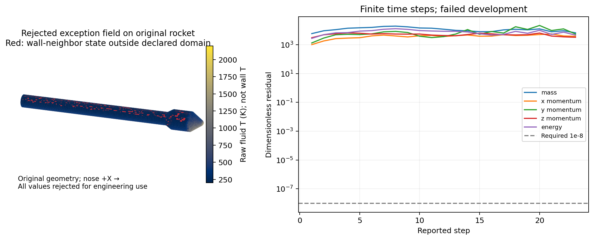

# v196 原生四面体时间尺度修正与真实发展结果

本轮修复了已实测的几何长度覆盖缺陷，真实箭体的巨大时间步异常已消失；修正后的首次真实发展仍因非法状态失败，**没有新增可用外流、热流覆盖或物理资格**。完整混合目标继续进行。

## 已实现的改动

固定官方提交 `f53f4609a0331d48efee69a4e4f3c3598378cc03` 的 `FluidFVCell.update_3D_geometric_data` 中，每个形状分支已通过属性写入共享长度。函数末尾又将临时变量 iL/jL/kL 写回同一数组；这些变量只在六面体分支赋值。四面体因此丢失有效长度，原生信号最终落到无湍流的 `1e−99`。

采用隔离的 [geometric-length-v1.patch](../patches/eilmer/geometric-length-v1.patch) 删除三行重复覆盖，保留公式、CFL、通量、边界、保存调度和原温域。新运行包 `rah-geometric-length-v1` 明确与旧包数值行为不同，原安装/旧包不改。旧对象为347源单一LLVM bitcode，未尝试不可靠的单模块替换；唯一实数目标重编监督83.970秒/入口85.117秒，在180秒预算内。编译仍产生既有LTO调试信息警告，不能把 `-g` 称作完整可用DWARF。

新真实入口 [geometricRocketEuler.py](../scripts/geometricRocketEuler.py) 绑定独立包、准入、原输入与预算，从启动即监测完整保存场和实时Step时间。共享原面读取器保留旧身份，并新增具名分派；异常结果仍拒绝。Windows/WSL来源键比较改为统一路径后核对SHA，不放宽内容一致性。

## 有区别的原生验证

| 观测 | 原四面体 | 独立单位六面体 |
|---|---:|---:|
| 旧包L_min / m | 0.005494449950738 | 1 |
| 旧包共享三长度 | 全NaN | 全1 |
| 旧包首次signal / s⁻¹ | 1e−99 | 1720.119897053874 |
| 修正后三长度 / m | 全0.005494449950738 | 全1 |
| 修正后首次signal / s⁻¹ | 175082.65241407012 | 1720.119897053874 |
| 修正后单步dt / s | 约1.71348e−6 | 约1.74406e−4 |

四面体逐字取自原网格第0单元，全部边界为相容环境均匀流，用于几何/时间尺度隔离，不冒充真实滑移壁控制。GDB读取原进程对象；因原包无局部符号，最终使用同编译器/版本的编译期 `offsetof` 和Linux x86_64 ABI读取，声速/速度/所选面法向同时记录。几何长度独立行列式/面中心距离重算及原信号公式吻合。修正后三项原生单步（四面体、六面体、旧包六面体）正常，均匀态变化通过2e−12门槛；六面体初/末场逐字相等。

旧Lua单元采样不支持非结构网格，没有冒用它。WSL新装GDB15.1及6依赖，下载约4.65MB、安装约12.4MB，位于E盘既有WSL环境；不调整内存/交换。安装工具墙钟6.223秒，另列于流动预算。

## 唯一真实候选：失败，已经关闭

按事前 [真实计划](validation/v196/ROCKET_PLAN.md)，复用64982四面体/26324ghost/原19752壁面，M5、30km、α20°、CEA9、滑移/环境边界、二阶AUSMDV、TVD RK3、局部时间/CFL .3。没有重新网格或原生prep。

- 实际首步dt从旧 `3e98 s` 恢复为约 `4.538e−8 s`；23条日志dt为 `4.538e−8—6.111e−8 s`。
- 峰组RSS **1,007,071,232字节，约0.94GiB**；54项输入稳定，实际5变量/4层/正常工作区91306/隐式备份0保持。
- 原生打印“Explicit update failed after 1 attempts”，最终标记step23。随后守卫发现完整异常场非法并SIGTERM：实际exit−15，监督22.975918秒、入口24.517548秒，全部进程清点；不是自然exit1、用户取消、OOM或预算耗尽。
- 保存0和23两帧；23帧属于异常路径，不称成功完成23更新。其dt为 `1.11447e−8 s`，与原生失败缩步有关，不能替换最后日志步长作成功步长。
- 异常帧温度 **−140.368002—2107.926505K**，1351单元超出200—6000K，其中负温/负压各1个，密度均正。最低温原单元9184，位置约 `[-2.84872944,−0.03770369,0.05366799]m`；这只是末异常场位置，不证明首次非法查询或唯一病因。
- 63631个接口域内单元单独EOS比较最大约1.1642e−10，**全场审核失败**。原1247壁面邻接超域单元，面积0.136574535m²；不是可恢复热面积或物理分离区。
- 末五项无量纲残差约3.29e3—6.67e3，原1e−8门槛未过；不足50行，预定50窗收益待验。400更新/200与400保存未完成。

所有异常值原样保留，未裁温/补零/扩温域。生产原面读取拒绝，真实工程默认不变。当前候选CLI启动前关闭，旧v195候选也保持关闭；12项准入/旧失败检查和4项真实新失败/关闭检查通过。

## 原始失败及预算说明

首次GDB变量名观测因缺DWARF失败；一次ABI查询遗漏`src`目录导致编译失败，修正后取得真实数据。一个PowerShell内联Python命令引号错误，没有执行查询或原生任务。四面体单步原生成功，首审核误锁三份输出而报输入变化；只读恢复并保持原失败，不重跑四面体。真实准备首次因Windows/WSL来源键不同而拒绝，准确源归档，规范路径恢复，无CFD重跑。

上述失败和准确执行源保留于小证据。完整几何/气体初态、全部历史门槛、原19层/尾缘及29项并发保护不改。观察/小例各在原120秒预算内，构建83.970/180秒，真实22.976/630秒监督，收尾审核4.578秒；工具父耗时、安装与开发协调分别记录，不把这些分项简单相加冒称完整开发墙钟。

当前瓶颈是**三维非结构Euler方案的稳健性与热物性/工程外缘相容性**，不再是这条Euler路线的内存容量或NaN长度。下一项按[具体决定](validation/v196/NEXT_DECISION.md)，一次核对成熟的完整稳健合同并选择实施入口；不再同CFL/通量/初猜扫描、不为补日志重跑，也不持续自研通用CFD内核。

科研UI和单工况全面积最高、累计后置。小源码/证据/目标公开同步，大场与运行库仅本地E盘，无工程包、无独有删除。本轮无MATLAB/主UI重验或computer-use。
