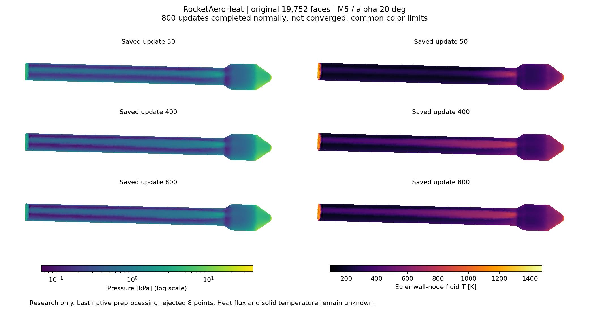

# v232：修复后的真实全局外流完成800更新

2026-11-12。原64,982四面体/18,027点/19,752壁面箭体在M5、30 km、α20°下正常完成800更新，原先第31次更新的异常未再次出现。**压力场已稳定，但稳态残差、净收支与独立动量/空间外域验收未通过；不是合格外缘或气动热解，新热流及合格面积均为0。** 总目标active，单工况全面积与科研UI最高。

## 1. 实际运行与守卫

复用v231已测试的物性拒绝回退对象和v229成熟归档，物性/数值组合/原均匀初态完全保持。唯一新O2薄驱动只增加前30历史比较与原生`GetNonphysical_Points()`记录，不重编变量对象。该计数由最后一次CommonPreprocessing写入，**不是所有子阶段累计次数，也不提供节点身份**。

前30条原生和物理历史在运行中逐行检查，进入31步前要求完整前缀一致；离线再次核对逐字节相同。初0/更新1完整场也与v230逐字节同。实际StartSolver及原成熟迭代运行800次，用时191.406秒、exit0，采样进程组RSS峰153735168 B，1CPU、输入稳定、组清空，没有资源触发。采样峰不保证其他工况或完整黏性域峰值。

18个完整自定义场保存为0、1、50、100……800；0的未计算RHS保持NaN且不作为零残差。16个新场均通过原ID/坐标/守恒态反算及相态联合域检查。物理能量RHS先逐节点减300000倍质量分量后求范数；当前U为更新后，残差/特征边界缓存来自该次更新所用阶段。

## 2. 数值结果与资格

| 检查 | 结果 |
|---|---|
| 末五式log10物理RMS | −4.783917、−1.605412、−2.448861、−2.083816、1.310441；未达原−8 |
| 原面压力750→800面积加权相对变化 | 9.04367e−6，即0.000904%；通过原1%稳定要求 |
| 质量/物理能量边界组装差 | 最大缩放7.34680e−16；只是残差与边界组装一致 |
| 末净质量/物理能量边界通量 | 以原固定自由流绝对输运缩放，9.08235e−7 / 8.01605e−7；未到1e−8 |
| 状态回退 | 第31步首次，末预处理点数最大9、最后8 |
| 空间/外域、同阶段动量、热资格 | 未验证/未通过 |

依据准确调用顺序，原观测中的壁压合力读取**更新后primitive压力**，而RHS及特征边界缓存属于更新所用阶段。因此本轮末差5.67174%是跨阶段比较，不是独立的同阶段动量守恒误差；v230对应10.2848%历史数字保持，但不能继续据其单独归因算法缺陷。仍需同阶段原生压力载荷/约束反力证据，不能用此解释直接授守恒。

末节点p范围38.0804—39237.33 Pa、T范围60.000448—1874.244 K、物理总焓0.8600—1.8093 MJ/kg；自由流H0为1.066865 MJ/kg。合法物性状态不等于正确稳态。最低温候选集中于X≈−2.7983 m的尾部，实际回退ID未记录，**不能把最低8点自动认作8个回退点，更不能据此宣布全域唯一失败原因**。详见[完整审核](validation/v232/evidence/audit01/report.json)及[低温候选](validation/v232/evidence/audit01/low_temperature_candidates.json)。

## 3. 前体工程入口的实际距离

复用v228既定3128面/0.317970330711786m²责任，不改面集。400→800原面压力变化3.97280e−6；相对自由流总焓的面积平均绝对偏差1.05568%、最大4.98923%。其1610个关联壁节点仅占全域各残差平方和约1.98e−7—7.07e−7。见[区域只读结果](validation/v232/evidence/regional01/report.json)。

这说明前体壁面记录比全域残差更稳定，值得直接推进区域入口/误差判断；但关联壁节点不是完整区域体积，不能据此声称全域失败都来自底面或前体已经物理合格。壁邻状态还没有完成外缘、沿流线总焓/熵、横向流管尺度及空间/外域误差验证。3128面仍是责任目标，不提前增加热覆盖。

## 4. 原面科研展示

工作台“打开结果JSON”可加载[更新50/400/800比较](validation/v232/evidence/workbench01/rocket_euler_research.json)。13字段包括三阶段压力/流体温度、末场总焓/熵/三维速度、明确未知的热流/固体壁温。全部19752面与原面积保持，11个有值字段的217,272个数通过CSV逐值回读；方法、状态、工况、更新号与限制随字段保存。更新号不是物理时间。

共享WebGL未改，无浏览器交互验收。下面的科学图已经查看；三阶段共用色标，压力用明确标注的对数尺度呈现柱段差异，温度为线性。首图色标与箭体重叠，原图保留，只重排图形/色标、关闭绘制缝隙，没有重算物性或覆盖JSON。

## 5. 失败与资源

首导出在1.328秒被输出容量守卫终止：旧audit类别会累加审核目录，而本轮全BASE容量包装已覆盖它，造成重复计数。实际约284.8MB，没有超过512MiB；原exit15/stopReason=output回执保留，不改成成功。改为UI独立计时/全BASE只计一次后5.734秒导出通过；此恢复没有再运行CFD。首次图的布局问题通过4.875秒纯重绘恢复，首图保持。

监督离线15.483秒、薄构建8.156秒、唯一CFD191.406秒、UI含首次失败共11.937秒。最高采样RSS693424128 B来自编译；所有输入稳定、进程组清空。定向只读源查看时间未全部纳入这些数字，最终归档另记；GCC/OpenMP警告保持。原网格/近壁资产/物性、29/engineering54及候选/旧构建保持；无MATLAB、新网格、独有删除或工程包。

## 6. 下一项

按[v232执行点](validation/v232/NEXT_DECISION.md)，一次完成前体连续外缘与尾部必要黏性反馈的区域闭合决定。复用全部保存场和现有责任/原生源，闭合真实回退点及被拒更新、同阶段动量和尾部适用性，评估前体总焓/流管/误差；不以压力稳定为由盲续800、不自动降低门槛或放宽物性表。区域方案成立后才另预算所需成熟黏性/外缘任务。已有科研数据继续可查，热流与固体Tw保持未知。
