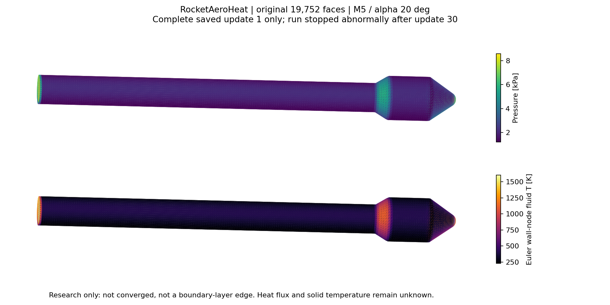

# v230：真实全局外流首次发展与原面研究展示

2026-11-12。本轮沿用“低成本内部全局外流 → 工程边界层 → 必要局部黏性 CFD”路线。真实箭体候选完成了30次更新后异常退出，尚未收敛；仅初始场0和第1次更新场完整保存。全部19,752原面已接入研究数据出口，**没有新增热流计算面积或物理合格面积**。总目标仍为active，单工况全面积气动热与科研UI并列最高。

## 1. 实际计算及退出

复用v229相态Euler build02归档、v194原64,982四面体/18,027点网格；19,752原壁面、6,572外界三角形和原面积1.9646292565715553 m²保持。M5、30 km、α20°、β0°，主轴X/鼻尖+X；标准相态Air、外部hs(298.15 K)=0、内部e/h偏置+300000 J/kg。旧黏性网格32层/2微米及历史19层尾缘不变。

采用既定general Roe、MUSCL、Venkat-Wang、隐式Euler、BCGSTAB10/LU-SGS、MG0和原CFL适配。薄驱动器调用实际CSinglezoneDriver::StartSolver及继承的CFluidIteration::Solve；只在原Iterate之后观察，不改通量、Jacobian、推进或松弛公式。六份准确驱动/迭代源绑定在[源索引](validation/v230/evidence/prepare02/sources.json)。实际执行源为[prepare02快照](validation/v230/evidence/prepare02/executed_helper.cpp)，不同于随后加异常记录的当前源码。

唯一候选预算800更新/600秒、1CPU、采样进程组RSS/虚拟地址空间4GiB及输出512MiB。实际10.344秒，exit3221225501（0xc000001d），采样峰161411072 B；没有触发资源守卫，输入稳定、进程组清空。30条迭代历史已落盘，但没有完整第30步或正常终态，不能以第1步替代末场。短暂运行的采样峰不能外推正常完整运行峰值。

本程序Windows故障偏移0xb1aa00与准确可执行文件反汇编对应`__gnu_cxx::__trap_terminate_handler()`的`ud2`。因此已确认std::terminate路径，**不是普通计算指令不受CPU支持的证据**。原始异常类型、消息及物理/软件根因仍未知，不能预先归因于物性超域。只公开[本程序故障签名](validation/v230/evidence/crash01/report.json)与反汇编，不公开整份机器WER报告；原临时转储已不存在。

## 2. 独立核对及仍失败的科学门槛

保存场含全局ID、坐标、控制体积、五守恒量及原生隐式RHS。初0的RHS尚未计算，保留NaN且只存本地；不能补零。更新后守恒态与该次更新所用的残差/边界状态属于不同阶段。物理残差按逐节点`-RHS`，再对能量减去300000倍质量分量，最后求RMS；受约束的动量不能称为未替换的物理散度。

| 核对项 | 实际结果与限制 |
|---|---|
| 初始相容状态 | 最大缩放差7.4773e−16；保存0/1的联合物性域通过 |
| 第1步物理RMS | 原生记录与独立重算差1.7153e−15 |
| 前四分量原历史 | 30行log值最大差4.9620e−10；全部zeroDt=0、截断项=0 |
| 原近零能量和绝对误差 | 首审核4.1980e−9超过2e−9，原失败保留 |
| 显式累加舍入界 | fsum与原生能量和差2.6602e−9，保守界1.8744e−4；只说明求和一致性，不改原失败或授守恒资格 |
| 质量/物理能量边界组装 | 以固定自由流对整个外界的绝对输运为尺度，最大差5.7234e−16；尺度分别2990.0266 kg/s、3.18995e9 W，不用近零净通量作分母 |
| 动量反力与压力合力 | 末条相对差10.2848%，完整动量账未接受 |
| 末五式log10 RMS | −2.2645、0.8988、−0.0541、0.5373、3.7730，均未达原−8要求 |
| 稳定/空间/外域及热资格 | 均未通过；边界组装一致不等于稳态守恒 |

完整数值见[只读审核](validation/v230/evidence/audit02/report.json)。面面积重新求和为1.9646292565715642 m²，与原分母仅浮点求和差；原三角形不变。没有新增全残差独立实现或实验验证。

## 3. 科研工作台数据

现有工作台“打开结果JSON”可加载[原面研究结果](validation/v230/evidence/workbench01/rocket_euler_research.json)。提供11字段：初0/更新1压力与壁节点流体温度，更新1总焓、熵、三维速度，以及明确未知的热流和求解固体壁温。初态为给定状态；更新1为未收敛研究值。Euler壁节点流体温度不是边界层外缘温度、恢复温度或固体温度。

压力、温度比较使用共同色标，方法/工况/更新编号/适用限制随字段保存。9个有值字段的177,768个数与原面CSV逐值相同；未知热量为null/status0，未补零。所有19,752面保留，但数据覆盖不等于求解合格面积。更新编号不是物理时间。共享WebGL没有修改，也没有浏览器交互验收。

图已经实际查看。第1步全节点p范围1182.96—8581.60 Pa、T范围223.91—1602.54 K；图显示三节点平均后的原面值，不应把节点极值与面值色标混用。

## 4. 异常记录器及资源证据

新增`rocketEulerFailure.hpp`仅在std::terminate时尝试保存阶段、最近观测更新、原异常what和未经EOS查询的原始五守恒量；快照标为可能部分更新/未接受，随后退出86，不恢复、不裁态、不继续。观察标签与错误记录不改变成功路径公式，但**本轮仅编译，未执行或证明故障记录路径可用**。普通main异常与无法提取异常信息仍须按实际输出区分。

唯一记录器build02用6.015秒正常编译，采样峰680837120 B；与原build01执行源和二进制分别绑定。两次薄编译累计12.203秒；监督离线累计17.265秒，唯一CFD10.344秒。所有输入稳定、进程组清空。另有未纳入监督计时的定向只读故障/源码查看，不能将上述累计声称为全部人工工作耗时。最终归档耗时另记。GCC/OpenMP编译警告保持，不重建引擎。

首准备缺新增头文件依赖而失败，随后以准确旧源SHA恢复；首近零和审核失败另存。原运行失败没有被恢复成成功回执。所有CLI物理运行入口已关闭。本轮无第二次流场计算、无MATLAB、无新网格、无独有数据删除。

## 5. 下一步

按[唯一下一执行点](validation/v230/NEXT_DECISION.md)，先另登记一次不超过31个完成更新的同输入故障捕获，验证前30步轨迹一致并取得实际异常/阶段/原始状态。不得盲续或自动开始新的800步候选；不改变CFL/通量/初猜/物性域。原因明确后才形成具名修复及新预算。真实可信外流和相邻流线尺度齐备后，接3128前体原面的工程边界层；收缩/后体/底面仍保留成熟黏性反馈责任。
