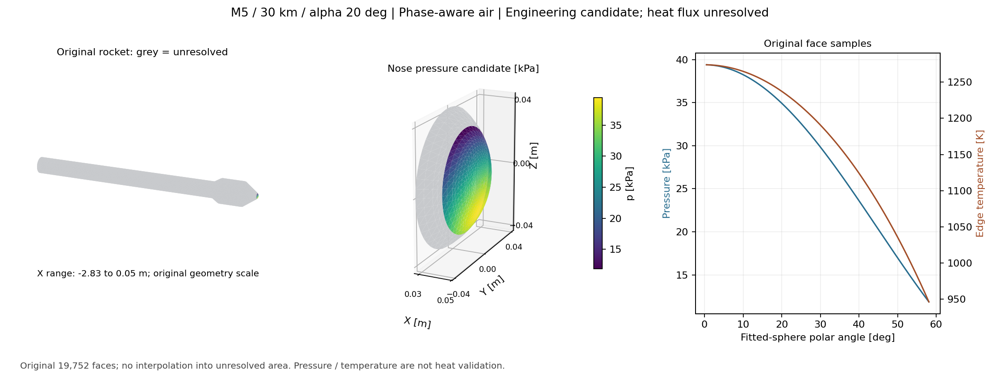

# v226：真实原面相态球鼻外缘和工作台出口

2026-11-12。原19752面/M5/30km/α20°/β0°/给定Tw300K下，**1306个鼻部面元已生成同相态空气工程外缘候选**，面积0.003518440977521075m²，占总面积0.1790893%。压力、Te、U、Mach、层流恢复温度估计及球面驻点弧长接入主工作台。**新增热流面积与物理合格面积仍为0**；后体、分离/再附、底面与完整热入口仍未解，不能因面数多就说全面积已接近完成。

## 可运行入口与结果

对已经完成几何前处理的mesh和cfg，显式选择区域模式：

```matlab
cfg.analysisMode = 'phaseAwareNoseEdge';
[current, freestream, report] = runAeroHeatSingleCase(mesh, cfg);
data = buildAerothermalViewerData(current);
```

这是局部外缘入口，`report.status='completed-region-edge-only'`，不是默认完整热链。新相态层流`phaseAwareLaminarIntegral`的一键ProviderNotConnected守卫仍保留。使用上例时不同时选择该未接通的层流模式。返回副本清除旧NASA7压力/热流/流线等物理结果，不修改输入mesh或原面。freestream速度重新按新空气声速与Mach求取（1509.141366m/s），不复用旧1508.543300m/s。

工作台“打开结果JSON”可读[真实鼻部结果](validation/v226/evidence/matlab02/rocket_workbench.json)。九字段包括：壁压近似、外缘温度/速度/Mach、层流恢复温度估计、拟合球面驻点弧长、未知热流、给定壁温及未知固体壁温。主结果出口实际调用通过；同一原面ID、状态、单位、方法、适用范围和拒绝原因均保留，旧压力不混入。没有修改共享WebGL或做本轮浏览器交互验收。



图只从保存原面结果绘制，灰色是真正未解区域，鼻部局部放大不替换完整几何。首次坐标刻度拥挤已单独重绘并查看，没有数值重算。

## 方法和物理边界

`solvePhaseAwareNoseEdge`复用`estimateNoseRadius`及旧`solveSphericalNoseEdge`的几何判据和NASA SP-8062 §4.2.1、印刷p30/PDF p36依据。当前拟合R=0.0497614320363713m，三个拟合残差/半径一致性及完整顶点范围没有放宽。合成攻角≤30°、默认迎流极角≤60°、原顶点球面误差≤3%、法向误差≤20°及无特征/拓扑问题仍是项目筛选条件，不是文献给出的实验精度保证。

内部计算全部用v225相态正激波与同Cp/线性mu-k，hs(298.15K)=0：

```text
h0 = h_inf + U_inf²/2
s02 = s_after_normal_shock
p_face = p_inf + (p02-p_inf) cos²(theta)
s(Te,p_face) = s02
U²/2 = h0-h(Te)
h_aw = h(Te)+sqrt(Pr_e) U²/2
```

不回退定gamma或NASA7、不外推/裁温，最终状态与恢复状态均经过60—2000K/气相/低密度联合域审核。Kn=max(lambda_inf,lambda_e)/R<0.01是特征尺度筛选，不是梯度Kn或完整连续流证明。某区域公共总态或局部批量域失败时保守拒绝，不换模型填值。

计算p02=39402.3130717Pa、T02=1274.08470224K。解析拟合驻点位于(0.0469990097, −0.0000190450, −0.0170263505)m，区别于轴向几何尖端。球面帽两端和驻点均在X/R正帽内，短大圆弧留在拟合帽内；弧长Rθ、横向度量Rsinθ和解析切向方向单独保存。这是拟合球面/驻点熵工程近似，尚未证完整真实三维流管、亚声速外域反馈或后体熵层。

实际原三角面的速度方向仍为来流切向投影，和解析球面切向量分开。驻点严格U=0；按压力二阶曲率得到有限速度梯度：

```text
p''(0) = -2(p02-p_inf)/R²
a = sqrt(2(p02-p_inf)/(rho02 R²)) = 16923.8924837 s^-1
```

这些量为下一步热入口提供依据，但不等于已求得边界层剖面。现有零攻角Levy–Lees模块没有被放宽到α20°；也没有将驻点当某个下游面中心、把参考Thwaites厚度当压缩性质量厚度。

## 验证和失败保留

- 首MATLAB27.109秒exit1/峰758136832B：局部布尔变量`lower`遮蔽同名函数，在大攻角拒绝支线的来源哈希处失败。早期结果中的代码哈希类型也不正确，不能当正式来源证据。改名`below`，原执行源/输出/失败保留。
- 恢复MATLAB20.922秒exit0/峰699064320B：主工况/主工作台、真实1306面与1706面半球柱控制通过；控制169面候选、精确驻点零/有限梯度、3项字段或原面篡改拒绝，以及特征/攻角/稀薄/高温/范围收紧/旧几何6项拒绝通过。完整任务及旧层流一键守卫检查通过，未重做v225整组波系或v224平板。
- Python首审核2.437秒在CSV→字节指纹重建失败；CSV文字NaN不能保留MATLAB原生`fff8000000000000`位形。按该位形显式恢复后，原SHA严格相同，没有放宽数值误差或跳过指纹。恢复审核4.734秒exit0/峰254062592B。
- 原面独立Brent熵反解、焓恢复及线性输运复算最大缩放差6.304e−11；三维速度最大绝对差9.078e−10m/s。原面面积、几何、短弧条件、全部显示数值和代码/条件/输出SHA绑定通过。当前源指纹`be5753d35a4e4253925a466b9355261388d01bda06414be02f21d59f440667c4`。
- 前端纯函数核对19752面/九字段/未知热流/给定Tw、单位、默认压力和原因通过；共享前端SHA保持。图重绘2.563秒，无数值重算。locale/perl警告保留。

MATLAB累计48.031秒、独立审核/绘图累计9.734秒；均在登记预算内。进程组输入稳定/退出清空，4GiB为采样守卫不是硬地址空间保证。无CFD、原生查询、引擎构建、网格重生或热实验验证。本轮1306面外缘是**方法复算通过的工程候选**，不是物理认证或完整三维激波解。

## 下一步

直接把这个真实鼻部外缘接到相态边界层/热流，优先复用`solveAxisymmetricLaminarMassProfile`与`solveSphericalNoseLaminarHeating`的有来源剖面和有限驻点入口结构。先确定Cp/输运/能量零点接口及在偏置球面帽上的近似适用性，保存质量/动量/能量厚度与真实剖面，不能仅把零攻角守卫删掉或把已有参考厚度乘常数。原面q和功率及各温度身份应同轮回工作台。

同时保留完整后体任务：球鼻驻点熵不能沿整后体保持，声速线/熵层/流管及收缩/底面仍需相容区域接口与必要成熟黏性反馈。全面积/科研UI仍最高，累计后置；小源码证据GitHub、大资产E盘，无工程包/独有删除。
