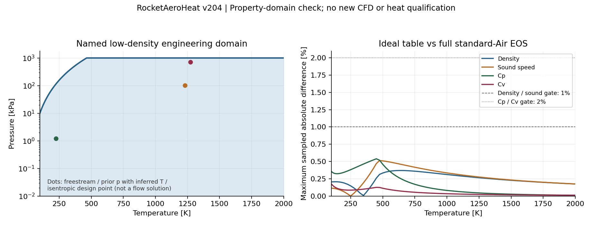

# v204：压力—温度合同与标准干空气原生映射

本轮完成了可执行的标准干空气候选及原生联合域反算，没有运行新的箭体CFD，也没有新增热流面积或物理资格。旧NIST模型、工程默认、v202温度失败和v203压力失败保持。当前主线仍是全局外流→工程边界层→必要局部黏性，全面积与科研UI并列最高。

## 为什么需要明确模型身份

100000 Pa是原NIST标准熵的参考压力，不是由气体误差推导出的统一准确性上限。本轮没有直接修改旧Pmax。用现有CoolProp7.2.0（commit `98b3523d5daa98454618d381d2ae53f7471d216b`）检查了旧精确组分及标准Air两种参照，各318状态。

旧精确组分的量值偏差全部通过预定门槛，但无强制相态PT求解只有91点成功，227点报错后仅能作强制gas诊断。这不是实际发生冷凝的证据；强制gas的小误差也不能补作相态证明。实际二元参数来自Gernert2013，交换CAS顺序时beta取倒数，F均为0；不能直接继承Lemmon2000另一套可变组分模型的误差保证。

因此选取一个显式的新候选：复用项目既有Lemmon标准干空气理想项及其固定组分，并直接对照同组分的标准Air真实EOS。没有换CFD引擎，没有重开SU2或更改工程默认。

| 项目 | 新候选定义 |
|---|---|
| 模型 | `rah-standard-dry-air-cp-table-of13-v1` |
| 联合域 | `rah-standard-dry-air-low-density-v1` |
| N₂/O₂/Ar摩尔分数 | 0.7812 / 0.2096 / 0.0092，Lemmon2000表3 |
| 气体常数 | 287.0491267875601 J/(kg K)，沿用发表模型的R/M |
| 数值/使用温区 | 100—2000 K；旧NIST100—2500 K表不改 |
| 压力范围 | 0＜p≤min(1000000,10000(T/100)³) Pa |
| 焓/内能参考 | hs(298.15 K)=0、hf=0、es=hs−RT |
| 熵参考 | s(298.15 K,100000 Pa)=0，相对熵，不能混作绝对热化学熵 |
| 原生表示 | perfectGas＋hIcoTabulated，3802个Cp节点及其原生积分 |

压力包络是事前登记、随后检验的工程范围，不是论文的普适公式或以失败点反标的阈值。100K最多10kPa、200K最多80kPa、300K最多270kPa，约464.16K以上最多1MPa。有限网格比较不是整个连续域误差上界的数学证明，连续流/固定组分化学/输运适用性仍须随真实工况核验。2000—2500K没有转授新候选资格。

新组分与旧NIST质量分数.755/.232/.013不同。原来流条件下密度变化+0.008713%、声速变化−0.008977%，这不是同模型的纯性能优化。旧OTH参考焓在298.15K为424668.7884273171 J/kg，新模型统一减去该偏置。M5、原p/T和20°保持时应重新生成速度，设计值为[-1418.1290057626304,0,516.1567464471211]m/s；新等熵设计T0=1274.08470223713K、p0=702078.7681721675Pa，均不是已求出的箭体驻点值。

## 实际验证

427个节点/非节点样本核对表积分与既有成熟理想项：Cp最大相对差2.4434e−8，H/E按CpT缩放最大9.8914e−9，声速4.8478e−9。没有重建旧理想空气库。

直接重用318条标准Air真实EOS结果，不再运行第二轮相态网格：

| 量 | 最大样本差 | 事前门槛 |
|---|---:|---:|
| 密度 | 0.369852% | 1% |
| 声速 | 0.513738% | 1% |
| Cp | 0.539099% | 2% |
| Cv | 0.175283% | 2% |
| 焓 / CpT | 0.203668% | 1% |
| 内能 / CpT | 0.226847% | 1% |

这是模型对照偏差，不是实验误差或包含参照不确定度的总误差。论文标准Air温区至2000K，但高温部分依赖氮气数据预测，不能将0.1%密度、0.2%声速或1%比热等范围内估计无条件外推到每个高温点。

Python最终源23项拒绝、318条已存参照回放、H/E/S导数（最大3.323e−10）及29项保护通过。非法批次整体拒绝；最小正浮点压力导致密度下溢时拒绝，不能补零。元数据拒绝使用显式异常，不依赖assert是否启用。

## 原生适配与保留的失败

新类型`rahStandardDryAirInternalEnergy`沿用Boost1.83 TOMS748。固定p下先验证100—2000K表内能量，再求联合域温度下界并拒绝更低能量；所有返回路径检查p/T和密度。最多8个浮点邻值定位最小可表示下界，输入p/es不变、不裁物理状态；64次能量求值上限包含端点与末态检查。

注册库及标量helper构建合计8.757271秒。17个正向状态与Python最大T差3.8062e−10K、es缩放残差4.8749e−13；压力上界逐位相同，物性缩放差最大7.7023e−12。查询监督合计10.706717秒。没有编译流动内核，没有foamRun实际分派或新CFD。

原生首审核仍是failed/originalPlanAcceptance=false：极小压力样本在`HtoEthermo::es=hs−p/rho`阶段因rho下溢先产生−inf，在The输入检查被拒绝。首审核错误要求必须达到末态密度拒绝分支。准确原生源/日志核对后独立审核通过，但没有冒称末态密度分支已被该样本覆盖。

原第10项“一ulp压力超界、原T100K”的能量必拒假设在执行前撤销：PT到es会量化，The不持有原T，不能要求两个映射到同一es的温度仍可区分。Python直接PT严格一ulp拒绝已测。另登记且只执行p10000.01Pa/T100K这一项可分辨的冷压拒绝；共观察10项原生拒绝，原计划失败不追改。未重建或重跑已完成17点/9拒绝。

源文件缺项、CAS逆序、Python3.7/3.12依赖差别、测试相对路径、恢复脚本漏写EquationOfState限定符等准备/审核错误均保留记录，均不代表CFD失败或引擎缺陷。初次扫描版论文抽字为空，采用NIST可检索原文与本地页面核读；不上传论文页面或全文。原生检查与离线检查的范围分别登记。

## 后续工作

下一项按[NEXT_DECISION](validation/v204/NEXT_DECISION.md)给原19752面新候选登记唯一有限预算。原64982tet、外域、壁边界、Euler/upwind/Kurganov保持；真实任务中核对实际分派、初Co、保存场/边界联合域、原面读取和真实残差。新模型、能量/熵零点及速度必须贯通，不静默使用旧NIST读取器或NASA7边界层物性。已有区域工程能力仍可独立推进，Euler研究不作为科研UI修复的前置。

没有新热面积、已验证外缘或固体壁温。总目标active，原19,752面/1.9646292565715553m²、旧19层网格/尾缘/原门槛和历史失败保持。小源码/证据公开GitHub，原生库等大资产留E盘，无工程包/独有结果删除。

## 一手来源与固定实现

- [Lemmon et al.2000原文](https://trc.nist.gov/refprop/Documents/Air.pdf)：表3/p337固定组分，标准空气与可变组分的不同范围，§7/p359—360不确定度限制。
- [NIST原文记录](https://www.nist.gov/publications/thermodynamic-properties-air-and-mixtures-nitrogen-argon-and-oxygen-60-2000-k-pressures)：标准Air至2000K、可变组分模型至1000K的区分。
- [Gernert2013学位论文](https://trc.nist.gov/refprop/Documents/Humid_Gases_and_CCS_Mixtures_Gernert.pdf)：表2.9用于核对实际混合二元参数；不据此自动授予高温精度。
- [CoolProp固定Air数据](https://github.com/CoolProp/CoolProp/blob/98b3523d5daa98454618d381d2ae53f7471d216b/dev/fluids/Air.json)及[固定混合参数](https://github.com/CoolProp/CoolProp/blob/98b3523d5daa98454618d381d2ae53f7471d216b/dev/mixtures/mixture_binary_pairs.json)。当前官网8.0相态算法不能冒充实际7.2二进制；实际版本/源码/许可/SHA保存在证据中。
