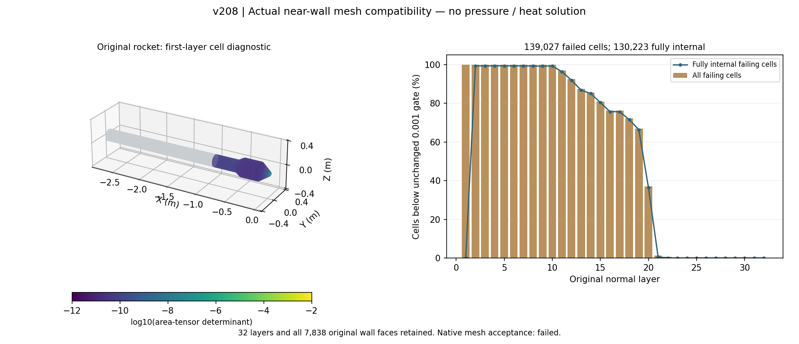

# v208：真实区域近壁层已转换，固定OpenFOAM质量合同未通过

2026-11-08。v207之后直接核对区域出口并导入真实近壁层。得到**7838原面对应的32层、250816棱柱、130119点、635614面**，原连接/坐标/面积保持。唯一原生checkMesh未通过；没有区域CFD或新增热资格。当前具体限制是**这套既有各向异性层与当前OpenFOAM质量验收组合不相容**，不是再次遇到整域内存不足，也不代表所有成熟求解器均不能使用这些层。

## 1. 出口核对与真实切口

固定OpenFOAM13源码提取36项/176272字节，0.583783秒；复用v207的shockFluid能量和压力源。stock waveTransmissive使用常gamma；advective会将负传播速度置零。采用的下一方案必须在此之前明确拒绝不允许的反流，不能把这种截断误称完整物理特征处理。

准确basicThermo提供按局部T/patch求Cp/Cv的接口，可构成`a=sqrt((Cp/Cv)/psi)`，但**尚未实现新出口**。shockFluid先解e并修正热物性，再由rho/psi修正p并更新边界rho；这一顺序以及温度到能量的边界映射仍须联合核对。不能只改声速就授予无反射或回流资格。旧heThermo目录命名的定位假设未成立，本轮未声称取得该实现。近壁组合先出现实证拒绝，因此没有再编译尚不能使用的出口库。

原v144真实层可全部复用：每原面32层、第一层2e−6m，外层高度0.00317623—0.02129394m；原壁切向边0.0005911—0.0269662m，最大切向/法向边比13483.11。完整原壁和历史最低19层/尾缘不改。

原壁切口在x−.894458635m，但其法向列的轴向偏移最大2.34638597e−6m。首严格平面假设失败保留，随后只读记录真实偏移。未来完整域出口必须沿实际层列连接到外环，不能压平原节点。v207只有原壁环和外域面，不足以证明这一近壁出口已适用。

## 2. 完整局部层转换和唯一原生诊断

从原v144资产选择250816个现存棱柱，未重建或剖分单元。准确配对618466内部面；边界为7838原壁三角、7838外层三角、1472切口四边面。外层顶面仅用于诊断，**不是实际远场**。向量闭合最大1.7347e−18m²，体积0.0161559898536m³，最小单元体积4.21201785077e−13m³。

导出监督4.812秒、子程序4.390秒、峰399298560字节，5输入保持。唯一checkMesh监督4.047258秒/入口4.373212秒、峰304680960字节、输入保持/进程组清空。原生exit0，但日志明确`Failed 3 mesh checks`，科学验收为false。

| 原生检查 | 实际结果 | 状态 |
|---|---|---|
| 内部面排序 | 未按owner/neighbour上三角顺序 | 转换程序缺陷，后续离线修正 |
| 高纵横比 | 最大3640.2，11075单元超原门槛 | 保持失败 |
| 面积张量行列式 | 最小约2.10716e−12，139027单元小于.001 | 保持失败 |
| 单元体积/面金字塔/面tets | 全正，通过原生检查 | 不代替其它门槛 |
| 非正交/偏斜 | 最大68.8903°/.625326 | 通过 |
| 面平整度/插值权/体积比 | 最小.993754/.169405/.203986 | 通过 |
| 连通分量 | 1 | 通过 |

这些数值只描述该原层子域，不说明p/q、实际y+、网格收敛或物理分离。检查时没有气体字段和时间推进。

## 3. 排序修正与独立复核

`layer_mesh02`只对内部面编号置换；原边界面位置、节点/单元、7838原面ID均保持。实际points/faces/owner/neighbour文本与准确数组逐项一致。未第二次原生checkMesh，不能称修正版本已经原生通过。旧`layer_mesh01`和全部失败保留。

按固定准确源码复算原生内部面面积张量：min2.1071611583366137e−12，与六位原生日志相对差5.49715e−7；139027坏单元计数一致。其中**130223为五个面均内部的单元**，接上外域不能改变它们的这一局部指标。原32层逐面保留，独立Heron原壁面积0.7198603834559664m²；整箭19752面/1.9646292565715553m²分母不变。

首审核对极小det排序舍入要求相对2e−9失败，实测最大3.2880189e−9、绝对5.3290705e−15，坏集合不变；失败及源保留。恢复以几何输入的**逐位逆置换恒等**证明排序不改变物理网格，另报舍入，不放宽det=.001的质量门槛。正确性检查与原生质量拒绝分别记录。

图已查看；首版色标重叠只修排版，保留两版。灰色为其余原箭体，彩色是原壁邻接单元的几何质量量；没有伪造压力或热流云图。本轮未改MATLAB、主UI或并发Web代码。

## 4. 资源与采用决定

当前子层已有N250816、G17148、F635614、V130119，单元—顶点1504896、单元—面1254080、面—顶点2283802。将这些实际计数代入v188**同一历史Wilcox布局**下界公式，示意必要分配为3207664540字节。这不是新模型/全区域峰值，不含外域，不能因此开放Eilmer或承诺8GiB足够；与按壁面积比例缩算不同。没有增加WSL内存或安装软件。

**关闭“原层不变＋当前OpenFOAM全部原门槛”的区域准入。** 不以减层、抬首层、调minDet或隐藏检查来通过，不再导出/检查相同子层。已验证的v207物性/热壁接口仍保留，未证明其物理算法失效。本轮不继续无意义的出口构建或外域剖分。

下一项按[具体验收与成熟入口决定](validation/v208/NEXT_DECISION.md)选择适合真实拉伸近壁网格的成熟组合，优先检查已有Eilmer区域黏性能力及其准确梯度、变cp/输运、边界与资源；具体能力不闭合就明确关闭该候选，不能连续品牌轮换。需可验证的各向异性几何/梯度/热流/网格误差证据，不能用另一引擎不报同名警告冒充合格。

原面/全面积/19层/尾缘/−8/热流/y+与全部失败保持，可信外缘和工程边界层、科研UI仍为主线。所有原区域仍须求解，累计后置。29保护文件保持，小证据公开，大网格本地，无包/独有删除；总目标active。
