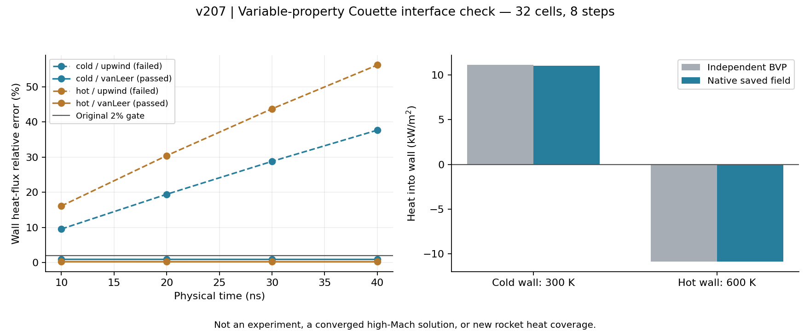
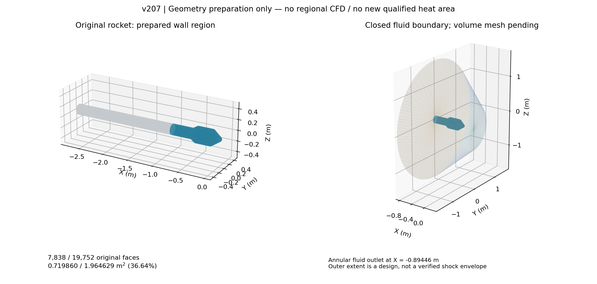

# v207：区域黏性导热接口通过，真实鼻部—收缩边界已准备

2026-11-08。沿用低成本外流＋工程边界层＋必要局部黏性CFD路线，未重开v206原全壁Euler失败。本轮完成温变输运原生适配、实际热壁读取和原7838面区域边界。**尚无真实区域CFD、认证外缘或新增可信热面积；总目标仍进行中。**

## 1. 成熟求解与物性接口

定向提取固定OpenFOAM13的50项源/官方算例文件，184279字节、1.499秒。实际`shockFluid`包含黏性动量、导热和黏性功；采用已有`icoTabulatedTransport`与Fourier，保留v206相态有界标准干空气、60—2000K和参考焓，未修改任何流动推进内核。3882节点输运表的中点误差mu为7.9974e−7、k为5.75634e−7相对量。

只构建一个独立注册库，监督6.700706秒/入口7.108173秒，峰344363008字节，67输入稳定、进程组清空。实际库SHA与许可见[适配说明](../native/openfoamPhaseAwareViscousAir/README.md)。旧模型、旧库和工程默认保持。

原生`Fourier::q=-kappa*snGrad(T)`；`wallHeatFlux`再取反，故项目的**入壁为正q = −原生wallHeatFlux**。以实际保存温度梯度独立重构验证，不能仅凭字段名称决定符号。

官方`waveTransmissive`的gamma来自常数字典；`freestream`是进出流符号切换，`supersonicFreestream`同样采用常gamma并带适用性警告。它们不能自动作为完整变比热特征边界。原生SA不是SA-Edwards。官方Run35是氮气、层流、Sutherland且初态已较收敛，未被冒充为本项目新实验验证。

## 2. 实际热控制：保留失败，只进行一次有依据的空间对照

独立SciPy边值参照解稳态平行壁Couette：gap1mm、p100kPa，冷壁300K静止，热壁600K/100m/s；温变mu/kappa，`dU/dy=tau/mu`，`dT/dy=(C−tau U)/k`。参照冷/热壁入壁热流为11101.29551788/−10850.98867747 W/m²，两者之和对应黏性功250.30684041 W/m²。这是独立数值参照，不是实验或真实三维高Mach验证。

首周期尺寸.02×.001×.02m的32单元网格det最小3.41167e−8，32单元均未达原门槛，未做CFD。确定性修正只将两个周期长度改为gap/32，使单元为立方，保留壁间距/初场/物性；新单壁面积9.765625e−10m²，一维单位面积参照不变。第二次blockMesh/checkMesh通过，原失败保留。

| 同一32单元/8步/4保存控制 | upwind，thermal_run01 | vanLeer/vanLeerV，thermal_run02 |
|---|---:|---:|
| 监督时间 / 入口时间，s | 1.640796 / 2.154272 | 1.822994 / 2.511120 |
| 实测峰RSS，字节 | 138661888 | 138620928 |
| 冷壁热流相对误差 | 37.6550% | 0.8977565% |
| 热壁热流相对误差 | 56.1768% | 0.2341057% |
| 温度最大相对误差 | 0.828629% | 0.00133327% |
| 速度最大误差/100m/s | 0.817675% | 0.0310076% |
| 原2%q/.5%T/U门槛 | 失败 | 通过 |

第二项采用固定版本官方wedge15Ma5/Run35使用的Euler/Gauss linear/vanLeer(rho,T)/vanLeerV(rhoU)/Kurganov空间组合；只更改三项重构项，dt5e−9、物性、网格、初场、步数及验收门槛不变。准确源码和独立梯度预测的初密度面跳跃比.0057218917，小于事前.01。首控制有非零法向数值质量耗散，不能把它声称所有误差的唯一根因。

两项实际任务原生exit0，各4完整帧，初态index0/check1与终态index8/check9守卫已核对；83/90输入稳定、进程组清空。保存帧EOS/内能和实际非零温变输运通过。守卫逐步核对最终状态，保存审核才独立核对e(T)；它不是每次反算前的完整能量审计。8步不证明数值收敛、真实残差−8、全瞬态能量收支或物理资格。已报告的壁功差只是相对稳态参照的差，不能当作完整瞬态守恒残差。

## 3. 真实原面区域与科学显示

复用v194原表面和v189原面集合，准确保留7838个三角壁面、0.7198603834559664m²（整箭36.6410294%），切口x=−.894458635012947m、46原环节点。全19752面/1.9646292565715553m²分母保持，剩余11914面/1.2447688731155888m²仍须求解。

流体边界为反向原壁＋鼻尖前圆盘＋40°扩张侧边＋**环形流体出口**，没有人为实体端盖。8396三角/4200点、封闭单连通两流形、相反共享边、正体积5.311826833755841m³均通过；独立Heron面积与原账差0，原面连接和坐标逐项相同。

M5/α20°均匀初来流的外边界法向Mach为−4.69846至−1.70980，出口+4.69846。这只验证初始几何方向，**不是实际激波包络、出口近壁特征、回流或域独立性验证**。x−1.194277633m扩域/9678面和外域半径×1.5只登记为未执行对照。

图已人工查看。首图底部文字重叠，figures02只修排版；figures01及其执行源仍保留。图不含未计算的压力或热流，未改主UI或MATLAB文件。

## 4. 输出身份、拒绝和失败记录

`readOpenFoamWallHeat.py`按实际原生面号与owner读取p、给定Tw和q，绑定时间/单位/类/对象/气体字典/层流输运；仅支持已测fixedValue壁温。固体Tw和Te保持未知，尚未连接真实箭体的生产结果映射。最终只读4帧值与旧通过审核逐项相同；35项损坏输入拒绝、零/负热流保留、29保护文件通过，共1.734秒。真实字段和几何输入未改。

失败按原顺序留存：Windows反斜杠入口在构建前失败；首高纵横比网格拒绝；首8步热门槛失败；首次限定器源码路径猜错；第二控制后的首次审核缺`thermo_contract.json`。最后一项由已绑定原合同和相同physicalProperties SHA在**运行后**补元数据，只读恢复，不把它说成运行前已存元数据，也没有重跑CFD。首图排版失败另列。原失败均未改写为通过。

本轮合计：1项适配库构建、2项小网格生成、2项8步CFD、0项真实区域体网格或CFD。两个小CFD入口均关闭，无第三项控制。大型库和区域NPZ留E盘；公开证据仅小源码、计划、报告、实际32单元控制小场和图片，不打工程包、不删除独有结果。

下一次直接执行[区域出口与近壁网格决定](validation/v207/NEXT_DECISION.md)，不重做物性、Couette控制、原面准备或已过UI。可信外缘/同模型工程边界层与科研UI仍并行主线，累计后置。

## 准确来源

- [OpenFOAM13 shockFluid](https://cpp.openfoam.org/v13/classFoam_1_1solvers_1_1shockFluid.html)。准确固定提交为18870c24d21c6b982e2cdec27b2f59738cca5f90；本地提取SHA清单在evidence/source01/report.json。
- [固定提交源码](https://github.com/OpenFOAM/OpenFOAM-13/tree/18870c24d21c6b982e2cdec27b2f59738cca5f90)。不混用OpenCFD分支的版本或边界行为。
- Lemmon标准Air量热、相态和输运来源沿用[v206](HYBRID_PHASE_AWARE_AIR_V206.md)，本轮未重复外部EOS网格。
