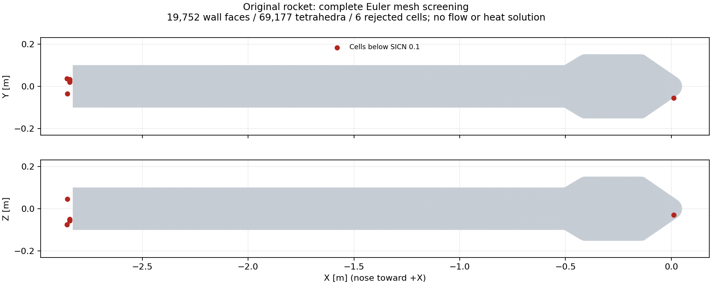

# v193：真实箭体完整Euler网格与原面采样接口

本轮从小控制转入真实箭体。**完整低成本网格已生成，但质量筛选未通过；固定边界refine又因改变原壁连接被拒绝。** 原始失败保留，没有新CFD或新增热流计算面积。目标及下一项见[执行决定](validation/v193/NEXT_DECISION.md)。

## 原壁全域实际生成

只读v144准确源，提取原物理壁而非棱柱外包络，与v104工程快照逐点逐面相等。复用TetGen1.5.1固定PLC、原参数和显式固体孔种子，原壁/远场全保持。

| 项目 | 本轮实际值 |
|---|---:|
| 原壁顶点/三角面 | 9878 / 19752 |
| 原壁面积 | 1.9646292565715553 m² |
| 新网格顶点/四面体 | 18004 / 69177 |
| 全体单元面/外边界ghost | 151516 / 26324 |
| 远场三角面 | 6572 |
| 流体体积 | 381.4346146072696 m³ |
| 最小SICN / 低于0.1个数 | 0.04849555 / 6 |

所有体单元正体积，内部面反向配对，单连通流体，固体孔未填充，边界与体积闭合通过。独立行列式体积、Heron面积、矩阵余子式质量核对通过；这不改变质量候选失败。5个低质单元在底面附近、1个在鼻部附近，每个至少一个自由内部顶点；四个受壁面约束单元的单面可达上界约0.186—0.194，只说明未被该单面排除，不证明全域可修复。

初次图为三维投影，小尺度坐标标签拥挤；保留原图，交付图改为两个等比例正投影，不改变点位。图只显示几何筛选位置，不能当压力/热流云图。

## 一次成熟refine及明确拒绝

在独立定位之后登记[修复预算](validation/v193/REPAIR_PLAN.md)。复用既有TetGen固定四面体入口，原生正常退出0，但映射发现8个原壁面连接变化：1769、1770、3167、3168、6041、6042、19600、19629。边界坐标最大差0、外边界连接保持，仍不满足原壁逐面合同。未经接受的结果为18044点/69458单元，最小SICN0.05790458、低质10个，**不是可采纳的质量改善**。

准确源`reconstructmesh`支持显式边约束，而当前包装只提供三角面、不填写edgelist；这为后续保边设计提供依据，不证明它能解决质量，也不据此重跑。当前PLC生成和该refine候选均关闭。

## 真实采样接口与物性边界

新增`hybridEdgeSampling.py`按原连接映射三角/四边壁面，保存唯一相邻单元、原生单元位置、法向距离和切向偏移，并核对p/T/rho/e/三维U。已有原生细控制480面位置/owner逐字核对通过，原箭体19752面源网格几何分派与CSV法向距差0；后者不是真实箭体原生准备或流场证明。10项错误输入拒绝通过。

输出明确为壁邻有限体积流体状态，外缘/工程热/物理资格仍false，q和求解固体Tw为null。空间/外域、流线与熵层、附着边界层适用、CEA/NASA7及公开热参考要求见[外缘合同](validation/v193/EDGE_CONTRACT.md)。旧小控制膨胀温差4.70%仍未解决，现有工程默认未改。

采样检查首轮为缺括号的导入语法失败，第二轮误要求原始frame schema而实际读取器返回已审核exchange schema；准确源/日志保留。sampling03修正接口后只读通过，没有重复原生CFD。

## 资源、预算与交付范围

实际5变量/4保留层的8组状态/增量数组为30,560,320字节。按v192粗细控制的RSS/(cell+ghost)外推为1.07—1.23GiB，仅量级示意：面数、邻域和内存分布不同，完整峰值仍未知，不作为准入。旧黏性705490单元必要8.14GiB结论不移用到新Euler域，也不由单元减少声称同倍加速。

8个正式父监督累计19.515秒，均在各自预算内，包括两个网格候选拒绝和两次采样失败。TetGen初生成原生1.031秒；准备父4.734秒、修复父3.938秒。另有补充只读质量工具墙钟约1.49秒和正投影绘图约1.69秒；开发、读源、交付另计。预算为检查/筛选上限，不代表稳态求解成本。修复输入/输出完整保留，无独有删除。

无MATLAB修改、主UI/computer-use、CFD、引擎构建或系统资源调整；原壁、旧19层/尾缘及29保护项保持。小源码/失败/证据公开GitHub，新大网格和原生数组只在E盘，不打工程包。单工况全面积与科研UI仍最高，总目标进行中。
