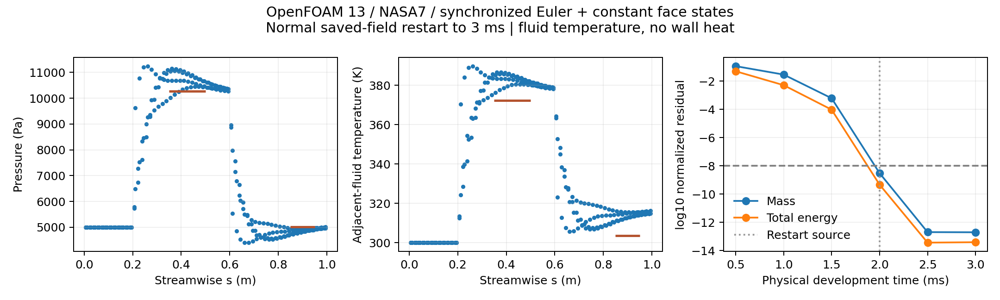

# v200：控制恢复闭合，真实全壁OpenFOAM网格入口就绪

本轮按混合技术路线完成两项实质进展：**同步外流控制从准确保存场正常恢复到原终点并通过数值门槛；真实19752面箭体转换到固定OpenFOAM13，局部内点调整后完整原生网格检查通过。** 尚未运行真实箭体流场，新增合格热面积0，工程默认和科研UI不变，总目标active。

## 保存场重启与正常完成

准确原生源码确认：p/T/U读取，rho可读取；e为NO_READ，由保存p/T重建，随后以该e反解T；phi可读取但构造器重新计算面通量。原uniform/time保存.002s/index7889/deltaT2.5680534155095303e−7s，启用自适应时恢复原时间步及写出相位。内部和边界重建内能缩放差6.909e−15、密度EOS差2.221e−16，核验0.664秒。不是无中断逐位等价。

唯一`of13-sync-saved002-to003-v1`恢复保持物性/网格/边界/同步Euler/upwind/Kurganov，只改startTime，不扩原.003s终点。原生exit0，监督13.971079秒、入口15.128634秒，峰149127168字节，36输入稳定/组清空。准确源.002及新增.0025/.003完整，3894个Time与ExecutionTime全部配对，原生累计index11783。首次新时刻.00200025680534s。原v199发展耗时61.204940秒另列，两轮累计监督75.176019秒。

活动日志确实位于E盘WSL原生ext2/ext3文件系统并逐字导出。一次scientific-observer ENODATA在第一次有限重试恢复，具体内部读取路径未知；不存在持续错误或原生失败。首版审核额外要求零重试而失败，按原有限重试政策修正后只读通过，旧审核准确源与失败保持，没有原生重跑。

六个组合保存时刻齐全；旧v199任务`planAcceptance=false`仍保留，新恢复计划通过。末五个体积L1无量纲残差为：

| 量 | 0.003s残差 |
|---|---:|
| 质量 | 1.95196232e−13 |
| X动量 | 1.94054787e−13 |
| Y动量 | 2.55629588e−14 |
| Z动量 | 2.59944329e−14 |
| 总能量 | 3.85131614e−14 |

均通过原1e−8门槛；.0025→.003s压力/流体温度面积L1变化1.9080e−14/1.9698e−14。压缩p/T平均参照误差+4.16784%/+2.83155%，膨胀−2.68888%/+3.45798%。与v198同NASA7数值参照比较，未宣称实验、空间或外域独立性。控制数值收敛不授予真实箭体热资格。恢复CLI已关闭，不再重复控制。

## 真实原面与相容入口

复用v194的64982tet/18027点/143126面，原壁19752三角/9878点、远场6572三角及所有连接不改。原壁面积1.9646292565715553m²，独立Heron差2.221e−16m²，域体积381.4346146072696m³。原SU2采用隐式单元行编号，首转换读取器要求显式编号而拒绝；新增具名模式后8.031秒完成转换，默认显式模式保持。

采用原工况M5、p1197.0279007383137Pa、T226.50908361133003K、α20°、β0°。NASA7声速301.8408449195006m/s，速度[-1418.1880731131923,0,516.1782452045427]m/s，比旧CEA速度模量低0.0052891%；固定Mach/方向，气体身份不混用。沿用已核对的200—2500K、hf、RR等效EOS参数及1000K跳跃。

壁面U滑移、p/T零梯度。整个远场及出口采用原生freestream→inletOutlet：`valueFraction=neg(phi)`，负质量通量固定来流，非负零梯度。准确源码和字典绑定；这是完整边界分派，不是精确无反射特征边界，外域敏感性仍待验。Tw300K保持给定工程壁温，Euler不求黏性热流或固体壁温。

原面→原生face/owner按连接精确双射，记录真实四面体质心、法向距离和切向偏移；这些是采样位置，不是已认证边界层外缘。当前只有初始化输入，endTime0，没有真实箭体CFD准入。

## 19个单元的具体失败与一次局部修复

首次完整checkMesh原生exit0，但日志明确`Failed 1 mesh checks`，整体拒绝。19单元内部面积张量行列式小于原生.001，最小.000260280212906；其他拓扑/几何检查通过。独立重放最小值相对差6.95e−14。它们都在底面后方x约−2.84873至−2.84216m，均3壁点+1内点，内部面数3，不能盲套v198“内部面不足”的重心四分。

19单元共享4个内部自由点（零基16695/16709/16721/17081），全部受影响邻域145单元。另行事前登记唯一局部候选，使用已安装SciPy1.7.3的SLSQP；只优化12个坐标自由度、以位移最小为目标，所有壁/远场点及连接固定。约束145单元有向体积≥旧值1%、原SICN≥.1、原生det≥.00105，不放宽原.001。

一次优化43迭代/613次约束评估，优化.344秒、完整入口.938秒；最大内点位移.067927685m，必须作为实际几何调整报告，不能称纯编号变化。全域独立核验.360秒：全部有向体积正、连接/边界逐字相同、壁邻质心映射正确，最小SICN .1427291366、最小det .00104999999999647，域体积差约2.22e−16相对。

最终rocket03完整checkMesh全部通过：监督2.079秒、入口2.600秒、峰110567424字节、23输入稳定/组清空，原生det .00104999999999666。非正交最大71.449257°、1面>70°警告保留；该项原生检查仍为OK，不称零警告。旧rocket02失败及所有原网格均未改。

本次局部优化是针对准确四个自由点的几何约束，未开发CFD内核、重建表面或删除困难区域。完整检查通过是求解入口条件，不等于空间精度或热验证通过。

## 测试、失败与交付边界

2项正向/14项拒绝检查通过，覆盖来源时刻/index/字段/几何/时间SHA、SU2具名编号模式、错误点编号及已完成CLI关闭；语法与29并发保护核对通过。首重启源搜索匹配到清理函数、首审核零重试假设、首SU2编号、首边界源码拼写断言失败均保留准确源；它们没有触发CFD重跑。实际rocket02网格失败单独保持。

所有原19752面/面积、旧19层/尾缘与物理门槛保持，无MATLAB修改、主UI/computer-use、新代理、工程包或独有删除。小源码/计划/准确证据公开同步GitHub，大网格/体场/运行库在E盘。全面积与科研UI最高，累计后置。

下一项见[NEXT_DECISION](validation/v200/NEXT_DECISION.md)：直接实现真实20°完整域发展与原面研究读取，不再控制小例/安装/重启/已过网格诊断。压力/热流/温度身份始终分开，取得可信外缘后接工程边界层及必要局部黏性区域。
