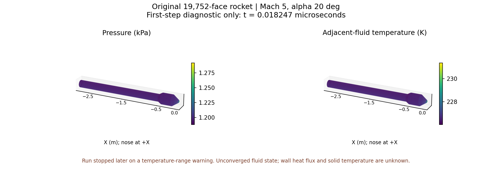

# v201真实20°全壁Euler：首步守恒与原面读取通过，温域警告使候选关闭

本版实际执行了固定OpenFOAM13/NASA7的真实原全壁候选。计算在早期触发200 K下界警告，监督停止；没有完成计划终点，也没有取得新外缘或热资格。当前瓶颈是气体有效域与真实工况/数值过程的相容性，不能归为内存不足或通过扩大旧温域解决。

## 已实现与实际运行

- 复用v200 rocket03：64982tet、18027点、19752原壁面、面积1.9646292565715553 m²。原边界/连接/工况和工程默认保持，无新网格、内核构建、MATLAB或主UI修改。
- 新具名入口`runOpenFoamRocketDevelopment.py`绑定准确源/预算/气体/运行库。采用原生同步Euler、upwind、Kurganov；初dt1e−7、maxCo.2、终点.00045 s，监督900秒/外层960秒/1线程/2GiB/96MiB，自动追加0。计划见[事前预算](validation/v201/RUN_PLAN.md)。
- 初态完整面信号预测Co=1.0960272890381695，原生=1.0960272890381728，相对差约3.1e−15。原生首dt=1.8246695320736354e−8 s，略低于Co上限预测1.8247720836906545e−8；原生可调整步长以对齐写出时刻，不把这点差异当时间尺度失败。
- 唯一原生监督3.578931324秒，入口4.948061757秒，exit−15/SIGTERM；峰组RSS218271744字节（208.160MiB），36输入稳定、进程组清空、日志逐字导出。一次scientific-observer的ENODATA首重试恢复，具体读取位置未知；持续IO不是停止原因。

## 停止原因及证据边界

第60个宣布步（日志时间1.09586382855e−6 s）首次出现原生温域逆算请求199.87859522488802 K。最终日志152条此类请求，最小请求197.36539304474493 K。监督观察警告后终止，最后67个宣布/66个完整日志步、无孤立完成标记；最后完整日志时间1.20552071653e−6 s，末宣布1.22379562093e−6 s未完成。

这些温度是原生逆算的**请求值**，不是已保存完整场的最低温度；警告没有单元ID，没有证据定位唯一单元/阶段或证明唯一根因。警告首次出现到监督处理之间有数步进展，不能声称瞬时查询前阻止。没有异常末场，不为补日志/补场重新运行。

当前候选CLI启动前关闭；旧失败保持。没有从首步继续运行、扩展终点、扫描CFL/通量/初猜，或更改200—2500 K门槛。

## 原面读取与独立数值检查

早期writeObjects确实保存了p/T/rho/U/e/phi和uniform/time，准确实际时刻1.82466953207363542e−8 s/index1，目录按timePrecision12写作`1.82466953207e-08`。事前“没有uniform/time”的推断不成立，已纠正；存在时间字典仍不代表获准重启。

`readOpenFoamRocketState.py`验证原faceID→native face→owner、原连接/中心、实际四面体体积质心、法向距离和逐面面积；全部19752面保持。原生es、工程e=es+hf、h=e+p/rho、h0=h+|U|²/2分别保存，hf=2016.774642574509 J/kg。流体温度与Te/Tr/固体Tw分开，q及固体Tw为未知。异常任务默认拒绝，显式诊断可读首步但资格仍false。

| 检查 | 实测 |
|---|---:|
| 首步五守恒量更新最大缩放差 | 7.539e−16 |
| 原生首步滞后phi与独立初态通量差 | 2.673e−17 |
| 首步离散全域守恒账最大缩放差 | 2.477e−17 |
| 保存场密度EOS最大相对差 | 2.220e−16 |
| 保存场原生内能最大缩放差 | 3.606e−12 |
| 工程参考焓相容差 | 7.065e−12 |
| 原面首步p范围 | 1188.368—1291.584 Pa |
| 原面首步流体T范围 | 226.0375—231.3581 K |

独立原面Heron面积、3项准入正向/11拒绝、5项真实读取正向/16拒绝通过。首次只读审核错误地要求17位时间字典与12位目录浮点逐位一致，失败及准确源保留；按原生格式修正后只读恢复，未重跑CFD。

真实五方程空间散度使用本箭体L=2.878319945369148 m、U∞=1509.204224597503 m/s及真实来流守恒尺度，体积L1残差依次为[.00385054, .00361828, 5.50389e−7, .00131695, .00170147]，原1e−8门槛未过。保存末对稳定及残差窗改善均不可评价，不能用日志diagonalSolver恒零残差补齐。保存时刻的边界通量与体积散度积分最大缩放差1.327e−14；其净流量是非定常变化的一部分，不是独立时间守恒误差。

三维图使用原箭体，只显示首步诊断p/T，没有生成壁热结果。首图坐标标签拥挤，后两次仅调整排版，数值不改；最终图已查看。

## 温域与下一步的物理依据

复用已有同EOS简单波关系dθ=√(M²−1)dU/U，在**200—226.509 K原有效温域内**计算：当前M5来流只需3.36341156°二维等熵膨胀即可到200 K，此时p=774.9326 Pa、M=5.38318。cp积分与焓差误差3.274e−11 J/kg；γ1.4闭式/积分互验4.927e−16 rad。参照公式见[NASA Glenn Prandtl–Meyer](https://www.grc.nasa.gov/WWW/BGH/pranmyer.html)。这说明低温需求具有物理可能性，不证明三维真实箭体的温度、位置或此次数值警告根因。

已核对以下一手数据入口，作为新具名物性方案的来源候选：

- [NIST N₂ Shomate](https://webbook.nist.gov/cgi/cbook.cgi?ID=C7727379&Mask=1&Units=SI)：低温分段100—500 K，给出Cp、H和S的相容表达；后续分段另列。
- [NIST O₂ Shomate](https://webbook.nist.gov/cgi/cbook.cgi?ID=C7782447&Mask=1&Table=on&Type=JANAFG)：低温分段100—700 K；一次工具读取失败，随后官方表检索已核对范围，完整系数/单位/分段连续性尚待逐项验证。
- [NIST-JANAF Ar参考表](https://janaf.nist.gov/tables/Ar-001.html)：100 K及以上有标准状态物性；必须核对相态/压力与组分，不能误用离子表或把WebBook高温拟合直接外推。

这些来源**尚未组成可运行新模型**，也没有改变旧NASA7或工程默认。下一项见[NEXT_DECISION](validation/v201/NEXT_DECISION.md)：先闭合有物理数据依据的低温气体模型和成熟原生接口，再登记一次最小有区分力控制；不换求解器品牌试错、不裁温、不以新范围追改旧失败。

## 交付范围

小源码、具名预算、准确执行副本、完整短日志、拒绝测试、科学图及目标同步公开GitHub；体网格/完整体场/完整原面CSV和NPZ保留E盘，用SHA追溯。29并发保护文件和其他工作未改动，无独有结果删除、无工程包。总目标active；新增可信热面积0，尚未完成单时刻全面积计算。
