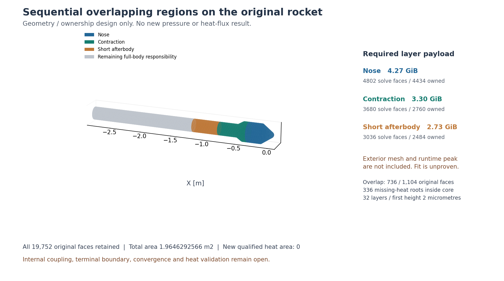

# v212：顺序区域设计与冻结接口文件

本轮为progress，总目标active。采用“同母网格、完整接口快照、顺序重叠反馈”作为**待原生验证的边界适配候选**；固定Eilmer没有已证的磁盘顺序区域实现。本轮已实现分区选择与接口读写/审核，没有构建新引擎、生成体网格、运行CFD或增加可信热面积。原v211超内存方案仍关闭，不等待更大主机。

## 1. 为什么不直接使用剖面或inactive块

固定提交`f53f4609a0331d48efee69a4e4f3c3598378cc03`，46份定向源提取1.024705秒。沿用v211准确源/布局；源码摘录与SHA见本版本证据。

| 原生路径 | 实际能力 | 本轮决定 |
|---|---|---|
| `InFlowBC_StaticProfile` | ghost按位置读p/T/U/湍流量；黏性面状态也被剖面覆盖；xyz最近点无一般距离/插值误差保证 | 不作为完整内部耦合。正常数值通量仍启用，不能把它误称为强制所有特征而必然不适用 |
| `ExchangeBC_MappedCell` | 传递真实donor几何、FlowState、重构梯度/限幅/min/max、黏性梯度、湍流输运和激波标识；同进程持有donor cell引用，MPI需要发送方 | 可复用其交换语义，不能直接当作磁盘顺序驻留功能 |
| `FluidBlock.active=false` | 显式推进存在active判断；准确NK残差、向量和预条件器遍历localFluidBlocks，没有对应`blk.active`过滤 | 没有免分配或仅求解active区域的保证，不采用 |
| 普通profile ghost | 镜像ghost位置，非mapped重构/限幅复制内部侧 | 不等于真实donor几何和梯度，不能冒称同离散算子 |

NK的`evalResidualWorker`在状态交换后执行原生重构、两次重构梯度交换、黏性梯度交换及湍流输运交换。`fluidblock.d`的Jacobian边界修正对mapped类型专门跳过。适配必须保留这些行为并实际检验；仅继承类名不构成通过。

初次搜索用了不存在的`InFlowBC_FromProfile`名称。已取得真实StaticProfile源码，但没有声称搜索覆盖全部官方算例。几次本地rg路径/通配符错误保留在工具备注中，不是原生求解失败。

## 2. 一手方法依据与适用边界

[Wentland等，arXiv:2410.04668v1，§2.2—2.3](https://arxiv.org/html/2410.04668v1)讨论cell-centered有限体积用ghost状态弱施加Schwarz接口；其顺序形式更新邻区数据。该文的二维Burgers、浅水/Euler及降阶算例不是本项目三维高Mach黏性SA/壁热验证，也没有提供本问题普适收敛证明。采用它作为区域迭代结构依据，不转授物理资格。

[NASA-TM-106601 / Kao与Liou](https://ntrs.nasa.gov/citations/19940028614)的公开摘要以非结构连接区实现守恒，提醒任意重叠插值不自动守恒。本轮只读摘要，没有复现其算法。另一篇overset论文正文403，未用作已核对算法依据。

选择复用同一母网格的整数cell/face映射，不做最近点插值。每轮只驻留一个活动子域及接口数据，原生NK/SA求该子域；相邻区之间反复交换最新实数快照。**固定点一致、实际迭代收敛、资源可容纳和物理热流合格是四个不同条件。** 冻结donor对当前子域的导数为零，但这不是完整耦合Jacobian，也不保证外迭代收敛。

## 3. 原面与近壁层的具体分区

`designSequentialRegions.py`只读取v144原母网格，匹配既有32层柱，未生成体网格。全部原19752面、1.9646292565715553m²、原编号、所选32层/2微米首层及历史最低19层/尾缘保持。切口沿真实层列，不压平。

| 子域 | 求解面的轴向范围m | 求解原面 | 唯一负责原面 | 32层棱柱 | 层域必要载荷GiB |
|---|---|---:|---:|---:|---:|
| 鼻部 | x≥−.39975728862743776 | 4802 | 4434 | 153664 | 4.270173 |
| 收缩 | −.8794676851224779≤x≤−.27982968950367837 | 3680 | 2760 | 117760 | 3.297128 |
| 短后体 | −1.1942776328223483≤x≤−.6995762864368374 | 3036 | 2484 | 97152 | 2.727176 |

两处完整周向重叠分别736/1104原面；责任切分在原环x=−.33979348906555734和−.7895219857796577m。336缺热根面全在收缩核心，未落到人工接口。三个责任面积分别.3214887716893075/.3325150203872116/.2540157654976384m²；并集9678面/.9080195575741575m²，保持原v189扩域范围。其余10074面/1.0566096989973979m²继续由适用工程链或后续后体/底面局部方法负责，未解决部分仍明确待解，不称全部已有结果。

载荷复用v211实际类型尺寸，按真实拓扑计数并由独立所有者公式核对，没有按面积比例缩算。数值未含外域、GC/临时量、I/O、快照及运行峰值；**三个下界小于8GiB只表示未排除，不是可运行证明**。几何选择.484秒；Windows直接运行未采样RSS，峰值未知，不能称完整资源预算验收通过。

重叠是几何设计，不是附着/单向流动证据。原基准终端x=−.894458635m及扩域−1.194277633m仍用于未来截断敏感性；该终端的物理外压/回流条件未闭合。顺序内部交换不能替代这一条件。如果可靠终端压力无法获得，应通过邻区反馈延伸到有物理边界的后续区域，不能填均匀压力或封堵回流。

该图只表示责任分区，灰区不是零热流。首图横向刻度重叠已保留并修正；没有改变数据。

## 4. 已实现的接口文件

`sequentialRegionSnapshot.py`支持具名物性/表SHA、母网格、离散配置、工况、原生包、donor帧、全壁距离场及外迭代身份。调用者必须给出预期摘要和精确映射，不能由文件自证身份。保留原始双精度，按整数faceID重排，donor可以一对多；不插值、不裁状态或复数扰动、不替补热结果。

记录真实donor几何、face位置/外法向/面积、完整单组分状态、两槽湍流存储（SA只有第一槽有效）、热力/输运/总焓、重构梯度/限幅/上下界、黏性梯度、原生六分量积分通量、全壁距离。合法负内能保留。原生未用重构槽的phi=−1及NaN按明确未用语义保留；参与计算的槽必须有限，不能把未用哨兵扩散到物理结果。`lref`、固定网格及完整离散配置仍须由原生适配绑定。

法向Mach和u_n±a仅作传播方向标签；混合特征不触发裁值或封堵，也不授完整黏性边界资格。本轮通量数据是**合成搬运哨兵**，没有自行实现流动通量，更没有做实际界面守恒验证。生产原生导出/导入尚未实现。

## 5. 验证与准确失败

`packet01`在保护清单的Windows反斜杠路径处失败，原报告false和已写合成文件保持。首监督器错误使用项目根作为输出计数目录，进入无关大树扫描；子测试在Python异常后已成为僵尸，实际wait退出码未记录，监督未及时执行预算检查。核对PID12/子PID26后只终止本任务监督，原running报告保留并另记外部干预。首项资源验收失败，耗时/峰值不能由成功恢复回填。

仅规范保护路径与独立小cwd后，唯一`packet_work02`测试通过：48拒绝、原位模式往返/乱序回排、独立只读副本、合法负u和未用槽保留、四种方向标签及29保护。测试内.184852秒，监督.448529秒、入口1.258275秒，采样峰36306944字节、8输入稳定、进程组清空。未将48次拒绝当48次CFD。只有合成接口通过，没有原生残差/Jacobian或流动峰值证据。

## 6. 下一项与关闭条件

直接实施最小原生**冻结mapped边界适配与一次完整算子对照**，见[下一执行点](validation/v212/NEXT_DECISION.md)。以同一小三维非结构子域的resident-donor与frozen-donor比较状态、实际重构/黏性/SA通量、守恒量残差及对受体未知量的导数；原生气体helper不重复。控制应含拉伸近壁点云和不同法向传播方向，同时冻结donor导数语义，避免只证明文件可读。

当前没有引擎构建/体网格/CFD准入。原生对照前另登记准确文件、资源和停止预算；若需要重写通用Jacobian/推进/存储内核，则关闭该适配候选并回到具体区域/边界决定，不做无界子控制。通过后尽快闭合终端物理边界、外域完整资源与唯一真实候选，保留原收敛/热流/空间/截断误差门槛。工程/科研UI独立推进，本轮没有改并发Web文件、MATLAB或主UI，没有新可信热面积。
