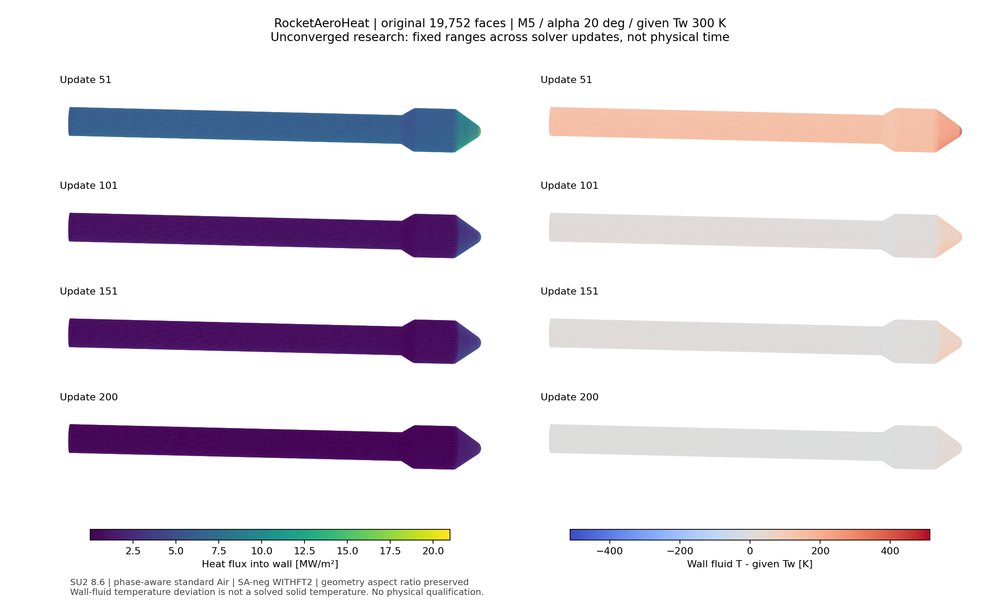

# v223：真实末场的热壁与收支审核、四阶段科研对比

2026-11-08。总目标active。本轮完成已有完整场的定向审核和科研数据交付，**没有新增流动更新或物理合格面积**。原19752面、面积1.9646292565715553 m²、705490单元/335726点、32层2微米及历史19层/尾缘保持。

## 1. 已能排除什么

v222四个保存场的9878个壁节点速度均精确为0，SA变量均为0。不能把后段残差恶化解释成保存态失去无滑移。原生`BC_Isothermal_Wall_Generic`采用给定Tw计算法向热梯度，能量边界弱施加；不会在每次更新后把节点温度强制改成300 K。动量RHS清零、旧态速度置零，与`AddSolution`从`Solution_Old`加更新相容。新气体的壁能量Jacobian采用实际secondary导数，但仍是原生近似对角预条件，并非完整边界精确Jacobian。

| 成功更新次数 | 壁节点温差RMS/K | 原三角面平均温差的面积RMS/K | 壁节点占全域物理能量RHS平方和 |
|---:|---:|---:|---:|
| 51 | 215.370 | 175.955 | 0.00269943 |
| 101 | 62.404 | 49.236 | 0.000375849 |
| 151 | 51.013 | 41.874 | 0.000371285 |
| 200 | 19.567 | 16.183 | 0.00000672434 |

RHS逐点先用`RE=REstar−300000 Rmass`转换，再求范数。非壁能量RMS从151次的166.079升至200次的717.513；后段增长主要在非壁节点。最大末保存RHS位于节点330839，坐标约[-4.057293,0.098106,-0.411723] m；不能据此宣称物理分离或唯一根因。这些保存RHS属于更新前隐式阶段，不能与本轮重新评估的当前状态RHS混用。

准确执行源及来源：[inspection](validation/v223/evidence/inspection01/report.json)、[空间分布](validation/v223/evidence/localize01/report.json)。定向源共10份，绑定准确构建来源；没有用共享最新源码代替旧对象来源。

## 2. 完整末场的冻结空间审核

`frozenBalance.cpp`仅初始化同一原网格/准确199检查点，链接v220既有两个归档。没有调用Run、StartSolver、Time_Integration或线性求解。先按实际次序展开成熟空间/边界入口，再调用原生`CIntegration::Space_Integration`。当前完整域只有wall和farfield两个marker。

335726点×5个RHS逐位差0；六个当前流动/SA变量前后逐位变化0，且独立读取对原检查点六变量逐位相同。两次空间算子评估、零流动更新。`Upwind_Residual`已融合边黏性，后续单独Viscous阶段总和不变不代表漏掉黏性。内部各五量总和相对其绝对和最大6.4191e−17；说明已观察算子内部的成对消去达到舍入量级。

| 同一冻结状态的量 | 结果 |
|---|---:|
| 独立热物性与原生壁状态最大缩放差 | 5.0990e−16 |
| 独立法向热梯度与原生q最大缩放差 | 4.0787e−12 |
| 壁节点面积热功率 | 1376897.429412981 W |
| 等温壁阶段加入能量RHS | 1376897.429412981 W |
| 上述热量相对差 | 1.6910e−16 |
| 外边界净质量通量 | −0.1853630862 kg/s |
| 外边界物理能量净通量 | +52125.774286 W |
| 最终物理能量RHS全域和 | +1429023.203699 W |
| 最终五量RMS | [0.000596541,0.828114,0.177740,0.205215,591.206263]，各自有量纲 |

正热流进入壁面。本冻结态壁节点q范围−1590.9618至3404550.8028 W/m²，保留负值。原面顶点均值的功率与原生节点向量面积功率使用不同离散面积，仍分别保留，不把两种积分冒称相同。

强无滑移动量行替换量为[-2755.620279,−1.252560,3521.384501] N，原生压力及完整黏性表面载荷为[-2582.656313,0.172873,3416.121746] N。差向量[-172.963965,−1.425433,105.262755] N，相对原生载荷范数4.72809%。**两者未闭合，不将壁行替换量当作物理牵引。** 已输出的Cf仅切向，不能拿它重构完整法向黏性应力并假称独立载荷审核通过。

这是冻结的flow空间算子审核，并非完整flow-SA迭代重放、伪时间更新守恒审核或稳态物理收支通过。原生载荷尚未独立重建；逐节点时间步、原始状态拒绝与CFL历史未取得。没有全域稳态，也没有新外缘/热资格。v222缺0帧的计划失败、−8/稳定/空间外域/公开热验证缺项全部保持。

详见[独立审核](validation/v223/evidence/audit02/report.json)、[分阶段有符号账](validation/v223/evidence/frozen02/stages.csv)、[原生结果](validation/v223/evidence/frozen02/native.json)。大型field.csv、可执行程序及归档留E盘，以SHA绑定。

## 3. 科研工作台交付

在现有工作台“打开结果JSON”加载[四阶段比较数据](validation/v223/evidence/workbench01/rocket_phase_comparison.json)。变量列表提供第51/101/151/200次成功更新的p、q、壁流体T−给定Tw，共12个研究字段；另列给定Tw300 K和未求解固体Tw。每类量跨四帧统一范围，温差色标关于0对称。初始显示末阶段温差，可切换压力/热流和对应阶段。

每字段保留方法、适用范围、成功更新编号和未收敛身份；没有伪造物理时间轴。全部原面、坐标、数值和有符号温差逐数回读通过，现有前端纯合同测试通过。共享viewer/section未改，也没有归档其并发未提交源码；本轮没有浏览器交互验收或MATLAB运行。

科学图已查看，采用原三角面、固定投影和真实长宽比。图中固定全范围使晚期低热区颜色接近，表示跨帧量级下降；不能据此判断已稳态或把局部细节抹成零。交互工作台仍可选择其他色标范围检查细节。

## 4. 执行与失败记录

- inspect2.875秒、localize16.704秒、准备3.172秒；helper唯一构建7.078秒，未重编引擎。
- 首查询1.250秒因Windows盘符冒号被配置解析器分成多个token而exit1，尚未加载网格；原失败及配置保留。仅用等价相对路径恢复，第二查询93.171秒、父95.281秒exit0。两查询总94.421秒/120秒；原生峰1468760064 B，父组峰1498869760 B，1CPU/4GiB采样预算，输入稳定/进程组清空。
- 首离线审核4.796秒误把wall的20列写为21列而失败。修为准确列名后audit02读取9.093秒通过，无原生重算。导出/绘图/前端测试4.890秒通过。归档前离线总41.530秒/120秒，阅读开发另计。
- 首inspect在线容量范围仅进程目录，未覆盖全部source输出；后续守卫显式统计整个v223，最终再核256MiB。原差异不追改。资源为进程组采样而非硬地址空间保证。
- 冻结CLI已关闭；未新增CFD、网格、引擎编译、包或独有删除。29保护/298旧对象/743依赖和原资产最终核验见[归档报告](validation/v223/evidence/final_report.json)。

## 5. 完整决定与下一项

**当前199末场不准入直接续算。** 热壁链与内部消去得到新证据，但后段非壁残差增长、完整物理牵引差异、未取得实际接受/CFL轨迹和稳态收益仍不足以支持盲加步数。关闭本轮有限候选，不据此判定SU2或该物理模型无解；旧可执行包、检查点和相容接口继续作为资产保留。

下一项回H1/H2的**同模型工程边界层入口闭合**，不是再做一版完整域字段诊断。定向代码确认`calcBoundaryLayerState`/`airReferenceTemperature`仍调用旧NASA7与Sutherland；已有`phaseAwareAirReferenceState`提供同相态气体恢复焓/参考焓，但尚未接入主链，输运仍用解析稀薄公式，不能无说明等同于新求解器的节点线性表。优先把这个具体接口接完整，复用已有物性表/参考焓证据而不重算全物性网格；新外缘必须有来源和独立接受身份，v222未收敛场不能自动当可信入口。落实方法/区域/边界层剖面与原面映射，工程已有范围和科研UI不再等待完整域研究。

后体/底面/分离区仍归必要黏性及反馈任务，不能借工程接口全部强行覆盖。[下一次完整实施点](validation/v223/NEXT_DECISION.md)规定边界和预算。总目标active。
