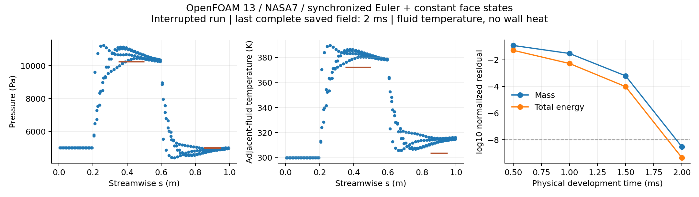

# v199：同步外流控制的实际数值进展与监督修复

按用户更新的混合路线，完成固定OpenFOAM13的同步推进与一致面状态入口，以及不参与求解的独立守恒校核器。**最后完整保存场五项真实方程残差通过原1e−8门槛，压力/温度参照误差约2.7%—4.2%；发展任务因监督日志读取故障中断，原六帧计划仍未完成。** 本轮没有真实箭体、热流或新增物理资格，工程默认保持。总目标active。

## 实际算子与来源

固定Foundation13 / Debian20260624 / build `13-18870c24d21c`、shockFluid、Kurganov；采用原生全域同步Euler、所有重构量upwind（一阶单元面状态）。内部相邻单元使用同一时间增量，rho/rhoU/e/RT/c各侧来自同一个单元。与v198的localEuler/vanLeer相比，实际时间离散及重构均有区别，不是同候选CFL扫描。没有修改内核、编译引擎或裁温；一阶耗散不能代替空间精度验收，也没有宣称任意三维变cp的完整保正定理。

准确原生源码审核0.338秒。理论依据为[Greenshields等，DOI 10.1002/fld.2069](https://www.math.umd.edu/~tadmor/centpack/publications/files/Greenshields%20et%20al%20polyhedral%20FV%20IJNMF2009-centpack.pdf) §3、§4.1–4.2，其定比热控制不授予本NASA7气体或真实箭体资格。源码绑定见[源审核](validation/v199/evidence/source_review01/report.json)。物性沿用v198：R=287.07413663878884 J/(kg·K)、200—2500K、1000K分段跳跃、hf=2016.774642574509 J/kg、等效EOS参数与真实分子量分列。没有重复安装、物性探针或网格检查。

复用14892tet/4007点/32504面/240控制壁三角。新`openFoamConservation.py`只读取原生状态和准确连接，独立计算Kurganov通量、五守恒量散度及全域边界账。它不推进流场、不修补结果。原生diagonalSolver恒零日志不用于判断收敛。

## 最小实际控制

四步固定dt=1e−7s，四完整p/T/rho/U/e/phi场，原生exit0；监督2.480秒、入口3.409秒、24输入稳定。三对相邻保存帧的五守恒量更新最大缩放差4.435e−16，原生质量面通量差3.673e−17，全域质量/三动量/总能量账≤7.00e−18。独立审核0.453秒。这证明准确实现与离散守恒账相符，不是实验验证。

## 发展任务与准确终止原因

事前计划为M3/p5000Pa/T300K、均匀初态、同步Euler/upwind、maxCo=.2、到0.003s，最多16000步、总监督240秒/1线程/2GiB/96MiB、每.0005s完整保存，六帧。完整计划及唯一监督故障恢复登记见[DEVELOPMENT_PLAN](validation/v199/DEVELOPMENT_PLAN.md)。物理发展时间不是飞行轨迹时间。

| 任务 | 监督/入口秒 | 结果与保存 |
|---|---:|---|
| development01 | 3.081420 / 4.047243 | 监测OSError(61)，SIGTERM/−15，无发展帧；具体读取位置未知 |
| development02 | 58.123520 / 59.085934 | 同故障再次发生，SIGTERM/−15；4完整帧.0005/.001/.0015/.002s |

第一次失败后，针对ENODATA/EAGAIN/EINTR加入最多两次、每次50ms的监测读取重试，7项注入测试通过后仅恢复一次相同候选；没有改变算子、初态和门槛。第二项共记录30次监测读取异常，末次连续三次失败；栈定位`PhysicalTimeGuard`读取`/mnt/e`上正在追加的stdout。不是原生数值、温域、内存或时间预算失败。峰组RSS149155840字节（142.246MiB），27输入运行中稳定，自有进程组清空；两个发展任务累计监督61.204940秒。本轮没有第三项CFD。

日志有8353条Time宣布、8353条ExecutionTime，其中**8352对时刻与完成标记可配对**，第51515行完成标记没有对应Time行。末宣布.00211941448382s尚无完整完成日志；最后可配对完成时刻.00211915767848s。缺失Time的原因未知，不猜测补齐或把8353当完整更新数。首版inspection01误用`updates`记录宣布数，保留；修正解析首次严格拒绝这个真实缺口，inspection02准确源/失败保留。inspection03显式允许只读观察日志缺口，分别输出配对数/标记数/时刻，不改变任务失败身份。完整保存场时刻仍以文件和SHA为准。

## 四完整场的独立结果

全部四帧正性、200—2500K、EOS及原内能门槛通过。末帧T约300—389.710303K，EOS最大相对差2.221e−16、内能缩放差5.523e−15；最大总焓偏差2.8790%、体积平均0.2543%，仍需空间/边界评估。

| 末帧守恒量 | 体积L1无量纲残差 | log10 |
|---|---:|---:|
| 质量 | 3.03701249e−9 | −8.51755 |
| X动量 | 1.82882702e−9 | −8.73783 |
| Y动量 | 2.04442572e−10 | −9.68943 |
| Z动量 | 3.31663623e−10 | −9.47930 |
| 总能量 | 4.64556970e−10 | −9.33296 |

尺度为rho∞、各动量rho∞U∞、能量rho∞(abs(es∞)+U∞²)，再乘U∞/L，L=1m。五项均低于事前1e−8；与其他引擎不同定义的残差不能直接逐值比较。首到末五项改善7.49—8.11log。0.0015→0.002s原240壁面面积L1变化为压力0.0022263%、流体温度0.0008463%。

| 同EOS参照区域 | 平均p相对误差 | 平均流体T相对误差 |
|---|---:|---:|
| 压缩段s=.35—.5m、36面 | +4.167842% | +2.831552% |
| 膨胀段s=.85—.95m、24面 | −2.688883% | +3.457984% |

参照复用v198独立弱斜激波/膨胀计算，采用全部跨度的原壁owner，没有外移采样。它不是公开实验或空间独立性证据。图中温度是**无黏壁邻流体温度**，不是固体壁温、热流或已认证外缘。

`savedFrameNumericalThresholdPassed=true`，但`planAcceptance=false`、`developmentScreeningPassed=false`、任务级`numericallyConverged=false`。只读审核通过不追认原六帧/正常完成合同。新增合格热面积0、原19752面箭体运行0，旧工程q计算面积66.5626%未变。

## 监督修复、拒绝测试与交付

活动日志改写到E盘WSL原生文件系统的`/home/rah/.cache/RocketAeroHeat/openfoam-observation`；终态清空进程组后逐字导出到项目，SHA相同才删除临时重复日志。容量预算同时计case和活动日志。一次纯Python并发写入100000行/读取10次测试通过，监督1.440秒，文件系统ext2/ext3、零IO重试、完整内容与SHA一致、组清空；CFD/构建0。该结果不保证所有未来I/O无故障，也不改变已中断任务状态。

最终8项正向/20项拒绝检查通过，覆盖缺边界值、错误数量/类型、非有限/尾部损坏、面通量不能拿cell值代填、修改EOS/内能、日志缺口以及关闭CLI。边界检查仅增加拒绝条件，不改通量公式；inspection03四帧数值与inspection01逐项相同。两轮读取测试1.016/0.906秒，最终只读审核0.563秒；收尾失败保留，均未重跑CFD。29保护文件SHA保持，无MATLAB/主UI/computer-use、新代理、工程包或独有数据删除。

源码、计划、小证据公开同步GitHub；体场、网格和运行库留E盘，不称已远程备份。下一项见[NEXT_DECISION](validation/v199/NEXT_DECISION.md)，先核对准确保存场的原生重启身份，再以独立预算只完成原定剩余区间，尽快转真实全壁外缘入口及工程边界层。
