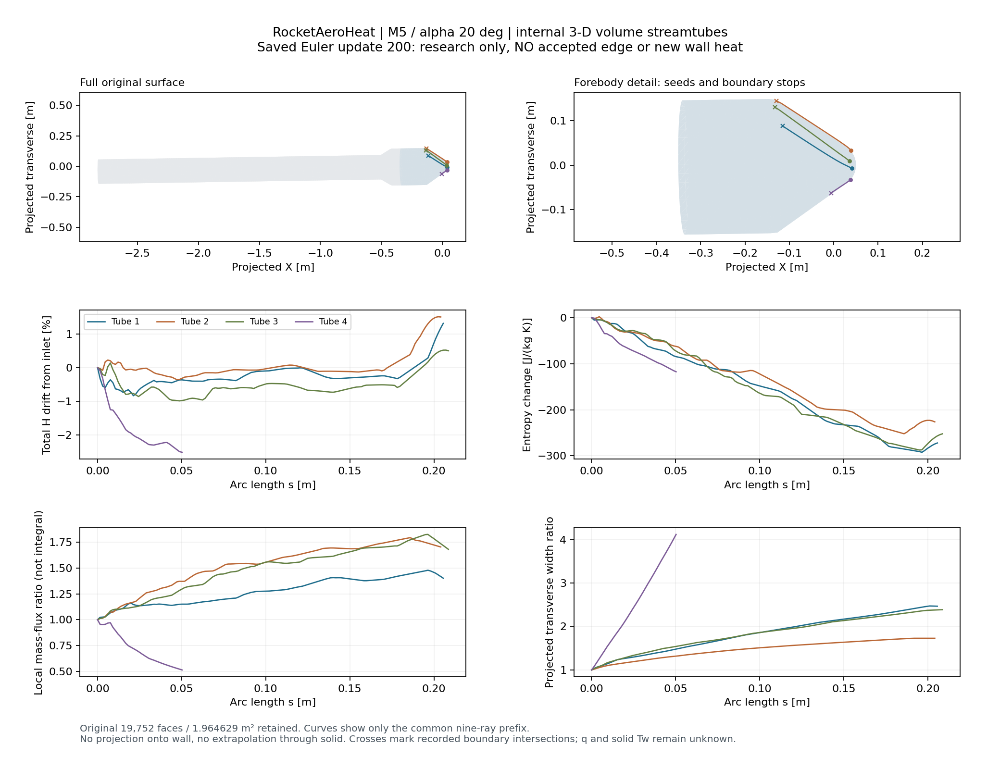

# v241：内部三维流管生产、越壁守卫与科研出口

2026-11-16交付整理；数值任务在2026-11-15完成。总目标active。本版实现了从程序内部前体场到三维流管研究数据的实际生产链，没有新增合格壁热面积。

## 实际改变

`scripts/tetraStreamtubes.py`在原四面体连接上插值五守恒量，按相同相态Air和+300000 J/kg能量坐标恢复p/T/U/H/S。弧长RK4沿真实三维速度积分，每个种子生成中心线和两个横向方向各四条邻线。邻线粗细差分给出横向投影宽度、有向横截面雅可比、H/S标签导数及局部质量流率比；H/S不冻结为入口常数。

与v96的关系是复用入口标签和横向投影思想：v96计算给定压力下的曲面流线，本版读取内部体场，具有两个横向标签，不能混称同一个曲面Euler求解器。参考[v96方法及出处](LABELLED_PRESSURE_SURFACE_FLOW_V96.md)、[内部场来源](FOREBODY_PLANAR_EULER_V240.md)。新程序是后处理和入口研究，不是新的CFD通量或求解内核。

四个种子来自3128目标面最前轴向带的四个周向位置，原面ID为18400、18331、18354、18377。从各自流体owner四面体质心出发，入口横向标签半宽取质心最小面距的0.2倍。它们是明确的**壁邻体样本**，没有熵层/边界层外缘资格，也不代表覆盖了四片已解热区域。

## 局部网格采用决定

一次定义的出口缓冲集合包含3471单元、4连通分量，包含此前前10个能量主残差节点的全部相邻单元。693个固定三角面中，有13个单面最优SICN上界低于0.1，最低0.0501563；出口面另有19个，区域外还留277个SICN<0.1单元。只替换该缓冲内部或只重剖出口平面无法达到原质量门槛，因此没有构建、调用或扫描TetGen候选。

这是对**这个固定界面组合**的拒绝，不能推断整个前体无法重网格。主残差点5273的相邻单元最小SICN为0.437515，故也不能声称差网格是所有残差的唯一原因。保留原壁面和完整责任；没有修改原黏性网格、32层/2µm或历史尾缘资产。

## 数值证据和修复

| 检查 | 本版证据 |
| --- | --- |
| 解析P1五量恢复 | 最大绝对差5.82e−11，含能量量纲 |
| 解析转向与独立DOP853 | 坐标差分别约2.50e−16/2.50e−13 m |
| 斜置标签与刚体旋转 | 真正横向投影区别于标签向量模长，旋转坐标差约6.11e−16 m |
| 原网格来源独立核对 | 6748保存射线站点，重心差6.11e−16，五量缩放差1.83e−15 |
| 热状态及指标独立核对 | 独立Cp分段积分、52步内能二分；指标最大缩放差4.55e−13 |
| 步长检查 | 第1管同合同半步长，最大位置差3.24µm，横向宽度差0.00778、截面雅可比差0.003079；不是网格/CFD收敛证明 |
| 科研出口 | 443共同站点、9746数字的JSON/CSV/前端实际纯函数一致；图已查看，无浏览器交互验收 |

首次测试误把能量标签导数1000当作总焓标签导数，原断言失败保留，改为同模型Cp/Cv关系。首次实际流管生产8.734秒完成，但独立审核发现**第2管中心线第134段（零基）**的两端都合法，中间穿过两片壁面。最初实施记录误写“第1管”，恢复对照给出准确归因，原记录及执行快照保持。

随后增加逐四面体面邻接的连续线段检查，覆盖RK试探弦和接受弦，禁止跳过固体/空洞；遇边界保存准确交点、三角面节点和积分阶段。增加两个分离四面体之间跳空洞的拒绝测试。恢复生产8.719秒完成，独立检查全部九线的已保存线段及45个停止交点：43个壁面、2个出口（包含第1管半步长九线）。这不是对精确ODE曲线的严格全程证明。

第2管中心线由274站缩为135站；四管九线共同有效前缀共3987射线站点和所有度量与首版本逐位一致，因为原共同前缀已先被较短邻线截断。不能据共同前缀相同宣称首版本全部单线都正确。

## 当前研究结果与限制

| 管 | 共同有效站点 / 请求386 | 最大绝对H漂移 | 最大绝对熵变化 J/(kg·K) | 局部质量流率比范围 |
| --- | ---: | ---: | ---: | --- |
| 1 | 136 | 1.315% | 292.226 | 1—1.480 |
| 2 | 135 | 1.510% | 251.999 | 1—1.795 |
| 3 | 138 | 0.986% | 287.344 | 1—1.827 |
| 4 | 34 | 2.511% | 117.425 | 0.513—1 |

四组均未得到覆盖整个目标前体的共同管段。当前未收敛源场、体插值和种子位置对偏差的贡献尚未分离；壁面停止不能直接当作真实物理分离点。不能把轨迹投影到壁面、移种子避开失败、固定H/S或令质量比为1来制造合格入口。质量指标采用中心ρU和微分横截面积，不是严格管面积通量积分。

原19752面/1.9646292565715553 m²责任保持，新热流、固体Tw和资格均为0/未知；300 K给定壁温单列。原面顶点/面编号逐位回读一致；UI元数据按Python顺序求和为1.9646292565715642 m²，与原NumPy归约差8.9e−15 m²，未改任何面面积或分母范围。

## 使用与交付

本地科研页：`outputs/v241_validation/workbench01/index.html`。它提供可旋转的三维流管投影、原箭体与前体放大、四管切换、同纵轴曲线、站点滑块/曲线点选、逐变量探针和CSV；另有既有原面WebGL压力工作台入口。新流管投影使用独立Canvas显示，原WebGL没有修改；尚未成为主五步骤工作台的生产热入口，也没有实际浏览器交互验收。

运行/审核输入和准确执行源、两次原失败、恢复前后对照随小证据交付GitHub。大数组、网格和完整场仍在E盘，仅按SHA索引，不是GitHub备份。不创建工程包，不删除独有资产。通用算法模块保留复用，本轮固定任务CLI在交付时关闭。

监督离线累计24.469秒、审核/导出7.813秒（归档另计）；峰值采样RSS128225280 B、1CPU。程序开发/工具读取、三次针对恢复归因的只读检查未计入监督，另行明示；没有把它们冒充全程监督。10个原数值任务回执均终态、输入稳定、进程组清空；暂停/恢复后的进程检查无活动任务。无新CFD、原生编译/查询、MATLAB、新代理或computer-use。下一项见[执行决定](validation/v241/NEXT_DECISION.md)。
