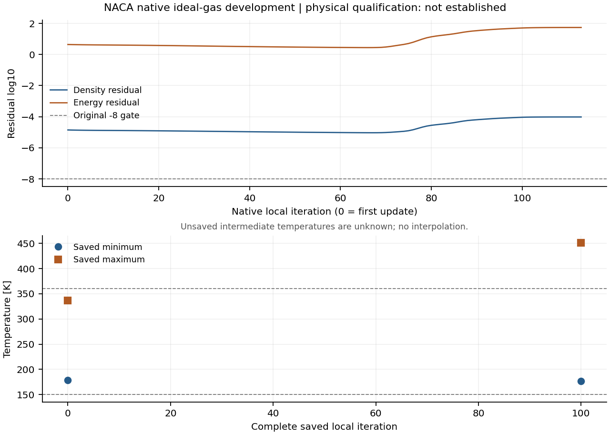

# v174：原生定比热低焓基线与保存场温域停止

2026-11-06。**独立模型、空间壁温、首帧输出和严格热接口已测试；唯一实际网格候选因温域越界关闭。整箭全面积气动热尚未完成，新增物理资格为0。** 用户接受内嵌成熟引擎，计算不要求导入外部CFD。单工况全面积和科研UI仍为最高优先级。

本轮使用SU2原生IDEAL_GAS低焓层流路径，区别于原Lemmon/OTH变比热系列。没有修复、接续或追改v173的未知退出；没有新的整箭、MATLAB或主工作台UI任务。

## 1. 明确模型及能量参考

保留NACA TN3344实验的M1.97、Re_D=2.28e6、T0=570°R=316.6666667K、D=0.1016m及原壁温测点。选定gamma=1.4、R=8.31451/0.02896546、Sutherland(1.716e−5 Pa·s,273.15K,110.4K)、Pr=0.72。由新模型重建静态条件：

| 量 | 数值 |
| --- | ---: |
| T∞ | 178.285233854 K |
| U∞ | 527.310047475 m/s |
| rho∞ | 0.511635944608 kg/m³ |
| p∞ | 26183.7986721 Pa |
| cp / cv | 1004.671943756 / 717.622816969 J/(kg·K) |
| h0 | 318146.115522879 J/kg |

采用e=cvT、h=cpT，无OTH偏移；不读取旧模型rhoE。C1解析初猜使用原几何壁距和实测Tw，prior=0，local0为第一次完成更新。初猜不是已发展的边界层。

第一阶段三项监督合计1.218秒。主比较温区及预设150—360K开发域均满足事前模型差额度：cp/导热率/同参考Δh≤2%、声速≤1%、相同明确局部状态的Nu归约因子≤3%。主温区最大cp/导热率/Δh差约0.236245%；开发域cp/导热率差约0.427871%。独立50位Decimal的12状态核对最大差4.44e−16。

上述额度是开发模型误差分配，原实验Nu约15%、Re约1%的probable error另列。没有用误差额度代替真实外缘、后6测量中心、原输运表、网格/外域和实验资格。[事前计划](validation/v174/PLAN.md) [模型与合同](validation/v174/CONTRACT_REVIEW.md)

## 2. 首帧缺失及纯输出修复

small02原生4更新0.328秒exit0，但监督器因为缺少local0而退出1；只有2/3完整。准确CFlowOutput::WriteVolumeOutput的门控只额外接受IDEAL_AIR_VARIABLE_CP，原生IDEAL_GAS被跳过。第一阶段源审查未识别这个实际override门控，这一限制保留。

只增加IDEAL_GAS首帧输出条件，建立独立`rah-native-ideal-gas-spatial-wall-v1`包。一次编译9.875秒、链接2.219秒，内部19.125秒、外层19.781秒，全部在预算内。297父对象准确继承、4对象从准确缓存恢复；原19源、298共享对象、依赖和exe全部恢复。没有改物性、流动更新、弱壁热公式或17位字段。

small03原生0.750秒exit0，父1.719秒；0/2/3完整，35输入稳定。严格热审核1.031秒、共有比较0.515秒通过。与small02共有2/3体场各549×27列、表面文件、4×29完整历史和施加Tw回执**逐字相同，数值差0**。这里只证明已比较的小例共有状态，不推广为任意未来轨迹完全相同。

小例第0帧177.347—344.276K；第2/3帧最高361.938931/367.697414K，分别11/21点超过360K。输出修复没有改变这个失败。正常保存/严格热接口与模型开发域分别判定；小例不取得物理资格。[构建审查](validation/v174/BUILD_REVIEW.md)

## 3. 自动温域停止与一次实际候选

保存场守卫仅用于具名实际定比热候选。它不改变数值更新，也不发用户取消请求。原生程序可能在退出时重写同编号末帧，因此运行中只读取有限连续历史已越过的旧编号，最新帧等原生终态后检查。异步助手同时持有CSV/VTK的Windows拒写读句柄，核对完整列、原节点/壁面及来源后检查150—360K。单助手15秒、累计60秒；缺失异常瞬间场保持未知。

28项守卫检查通过，最终监督2.750秒；包括前两次失败在内合计4.234秒。实际资源/早收敛/缺帧及异常选择新增4正向组合、27拒绝，1.875秒通过。完整新模型/输出合同另有1正向、35拒绝。它们是不同范围的检查，不累计成实验样本。[守卫计划](validation/v174/DOMAIN_GUARD_PLAN.md)

唯一real01逐字复用v170 mesh02：190334点、179568单元、3096壁面、3226壁点、130站Tw；新cvT初态。固定Roe/WLS/二阶、CFL0.4、线性1e−5/10、MGLEVEL0。最多500更新/every100、600秒、2线程、1536MiB，事前保守输出上界1176607488字节。准备4.453秒exit0。

| 实际结果 | 数值/身份 |
| --- | --- |
| 原生监督时长 / 退出 | 54.609秒 / exit1，守卫请求停止 |
| runner / 父 | exit127 / 64.641秒，非时间/内存预算终止 |
| 父采样峰值工作集 | 1103089664字节 |
| 源与输入 | 47项全部稳定 |
| 完整保存 | local0与100，分别累计1与101次更新 |
| 最后有限历史 | local113，累计114次；没有113全场 |
| 温域触发 | 第100保存场，22260点超过360K，最高450.968607K |
| 停止身份 | modelDomainExceeded=true；cancelled=false；无supervisorError |
| 助手累计 | 8.031秒；两帧均运行中提交检查；无可见残留助手 |

这是首次**被观察到的完整保存场**越域；不代表第100步才首次瞬时越域。保存间隔、至少一条后续历史和助手解析带来延迟。不能由450.97K断言真实物理温度，也不能把退出码解释为SU2自发崩溃。

## 4. 完整帧核验与候选判定

显式异常保存帧热审核16.141秒exit0；独立终态/守卫/能量反算4.641秒、筛选1.813秒。严格热接口通过，任务仍不是正常完成，模型域失败没有被接口通过覆盖。

| 指标 | local0 | local100 |
| --- | ---: | ---: |
| 全场温度范围 K | 178.272—336.354 | 176.407—450.969 |
| 给定Tw与壁流体T最大差 K | 9.02e−6 | 5.36966 |
| 独立首邻y+的99百分位 | 0.004733 | 0.123628 |
| rho / rhoE logRMS | −4.85097 / 0.643103 | −4.03554 / 1.70359 |

两帧能量最大相对差2.22e−16、原严格热梯度差5.70e−16、功率差2.79e−11；独立cvT反算最大2.22e−16。原−8未过；低y+是当前未收敛状态的诊断，不单独授予近壁/热流资格。

114行历史末50相对首50，rho/rhoE平均log分别恶化0.519207/0.709739；末50相对前50反弹0.556877/0.753801。没有完成500步，趋势只作诊断，不代替缺失终态。5项发展筛选失败，候选不采用、不改默认、不续算。

0→100压力面积L1差1.21452%。热流面积绝对差937.7085W；初始绝对热流面积积分仅0.0123333W，使相对L1达76030.77倍，不能将这个近零分母比值当成实用稳态误差。原生扇区热功率−0.0101294→937.16683W，没有热稳定或实验通过。

最高温节点42065位于原鼻部法向第13层，几何偏移48.497μm、s=6.832mm。最大总焓位于鼻轴第13层节点41938，为496637.169J/kg、来流h0的1.561035倍。壁面加热存在；这些是保存100的定位事实，不是唯一病因或严格绝热总焓上界证明。

温区图只在完整保存位置画标记；未保存中间温度未知。原始两点连线图及准确执行源保留，最终散点图生成1.015秒，合计后处理23.610秒/180秒。

## 5. 失败记录、交付与下一步

保留small01仅准备、small02缺首帧、合同测试CRLF/LF误比较、guard01 UTF-8读取遗漏、guard02 VTK末tab被误当缺换行、对应准确源与失败回执。后两项发生于源码/字段小检查、测试0项；没有因此重跑CFD。修复后28项实际检查通过，没有放宽完整字段、温域或热流门槛。

本轮无新MATLAB文件，无新整箭、主UI或原生鼠标验收。原19752面、面积、最低19层、尾缘及全部历史失败保持。给定Tw、壁流体T和未解固体Tw分开；Te/Tr/真实实验归约尚未闭合。

关闭当前低焓NACA发展候选。下一项只允许一次有明确出口的成熟官方热壁控制路线评估，不能继续同CFL、通量、初猜或步数扫描，不能扩360K挽回本次失败。具体停止条件与返回主线安排见[下一执行起点](validation/v174/NEXT_DECISION.md)。小源码、准确证据和目标同步公开GitHub；大场本地、无工程包，独有结果不删除。

本轮仅六个逐字末帧别名作硬链接去重，12原路径/SHA和10份回执保持；去重123398289字节，空闲观测+123396096字节。首次预检误用异常任务interfacePassed而失败，未改变场文件；改按已保存场审核及独立证明后完成，原失败保留。两次总0.984秒；不动runtime、OpenCode或其他历史。[存储回执](validation/v174/storage_receipt.json)
