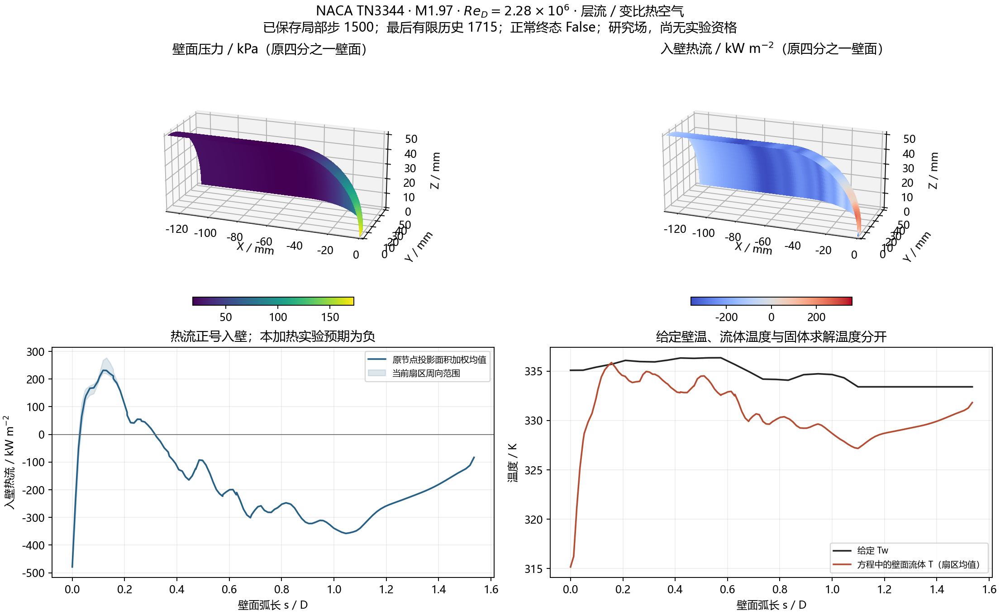

# v171：空间壁温组合运行包与实际三维热验证入口

2026-11-06。继承v170实际网格，直接补空间壁温和真实段功率能力，保留原默认与全部物理门槛。总目标仍为单时刻真实20°全面积气动热和科研工作台；本零攻角层流基准不授权分离、底面或突起。

## 运行包与准确来源

新 `rah-ideal-air-spatial-wall-v1` 复用v115成熟文件适配，将明确SI的X/Tw表写入官方逐节点CustomBoundary数组，不改弱等温热流公式或热物性。准确observed基线上只需两个适配对象；由于共享缓存还留有v167数值对象，另外编译恢复CNSVariable，并从旧缓存恢复逐字匹配的CTurbSST。没有将v167额外限步混入本包。

三对象编译9.360/3.500/2.593秒、链接2.172秒、外层71.047秒均exit0。新包296对象与observed相等，本轮294对象未动；19项源、8项共享二进制/依赖和全部298共享对象最终恢复。新exe SHA为 `3309e77ed0fdfdb465e6d774f2157b7ef8d2cb2252a3d4abbfab7ee49fd7a217`。没有重建整个引擎或覆盖旧包。[构建与准确来源](validation/v171/RUNTIME_REVIEW.md)

全包明确记为额外边界能力，不预设全部数值相同；无温度表路径由实际对照证明保持。安装包的构建状态与下述组合测试证据分列，不在真实任务期间改包清单。

## 严格入口和实际组合测试

新合同 `naca-tn3344-spatial-wall-laminar-v1` 独立于旧549点/3更新合同。配置、包、网格、列编号、相容初场、壁温表、原数据和计划绑定；60–2000K范围、无外推、单wall与错误标记预拒绝。2000更新/1800秒是唯一具名实际候选预算，不提高旧入口上限；4GiB由外层进程树监督真实执行。

原小几何合并为单wall，用四项有区别的4更新组合验证新增能力：

| 组合 | 原生秒数 | 结果 |
| --- | ---: | --- |
| 旧observed、标量335K | 0.344 | 正常0/2/3保存，严格热审核通过 |
| 新包、无表标量335K | 0.828 | 三个保存帧与旧包逐字段/逐字相等 |
| 新包、335K常值表 | 0.266 | 三帧与旧标量逐字段/逐字相等，61节点实际回执通过 |
| 新包、原实测非均匀表 | 0.265 | 61节点给定温度差0，实际字段有变化，严格热审核通过 |

四组最大能量相对差3.84e−15、EOS2.22e−16、热流6.82e−16、有限位历史热功率2.79e−10。原−8未过，小步结果不代表收敛。输入/预算拒绝检查通过；稀疏历史夹具7项通过，异常最后历史不强求瞬间完整场。旧v169正确入口18项实际输入锁只读通过，−7配置仍拒绝，没有替身或CFD重跑。

组合比较第一次误读回执字段名而失败，原源码保留；修正只读比较后通过，没有重复四个原生任务。正式准备另锁定v170白名单及几何/表SHA；已有小型运行的准确准备源码随任务保存，旧运行证据不改。

## 热流与实验区间映射

新增 [单wall空间热流](../scripts/nacaSpatialWallFlux.py) 和 [逐帧分析器](../scripts/analyzeNACASpatialHeat.py)。法向距离准确采用原生 `max(|n·Δx|,0.05|Δx|)`。给定Tw、壁面流体T、固体求解Tw始终分开；层流原生Y_Plus=0不当通过，另从原首邻距离、同阶段ρ/μ和实际壁剪求y+。

原生热功率为 `Σ q_i |Σ N_ij|`，不等于用所有子面面积直接乘同一q。因此有限段把中位对偶三角片按原s界裁切，以明确的 `q_i n_i·N_片` 分解原生节点功率。全壁回加一致；投影面积、实际几何面积、名义光滑实验面积单列。四分之一到全周的对称缩放明确，20段重叠功率不能相加当总功率。这是有标记的节点通量向量分解，不称求解器直接输出了子面热流。

合成与既存实际几何检查3.828秒exit0：平面解析功率差3.55e−15W、面积1.11e−16m²；真实曲面互补裁切差8.88e−16，子面回加差2.03e−16。真实网格投影面积0.0101265413133m²与几何面积0.0101313019701m²分列。距离下限和5项拒绝已测。[范围与证据](validation/v171/HEAT_REVIEW.md)

外缘直接读取原列节点，中心不在原列时返回缺失，绝不最近邻冒充。每个原周向列单独保存接受/拒绝；仅对有局部平台、符号相容且Tw/外缘同中心的量作归约。后6段中心身份、第18图读横坐标及原输运表不等价继续保留。

## 实际候选执行记录

唯一 `outputs/v171_validation/real01` 复用v170的190334点/179568单元、原空间Tw表，没有生成新网格。准备6.406秒exit0；原生在1800.171秒达到事前1800秒上限，exit1/`timedOut=true`；监督器exit124、外层1821.078秒，峰值进程树1,052,053,504字节。原生和监督器均已退出，38项源/输入在终态全部稳定，生成输出613,796,896字节，低于1024MiB。没有追加或重新运行数值任务。

最后有限历史为局部1715（1716次更新），最后完整体场/表面为1500；0/500/1000/1500四对完整。二者不能互换，超时瞬间全场未知，不能将1500改名为1715或1999。

原审核默认拒绝异常任务。终态后先保存准确运行源，再增加默认关闭的 `--saved-frames-only`，重新核验历史、双文件哈希、原坐标/编号及完整性。23项离线检查通过，正常缺末/周期、历史断裂、错误哈希、输入变化等仍拒绝；异常半写帧保留拒绝且不冒充已保存场。正常路径集成1.235秒exit0。实际第一项0.765秒因合法上游/本目录同名mesh锁被误拒；优先精确路径并保留搬迁同名SHA一致条件后，只读第二项50.297秒exit0，无CFD重跑。失败及准确源均保留。

实际四帧 `savedFrameInterfacePassed=true`，`interfacePassed=false`、`normalRunCompleted=false` 保持，避免下游将热接口通过读成正常任务成功。3226节点实际施加Tw误差0；最大能量相对差2.003e−13、EOS2.22e−16、原生热流缩放差9.56e−16、有限位HF功率差1.21e−10，原严格门槛保持。

| 发展量 | 实际结果及含义 |
| --- | --- |
| 最后历史密度/能量log残差 | −3.448883/+2.336699，原−8未过 |
| 1000→1500原投影面积L1变化 | 压力20.3308%、热流175.4046%；热场未稳定 |
| 最后20步对前20步平均log改善 | 密度0.003987、能量0.004288；不能据此承诺继续同任务会闭合 |
| 最后20步热功率范围/平均绝对值 | 2.49959%；与保存帧的大幅变化分别报告 |
| 1500给定Tw与壁流体T | 最大偏差19.9253K、面积RMS4.21310K；输入正确不代表弱边界已收敛 |
| 1500实际首邻y+99/最大 | 0.893737/0.894390；只此尺度通过，不授予网格或热流资格 |
| 1500四分之一域入壁热功率 | −2092.382W；7.75024%投影壁面积仍正入壁，与电热实验预期符号须继续核验 |
| 独立物理边界质量/能量差 | 1.81816%/0.822675%；WLS/面心积分诊断，不是原生离散守恒证明 |
| 实际外缘 | 四帧接受均0；最后650个中心请求非原列、687无平台、88横流、75回流；不拿来流或最近列补值 |

20段原生功率已逐帧映射，但无有效局部外缘，不能生成有验证意义的Nu/√Re实验误差。后6中心身份和原1950输运表仍未闭合。有限3组补证找到1955 NBS Circular564官方后续汇编线索，没有原表数值，未下载大PDF；检索耗时334秒，超300秒预算34秒，明确保留。[输运资料范围](validation/v171/TRANSPORT_REVIEW.md)

发展评估21.813秒exit0。科学图独立展示原四分之一壁面的p/q、周向变化带和给定Tw/流体T；首图字形/色标布局修正，第二图触发旧Matplotlib面颜色初始化错误，准确源及失败保留，第三图6.390秒exit0并经目视检查。图像不是新原生UI验收，也不是收敛或实验资格。

本轮后处理6项进程累计92.156秒，但从首次真实审核开始到图像核验后的墙钟322.922秒，超过180秒计划；包含身份检查纠错、协同等待与绘图修正。两种口径同时记录，不以进程累计数掩盖墙钟超支。原数值预算未延长。[预算回执见证据清单](validation/v171/evidence_manifest.json)

## 下一项与主路线

空间Tw和原段功率的真实能力已经取得；当前瓶颈是流场发展、热层/激波解析度和局部外缘可定义性。不能把超时当算法失效，也不能把壁流体T偏差唯一归因于壁温输入或出口。末出口法向亚声速面积0.162992%、反流0.0097163%，外界压力最大偏差0.428679%；这些只作定位，不证明截断独立或唯一因果。

按[下一决策](validation/v171/NEXT_DECISION.md)有限审查已有伪时间/线性推进和原列的激波/热层解析度，再选择一项有依据的成熟隐式加速或确定性网格改进。停止同任务直接续算、CFL/通量/初猜扫描与已过边界/小步/UI重复。原−8/热流/近壁及原壁/最低19层/尾缘保持；有效能力须回到真实20°全面积、分离再附/底面/突起与科研UI，累计热量后置。

源码、小证据和目标最终同步公开GitHub，大场仅本地；没有原整箭或UI重复任务，不删除独有结果/不建立工程包/不动OpenCode。物理/实验资格在明确通过之前保持0。
