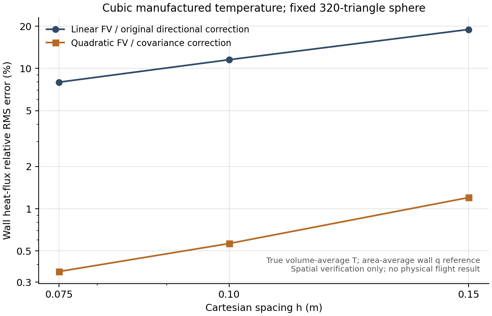

# 二次有限体积温度重构与曲面热流（v60）

2026-10-17。此阶段改善原曲面控制体的温度梯度空间精度，新增4个完整MATLAB实验模块。它们处理明确的温度体积均值，尚未耦合完整可压缩NS推进或生产区域求解。生产箭体热流面积仍为66.5626327424%，本阶段新增物理解面积0。

## 模块用途与运行

| 完整文件（`internalFlow/cutCell/`） | 用途 |
| --- | --- |
| `buildCutCellVolumeMoments.m` | MATLAB内部从原三角曲面、共享孔隙和聚合映射求二阶体积矩，以及开放面/墙片二阶面积矩；运行不依赖Python |
| `buildQuadraticTemperatureStencil.m` | 真实温度均值与Cov修正的9系数二次模板；沿正孔隙邻接扩展，长度/列缩放SVD满秩后接受 |
| `evaluateQuadraticTemperature.m` | 从明确的`volume-average-temperature [K]`及边界点输入求梯度/Hessian；质心点温与体积均值分别保存 |
| `quadraticTemperatureFourierFlux.m` | 在共享面质心平均两侧重构梯度，一面一通量保守积分；墙片直接使用局部二次梯度 |

```matlab
addpath('internalFlow');
setupCutCellFlow;
addpath('tests');
testCutCellVolumeMoments;
testQuadraticTemperatureReconstruction;
studyCubicTemperatureReconstruction;
```

测试从当前工程`outputs/v58_validation`、`outputs/v59_validation`及`outputs/v60_validation`读取冻结参考；交付包使用`validation/v58`、`validation/v59`及`validation/v60`。输出写入当前工程outputs。已用只有完整源码及这些明确输入的最终隔离目录实际执行三个入口，MATLAB PID47336退出0；不需要原E盘搜索路径。没有重跑旧六步NS试算、旧归档或v59三档二次误差研究。

## 均值与几何合同

每个控制体使用关于自身真实体积质心的协方差`C_i`，局部多项式为：

`p_i(r) = Tbar_i + g_i*r' + 0.5*H_i:(r*r' - C_i)`。

因此质心点温为`Tbar_i - 0.5*H_i:C_i`，不能直接把均值当点值。邻居均值约束的二阶项为`d*d' + C_j - C_i`；Dirichlet点值约束为`d*d' - C_i`。交叉Hessian系数不额外乘0.5。墙梯度为`g_i + H_i*d`，共享面取两侧在同一真实面质心的梯度平均；不再套用旧线性割线修正。

`buildCutCellVolumeMoments`用局部参考点、六项有向投影积分和边界散度恒等式求矩。原共享面/墙片二阶矩已用独立截面环与三点面积Gaussian积分逐项核对。矩对象绑定完整CV共享面和墙几何；模板构造及缓存使用时均核对身份，不能借用同体积/同质心但形状不同的Cov。正小墙片保留，秩不足、负Cov、旧几何和非有限通量均明确拒绝，不补零或裁数。

Dirichlet温度是墙片质心的给定**点值**，不是面平均；在非多项式数据下，它作为加权拟合约束，并不保证所有边界点的拟合迹精确等于输入。零法向梯度边界给定热流零，墙温保持未知；输入身份与推导通量分别保存。边界函数和均值都须由调用者按合同提供，声明标签本身不证明任意数据是真实均值。

## 二次再现与真三次精度

真实箭体及固定320三角面球体的8³/12³/16³控制体上，二次制造场的梯度、Hessian、墙热及Fourier散度可再现到舍入量；正式隔离版最大墙q误差约6.72e-11 W/m²。常量300K得到精确零热流。10类输入/缓存/秩/溢出拒绝（包括非实Hermitian Cov），以及零法向梯度不求墙温的合同已测试。几何矩完整测试的5个闭式例、大坐标平移及6类拒绝也在最终目录通过。

为避免只测试恰好可拟合的场，又采用：

`T(x) = 300 + g*x' + 0.5*x*H*x' + 8*(l*x')^3`，

`g=[8,-5,3]`，`H=[30,4,-2;4,-20,3;-2,3,10]`，`l=[0.6,-0.4,0.7]`（未归一化）。使用人工常导热系数2.4305555556 W/(m·K)，温度300K量级。

独立三阶体积矩给出真实T均值，独立二阶面积矩给出真实墙片**面积平均热流**。三次温度对应二次梯度，热流面平均与质心点值不同；本测试没有用后者冒充面积积分参考。该场存在制造压力梯度，不是无源NS稳态或飞行实验。

| 固定几何/控制体 | 旧线性q RMS，W/m² | 新二次q RMS，W/m² | 新相对RMS |
| --- | ---: | ---: | ---: |
| 实际箭体粗控制体 | 1.98984634 | 0.04197956 | 0.07043% |
| 球体8³，h=0.15m | 3.72284859 | 0.23597996 | 1.20181% |
| 球体12³，h=0.10m | 2.26611193 | 0.11097813 | 0.56513% |
| 球体16³，h=0.075m | 1.56791855 | 0.07011286 | 0.35700% |

新方法三档观察阶为1.86061/1.59630，旧方法为1.22433/1.28029。只证明本固定多面体、给定制造场和这些分辨率下的面积加权RMS改善；不能称完整二阶方法或工程/实验精度。球面最大误差为0.90695/0.47927/0.66330 W/m²，未随网格单调下降，因此不能将RMS改善推广为所有墙片最坏误差均已收敛。墙热功率误差与全域共享通量守恒也分别报告。



图中只有空间制造场误差，非真实空气飞行误差。独立Python逐模板、梯度及墙q复算与MATLAB结果一致；具体哈希、终态和谱审查范围见`docs/validation/v60/summary.json`。

## 完整区域求解前仍需完成的工作

一般可压缩守恒量均值经EOS求得的primitive温度，不自动等于温度体积均值。本接口会拒绝把`EOS-primitive-from-cell-average-Q`直接当T均值的声明。完整NS耦合还需一致的守恒量重构/热力学平均、特征边界、应力/黏性功、正性和更新后的步长模板。正均值也不保证多项式在所有点为正，当前没有热力学正性限制器。

独立冻结矩阵检查中，四几何的最大计算实部为-814.450/-136.627/-140.777/-142.313，体积度量对称部最大计算值为-802.484/-134.981/-138.400/-140.103；原矩阵单位是W/(m³·K)，只有另给体积热容量1 J/(m³·K)才同数值对应s⁻¹。球体8³另算全谱，其余为带残差核对的Ritz计算结果。负非对角项分别有11405/2910/9605/22410个，不能据此保证正性或最大值原理。这些结果仅针对所检查的固定Dirichlet标量子问题；不涵盖Neumann/特征NS边界，也不代替完整非线性NS或实际空气稳定性。

没有新时间推进，没有真实收缩/底部回流热流，也没有把短推进或有限数值写入生产有解区域。区域审计确认当前6061个未解面仍有真实外流/入口/区域模型缺口；单纯放宽旧层流参数或重播种不可恢复。后续优先推进已有可追溯依据的受限零攻角球鼻非相似层流分支，并继续主箭体横流—收缩—后体的一致外流；该球鼻分支不能直接给20°箭体或80°外球鼻区域计覆盖。当前单时刻全表面与科研UI目标继续执行。小版本本地交付，不推送GitHub。
