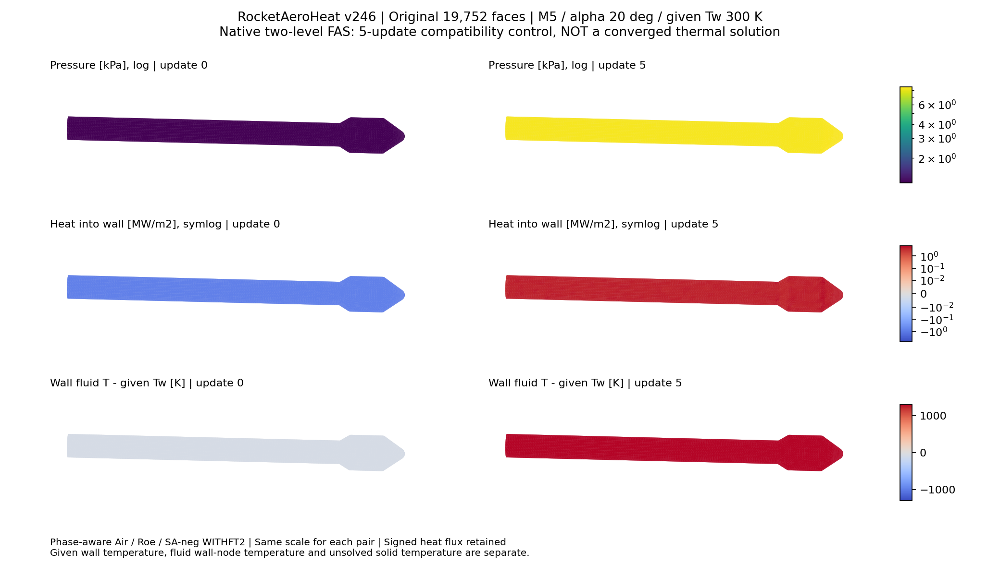

# v246 原真实网格两层FAS预检及完整五步控制

**真实完整箭体的固定两层几何预检与5步flow-SA兼容控制通过。** 观察开/关结果逐位一致，原面压力、热流和壁面流体温度已接工作台；目前仍是未收敛研究，新增合格热面积为0。FAS能否改善实际收敛和热精度尚未证明。

## 真实几何与初始化

原335726点、705490单元、19752壁面及1.9646292565715553 m²完整保留。原下游在同一物理域中求解，1984区域接口只作观察索引，没有人为出口。32层2µm及历史19层尾缘资产不变。

固定一层原生聚合得到44484粗点；9878细壁点对应3203粗壁点，3288远场点对应801粗点。父子覆盖、体积、边界类别/矢量法向及原面全球编号独立核对通过。粗壁法向模相对子壁法向模之和的最小比值0.7468062153，远场最小0.7071278205，没有出现v245小壳的整壁法向抵消。方向与法向邻点超过舍入可辨识界不等于网格热精度或空间无关。

唯一零流动初始化12.344秒exit0，采样峰1664020480B。760420保存状态联合域通过，原坐标/网格逐位不变；公开体积限制与物理能量最大缩放差7.890e−16。初始化温度226.5090836 K、压力1197.0279007 Pa。此阶段只调用公开原生体积限制；private完整FAS壁投影/SA限制没有被仿写或绕过。

## 真实完整FAS控制

采用同相容均匀新初场、相态Air身份15、Roe、隐式Euler、SA-neg WITHFT2，M5/30 km/α20°/给定Tw300 K。固定V-cycle、MGLEVEL=1、生产最小粗层500、预平滑(1,1)、后/修正平滑(0,0)、限制/延拓阻尼0.5、关闭MG平滑自适应；原CFL自适应保留。没有重启旧199/300等场、扫描参数或修改数值内核。

| 项目 | 真实证据 |
|---|---|
| 原生控制 | 观察开49.765秒、关闭36.657秒，均5完整flow-SA更新、exit0 |
| 内存 | 最大采样进程组RSS2431864832B，1CPU；不是精确瞬时峰 |
| 开关一致性 | 细层0/1/5、粗层0/5、history和原生末restart逐位同 |
| 初始化对应 | 两个薄入口的几何/五量/SA/涡黏度逐位同，4个primitive缓存列只有舍入差 |
| 完整阶段 | 80条细层记录、100条层记录、45次层间回调，19010500次原生联合域状态访问无拒绝 |
| 独立保存检查 | 1096146状态，52个极值/分布点另用Brent交叉核对 |
| 真实壁/SA | 粗壁无滑移、SA及涡黏度限制通过；20个同阶段细层壁热记录通过 |
| 层间质量/能量 | 5个真实循环的限制/延拓体积积分，最大缩放差1.265e−16 |
| 原生末CSV | 全部坐标、五流动量与SA和完整末帧逐位同 |

仅构建薄入口，所有成熟聚合、FAS、流动、物性、边界和SA对象复用v245准确归档。实际private壁投影与SA限制由完整原生循环自己调用。当前所有状态合法，不代表之后任意更新都合法或收敛。

## 结果语义与尚未通过的门槛

FAS将细层`LinSysRes`改为延拓修正，因此旧34列二进制的零基27～31列是**修正量，不能当末流动残差**。`field_semantics.json`明确这个身份；以`stages.csv`的细层`after_time`记录绘制平滑阶段物理残差。该阶段在粗层修正之前，不能冒充最后完整循环的残差。粗层末primitive也是更新前缓存，当前状态必须由保存守恒量反解；不同阶段不混比。

末细层平滑的六式logRMS约−3.278/0.204/−0.934/−0.206/3.072/−3.162，未达原−8。末完整循环残差、全域稳态收支、p/q稳定、空间/外域/近壁与实验热验证均未通过；没有放宽任何门槛。

更新5原面压力8.345～8.595 kPa，入壁热流3.010～7.122 MW/m²，研究热功率8.723 MW；壁流体温度1589.48～1598.65 K，给定壁温300 K仍另列。这些明显处于启动阶段的数字不能用作工程热环境或固体温度结论。固体Tw保持未知，负热流和真实零值不会被删改。

## 科研出口

`outputs/v246_validation/workbench01/index.html`复用既有WebGL，提供0/1/5三阶段14字段、同变量固定色标、面元方法与状态、周向查看及原导出能力。237024原面研究值逐数回读和前端实际纯函数检查通过；主共享web文件未修改，没有浏览器交互或MATLAB验收。

## 失败与存储

首薄构建3.516秒因访问private包装失败，准确失败源保留；改用公开体积限制，恢复薄构建5.921秒。真实控制薄构建6.375秒，成熟数值对象零重编。

首完整审核6.828秒误要求不同薄入口的4个初始primitive缓存逐位同。几何/守恒态以及同入口开关的逐位门槛保持，恢复按既定物性数值误差核对缓存，7.281秒通过，无CFD重跑。导出脚本首次多一括号，解析即停、未进入监督/执行，旧源保留；修正后3.078秒监督通过。科学与软件失败不互相替代。

7组逐字相同控制副本已建立硬链接，两套路径及原SHA保持，减少535916990字节重复内容；未测NTFS实际分配字节，不把逻辑长度称精确磁盘释放量。首整理回执合计字段为null，逐文件记录完整；独立求和及硬链接身份的更正回执另存，原回执保留。独有场、旧结果和保护资产均未删除。

源码、小证据和目标同步GitHub，完整体场留E盘。用户本地基准补充与并发web修改保持，未发布本地补充。总目标active。下一项是[同固定真实组合的一次有限发展](validation/v246/NEXT_DECISION.md)，不再重复零流动预检或5步控制，也不把兼容通过当作全面积气动热完成。
