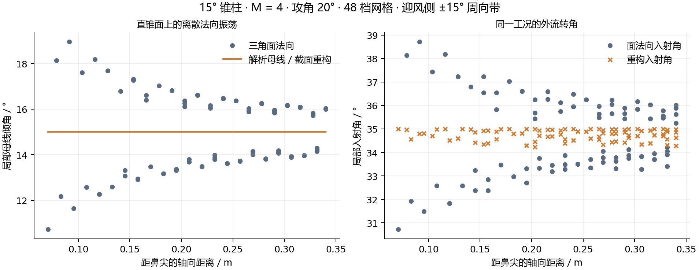

# v47：有攻角锥柱的离散法向误差修正

本版解决一个可以复现的数值问题：15° 锥柱、M=4、20 km、20° 攻角、48 档网格，在 v46 中热流全部被阻断。三个面元的疑似层流分离沿准流线传播，覆盖大部分模型。进一步检查发现，周向节点数变化的拉链三角形使本应光滑的直锥母线出现明显法向振荡。

代表路径的入射角为 30.72°→38.14°，外缘速度为 848.74→636.19 m/s。这不是解析 15° 锥面的实际母线折角。修正入射角几何来源后，该路径约为 35.00°→34.97°，原先的三个疑似分离起点消失；没有改动 Thwaites 分离阈值、转捩阈值或下游传播规则。



图中周向带宽为迎风侧 ±15°，因此重构入射角仍随周向变化，并非强行统一数值。

## 几何条件与处理范围

新增 `reconstructSectionNormals.m`。每个圆截面至少八个节点，最大周向间隔不超过 45°，圆拟合最大径向误差不超过 0.3%。三个相邻环带的母线倾角差不超过 0.5°，四圈圆心的偏移不超过局部最小半径的 0.3%，才允许用局部直母线及径向方向构造入射角法向。修正角不得超过 15°。

跨圆柱/锥面肩部的窗口因斜率变化被拒绝；端盖、端点邻接、特征折角、拓扑问题和非圆截面保留原三角面法向。坐标、连通关系、三角面面积、局部几何法向、修正牛顿压力/受力结果均保持原样。工程外流的速度方向仍投影在实际三角面切平面上。

节点共圆是几何重建依据，不证明真实 CAD 表面必然光滑。对于有意建模的多面体，或需要做离散模型对照时，可设置：

```matlab
cfg.externalFlow.normalModel = 'facet';
```

默认值为 `'validatedSections'`。法向重构不提供新的外流物理模型；切楔、膨胀、切锥及边界层仍保留各自工程近似的限制。

## 状态与界面溯源

`mesh.boundaryLayerEdge.incidenceNormal` 和 `incidenceAngleDeg` 保存外流实际使用的转角；`normalReconstruction` 保存逐面元是否应用、修正角、配置模式及检查状态。

WebGL 面元拾取的外缘压力/温度算法名称会附带“三角面法向入射角”或“校验圆截面/直母线重构入射角”。轴向波系推进结果独立注明来源。修正牛顿压力字段继续表示其自己的面法向模型，不与外缘压力混用。

## 验证结果与范围

- 新增测试检查解析锥面法向、肩部保护、椭圆拒绝、平移/缩放不变性、facet 模式、原压力结果不变，以及有攻角完整链路。
- 层流强减速和 Head 湍流分离等相关测试仍通过，说明真实判据没有为了提高覆盖率而关闭。
- 相关既有回归 6/6 通过：层流边界层、Head 模型、准流线、查看器数据、真实箭体外流和轴向波系推进。另有新增重构测试通过；没有声称整个测试库重测。
- 20 个经典工况已完成，详细记录见 `validation/v47_report.md` / `.json`。其中 48 档锥柱 20° 攻角的热流计算面积由 0% 恢复到 68.34%。这表明去掉了由已确认的几何离散误差触发的阻断，不代表热流误差已经通过实验验证。
- 真实箭体 10° 攻角计算面积约 80.23%，与 v46 的约 80.24% 接近；不是所有算例的覆盖率都会增加。本次零攻角外流测试约 12.5 s，未进行严格性能基准。

剩余问题包括未连通的有攻角区域、粗网格钝体的起点敏感性、底面/尾迹和分离再附模型。未解热流保持 NaN，给定底压仍单独标注。科学 UI 的热历史浏览和全流态模型尚待完成。

## 复现

```matlab
addpath('tests'); testSectionNormalReconstruction;
report = runCanonicalBenchmarks(fullfile(pwd,'output','canonical'));
% 对照原面法向：
options = struct('kinds',{{'coneCylinder'}},'resolutions',48, ...
    'alphas',20,'normalModel','facet');
baseline = runCanonicalBenchmarks(fullfile(pwd,'output','facet'),options);
```
