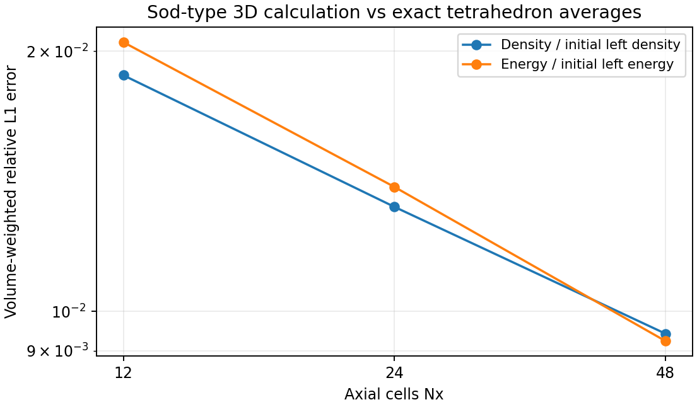
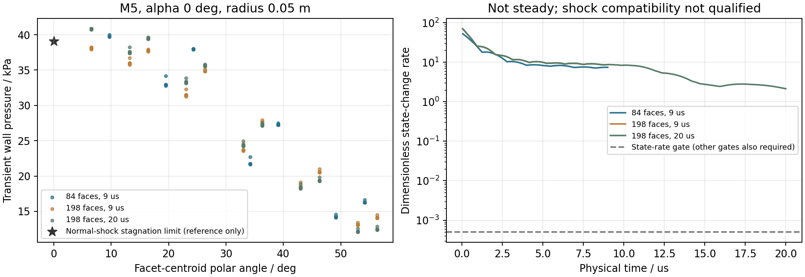

# v102 非均匀三维推进、球鼻候选和科研工作台

本阶段已完成数值内核测试、独立数据核对和实际浏览器验收。它是受限的研究模块，**球鼻区域资格仍未通过，新增正式热流面积为0**。项目已有正式热流覆盖率仍为66.5626327424%；当前Q41仍未稳态，单时刻全面积和全周期目标继续有效。

## 实现的方法与边界

- `buildShockFittedBoxMesh`构造Sod型三维四面体波管；`buildShockFittedSphericalCap`构造完整周向球鼻三角壁面及分层体网格。内部五量、横向速度和共享面均实际计算，没有将解析解或轴对称剖面复制进流场。
- `shockFittedBoundarySpeed3D`由下游单元状态和明确上游的法向精确Riemann问题求右压缩波速度，再回代移动RH。它不是直接复制内部压力，也不是已验证的曲面边界层外缘。
- `shockFittedShellMotion3D`固定壁面与径向射线，用面面积加权的全局稀疏最小二乘拟合面重心法向速度，内层线性随动。保留逐面投影残差，法方程驻定性门槛2e-10保持。原逐节点独立平均未求解这个全局目标，原问题版本和cap01结果保留。
- `shockFittedTimeStep3D`计入实际非均匀状态、Riemann波扇和明确边界波系。三维ALE共享面推进保留五量账、离散GCL、固定壁面和实际拒绝记录；类型4出口仅允许全部特征出流，`un-D>a`不成立即拒绝。
- 动态推进当前只支持明确的常gamma气体。NASA7此前仅核验RH/活塞相容，本阶段没有实现NASA7 ALE，不作静默替换。
- 预算含调用者保留数组、一步输入和声明的内部工作数组，是区域数组上界声明，**不是MATLAB进程峰值**。检查点保留来源身份，并用显式`.writing.mat`临时文件提交；续算须匹配输入、几何和计算来源。

正常压力/流体温度/速度、Riemann壁压、热流、外缘Te、恢复Tr、给定Tw和求解Tw分别保留方法和状态。流体温度不冒充外缘或壁温，无黏模型的零热流不算已求气动热。

## 非均匀基准的实际结果

独立Python审核采用Brent压力根、实验室系Riemann取样、Gauss几何和四面体体平均Sod解析解。后者按X投影的Beta(k,4-k)权重在波前处分段积分，没有把重心值当成体平均。

| Nx | 实际接受步数 | 密度L1/rhoL | 能量L1/eL | 横向RMS速度 / m/s |
| ---: | ---: | ---: | ---: | ---: |
| 12 | 86 | 0.01876079 | 0.02049092 | 10.5766 |
| 24 | 152 | 0.01320949 | 0.01393096 | 6.63327 |
| 48 | 287 | 0.00942056 | 0.00923762 | 3.66036 |

密度/能量误差随这三组加密下降；没有从三个点宣称高阶收敛。横向数值速度没有清零。独立末步通量差约1.8e-13，全步五量账约1e-16；旋转/Galilean物理尺度误差约1.44e-15。NASA7、非压缩波和非法出口拒绝及合法出口实际测试。



## 球鼻候选仍未满足区域条件

这是M5、零攻角、半径0.05m、截到60°的独立球鼻。仅复用原20°输入的p/T/rho/R及速率，**不是原20°箭体流场**。

| 项目 | cap02粗网格 | cap03细网格 | cap04细网格续算 |
| --- | ---: | ---: | ---: |
| 壁面 / 四面体 | 84 / 756 | 198 / 2376 | 198 / 2376 |
| 物理时间 / µs | 9 | 9 | 20 |
| 累计接受步数 | 196 | 278 | 678 |
| 无量纲状态变化率 | 7.4263 | 8.7149 | 2.13586 |
| 激波压力相容差 | 0.4627 | 0.3338 | 0.34594 |
| 最大未表示面速度 / m/s | 198.73 | 147.91 | 176.23 |
| 壁压范围 / Pa | 14146—39986 | 13067—38255 | 12072—40855 |
| 声明区域数组上界 / bytes | 18803688 | 57263788 | 58977938 |

独立通量、GCL、状态更新、全步五量账、SVD运动核对通过。cap04出口法向Mach最小仍为1.827。六步整算与三步加三步续算逐位相同。

但候选仍未稳态，激波相容差约34.6%，面速度残差明显。球面面元弦高误差粗1.41mm、细0.647mm，未达到原10µm几何条件。正常激波后等熵驻止压力39087.11980786282Pa只作解析极限参考，不能当整个球面压力实验验证或据瞬态最大壁压授予驻点资格。



上述结果不能作为合格Te/边界层入口；热流与壁温未求，生产资格全部false。

## 实际科研界面与独立导出核对

同一五步骤侧栏保存8个算例、16帧，支持逐面云图、真实3D拾取、任意X输入/滑块、周向交线与曲线及CSV。比较球鼻采用固定0—45000Pa色标；Sod采用0—110000Pa。截面更新不重置相机，0/360°拆段、开放/分支及未知值断开保持。

这仍是**已保存研究的查看器**，其中“计算”明确显示不启动新求解；不能将它当成完整实时全面积主程序。没有修改OpenCode正在编辑的`viewer.js`、`section.js`等文件；截面内核固定复制自已发布版本，SHA为00b6c92807a0df4261672dd337f67b2357ebcf1115d508addfa175e0d5e7187c。

- Node：40个流程事件、11500个探针、42份周向CSV、12650行合计CSV、84次导出、11类消息拒绝、21个几何子集及空交线无循环通过。
- 独立Python：56412个MAT场量、原V/F和面号、42份CSV的1154段交线通过。采用重心线性约束/SVD裁剪及KD树连通性，未调用同一JS截面算法自证；最大交点差6.22e-17m、角度差8.53e-14°。
- 实际浏览器：五步骤、三维点击联动X、输入0.04m、滑块至0.03375m、36段周向交线、未知热流灰色/0有效值、逐场量算法与SHA、初末帧和原整箭未知身份均已检查。
- 实际波管面元55在X约0.022222222m处，初始压力10000Pa，末帧30313.724Pa，流体温度299.06052K，速度292.7867m/s。球鼻点选边界面21对应球鼻面19，流体压力38986.933Pa、壁压39645.781Pa。
- CSV实际落盘，36行独立几何/场量复核通过。DOM文本框会把CRLF规范为LF；已保存原下载及预览，文本规范化后相同，不能宣称原字节相同。
- 本次tab捕获时段内warn/error日志为空，不将其推广成所有历史浏览器日志均无错误。截图、AX与下载证据见`docs/validation/v102/browser/`。

旧v101查看模式的43728探针/CSV行、14次导出、10项拒绝、8个子集及旧导出的13560个字段回归保持。

## 来源、原问题和复现

9项实际MATLAB任务均终态、exit0、全锁源稳定。核对883项精确MATLAB/实际UI版本及12个显式输入。运行时53份CRLF源码约1.03MB按原字节另存，避免Git LF规范化改变历史SHA。没有声称所有无关全快照原文都已归档：motion测试不调用的一个曲面求解器中间版本未当成实际依赖，OpenCode无关MATLAB测试亦不纳入本次交付。具体来源和排除依据在`provenance.json`。

首轮dynamics01数值任务exit0，但报告误展开为3×1结构体；后续修正报告并重新核对，不能把该报告错误写成物理求解失败。cap01旧局部节点平均的原文和数值问题保留。独立导出检查的旧字段名/旧状态标签读取错误、来源检查的未调用全快照版本，以及CRLF字节检查的中间记录均保留，没有通过重算数值覆盖失败。

新的复现必须用新目录，不加载不匹配来源的历史检查点。例如MATLAB中先生成内核基准，再运行动态检查：

```matlab
addpath('tests');
inputFile='tests/data/shock_layer_transport/parabolic_shock_layer_evidence.mat';
testShockFittedALEKernel('outputs/repro_v102/kernel',inputFile);
testShockFittedDynamics('outputs/repro_v102/dynamics', ...
    'outputs/repro_v102/kernel/shock_fitted_kernel_evidence.mat');
testShockFittedMotion('outputs/repro_v102/motion');
testShockFittedCapResume('outputs/repro_v102/resume',inputFile);
studyShockFittedCap('outputs/repro_v102/cap',inputFile,210,9e-6);
```

正式运行建议经`scripts/runMatlabResearch.py`绑定每项实际进程、源码、显式输入和日志；独立审核入口为`auditShockFittedDynamics.py`、`auditShockFittedCap.py`。导出需配合同源、已完成的审核，不直接授予资格。工作台独立检查入口为`auditShockFittedDynamicsExport.py`；来源核验为`auditShockFittedDynamicsProvenance.py`。小型数值参考在`tests/data/shock_fitted_dynamics/`，明确不是实验数据。大型MAT保持本地，不生成ZIP或重复工程。

理论说明参见[精确Euler Riemann问题](https://faculty.washington.edu/rjl/riemann_book/Euler_equations.html)与[NASA 2020激波拟合研究](https://ntrs.nasa.gov/api/citations/20205002191/downloads/AIAA_Paper_Final_V4.pdf)。当前是低阶三维有限体积候选，没有复现后者的高阶有限元、切向重分布或DIRK，也不能借用其收敛阶。

## 下一起点

不重跑本轮终态任务、旧局部平均或Q41，不靠延长步数或放宽门槛授予资格。先研究并验证激波处下游特征的一侧界面重构，区分边界状态误差与前沿运动空间不能表示的误差；再选有预算且共享一致的前沿/内部网格运动及真实壁面加密。自由3D节点能降低代数残差但试探需约2822m/s节点速度，不能将此当作已采用或合格方案。

原10µm、无穿透、同cp能量/熵、80—2000K、稳态、相容性和网格/外域条件保持。通过后接v96外缘、v61边界层和真实原面元。真实20°横流—31°收缩—后体、分离/再附、底面及突起仍需适用区域模型，与统一科研UI一同推进；通用Euler研究不是其他工程区域或UI的前置条件。累计热量、轨迹和跨流态扩展继续后置。
