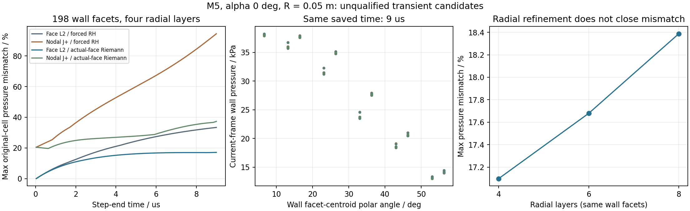
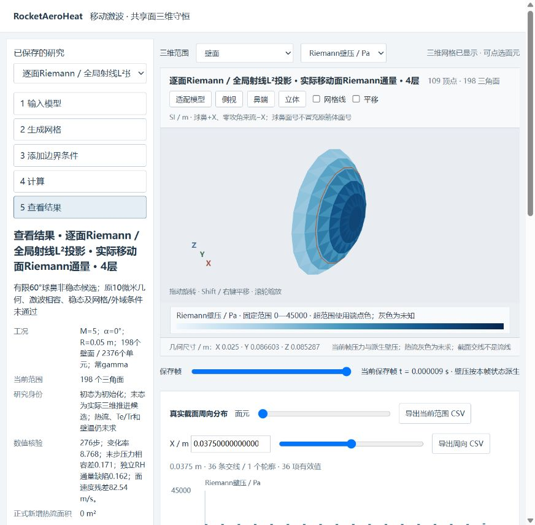

# v103 界面方法对照与当前帧科研工作台

本阶段已完成实际数值试验、独立核对和浏览器验收，纳入本次GitHub交付。**所有球鼻候选仍未取得工程区域资格，新增正式热流面积为0。** 单时刻全面积气动热和全飞行周期目标继续有效。

前五项MATLAB任务沿用原已终态结果，本轮追加“节点运动与新通量组合”“6/8层敏感性”“当前帧工作台导出”三项任务；共核对8项实际任务，均终态、exit0、运行期间源稳定。没有重跑旧Q41、已清理矩阵或整套历史研究。

## 算法与适用范围

`reconstructShockFittedTrace3D`用内部邻接单元的距离加权最小二乘/SVD恢复边界面上的线性迹。`reconstructShockFittedNodalTrace3D`从真实节点关联流体单元出发，以四未知仿射拟合求唯一共享节点状态；共同斜率系数仅用于原密度、压力和80—2000K物性域约束，不改写单元五量。

`shockFittedCharacteristicSpeed3D`采用常gamma局部法向声学不变量J+与移动RH的压缩分支求根。`shockFittedNodalMotion3D`按实际三角面面积法向求节点速度，壁面固定、内部层随动。它没有实现完整三维特征导数，也不意味着原逐面Riemann目标已被满足。原逐面目标和投影残差仍保留。

`advanceShockFittedALE3D`增加显式类型5：在**实际网格速度处**采样内部—上游精确Riemann问题。原类型3的RH强制通量及默认推进保持。数值通量与上游F−DQ的五量缺陷、原单元压力与移动RH压力之差分别保存；通量缺陷为零不能替代压力相容、稳态或几何资格。

9个已知平面激波的移动面/旋转/Galilean解析算例通过，通量误差约7.51e−16，旧六步数值逐位回放；两种运动配合候选通量均通过六步整算与三加三续算的逐位检查。NASA7、非压缩分支、预算越界和切换方法的检查点明确拒绝。线性场拟合检查属于数学校核，不是曲面外流或实验验证。

## 真实运行的六组对照

这是M5、零攻角、半径0.05m、截到60°的独立球鼻，固定198个三角壁面，研究终点均为9µs。原20°输入只复用p/T/rho/R和速率，**没有求出原20°箭体外流**。前四组的初始五量和节点逐字节相同；六组的壁面V/F、上游与气体参数相同。

| 方法 | 法向层数 | 实际步数 | 末步原单元压力相容差 | 最大RH五量通量缺陷 | 最大未表示面速度 / m/s |
| --- | ---: | ---: | ---: | ---: | ---: |
| 原逐面L² / RH强制通量 | 4 | 278 | 33.3827% | 0（强制恒等） | 147.907 |
| 节点J+ / RH强制通量 | 4 | 275 | 94.4655% | 0（强制恒等） | 321.555 |
| 逐面L² / 实际移动面Riemann | 4 | 276 | **17.0978%** | 0.162006 | 82.543 |
| 节点J+ / 实际移动面Riemann | 4 | 275 | 37.3172% | 0.318370 | 203.743 |
| 逐面L² / 实际移动面Riemann | 6 | 380 | 17.6788% | 0.169312 | 86.145 |
| 逐面L² / 实际移动面Riemann | 8 | 485 | 18.3871% | 0.172159 | 87.095 |

表中的压力/通量指标是最后一步输入态与时空平均几何的诊断；对应输入时刻分别保存，不能将其称为所有方法在9µs瞬时状态上的同一取样。图中横轴为步结束时刻。当前帧的主体压力与派生壁压则严格取各自保存时刻。

新通量降低这组末步相容差，但节点方案没有改善结果，法向加密也没有使相容差下降，不能宣称网格收敛。四层新通量的无量纲状态变化率仍约8.77，未稳态。壁面弦高仍约646.5µm，未达到原10µm条件。没有合格的边界层外缘、热流、恢复温度或壁温新增结果。

独立Python用实验室系Brent Riemann取样、四点Gauss时空几何、带列主元QR节点拟合及Brent特征根核对。六组末步通量相对差最大约1.05e−13，全步五量账约1.30e−14；最大声明区域数组预算112,281,924字节，低于128MiB。预算是数组上界声明，**不是MATLAB进程峰值测量**。



## 当前帧与末步诊断的界面修正

新增`exportShockFittedInterfaceStudy`，在同一五步骤侧栏比较六组、12个保存帧。云图、面元探针和真实X截面周向曲线采用同一帧；压力比较固定0—45000Pa，未解热流及Te/Tr/给定Tw/求解Tw分别标识。

旧研究导出把`lastStep.wallPressurePa`标在终态时间，但该壁压来自上一时间步输入态。本页按**当前帧五量、当前固定壁面法向及零壁速镜像精确Riemann**派生壁压，和其他主体字段同一时刻。原末步壁压没有改写，仍在独立折叠诊断面板中显示输入态时刻及平均几何时间段。

诊断面板保留质量、X/Y/Z动量、能量五个归一化RH通量缺陷，以及原单元压力差、节点重构压力差、请求/投影/时空平均网格速度及算法说明。类型5外壳可正常选择。42列面元CSV明确分开当前帧时间、壁压时间和诊断采样时间；完整箭体仅作未知场量的几何参照，其物理时间留空，来源绑定原几何而非球鼻候选。

这仍是已保存研究的查看页。“计算”步骤明确显示不启动新求解，**不能称作已完成的实时全面积主程序**。`main`仍是现有统一可编辑工程入口。



## 验收与来源

- 当前页Node操作：30个流程事件、11,668次面元探针、36份周向导出、33,144行合计CSV、73次导出、11类无效消息拒绝、18个实际几何子集通过。
- 独立MAT/导出核对：68,148个场量与诊断值、原19752面V/F、36份CSV的1728条真实交线通过；最大交点差4.91e−17m，当前壁压独立相对差约2.00e−13。
- 实际浏览器：五步骤、类型5外壳、三维点选第61显示面→球鼻面59、截面联动、滑块与实际键入坐标、未知热流及原整箭未知身份均检查。该实点流体压力34773.367Pa、流体温度1231.1069K、当前壁压34848.23Pa；这些均是未合格候选数值。
- 实际下载：X=0.04m的36条周向CSV已落盘并逐条核对原三角形重心坐标、当前壁压、时间与来源。第一次程序化fill没有提交change事件，实际键入不同数值并失焦后完成提交；先后下载记录按实际截面保留，不把输入框文字当成已更新的曲线。最终文件SHA见`browser/native_download_audit.json`。
- 旧v102数据配合当前JS资源通过11,500探针、42份周向CSV、12,650行、21个几何子集回归；没有复制完整工程或修改冻结视图。首版兼容包装器的目录层数错误发生在测试执行前，原文与修正记录保留，未改写物理任务退出码。
- 来源：8项实际MATLAB进程、17份显式输入及49项保守MATLAB调用闭包/实际UI源码版本逐项绑定原字节；没有声称无关900余项全快照均另有副本。独立审核、浏览器证据和精确来源见`docs/validation/v103/`。

本tab检查窗口读取的warn/error记录为空，不推广为所有历史日志均无错误。本阶段是解析与数值校核，**没有新增实验验证**。理论背景仍为[精确Euler Riemann问题](https://faculty.washington.edu/rjl/riemann_book/Euler_equations.html)与[NASA 2020激波拟合研究](https://ntrs.nasa.gov/api/citations/20205002191/downloads/AIAA_Paper_Final_V4.pdf)；这里的局部J+及低阶有限体积没有复现后者的完整高阶方法或精度。

## 复现与下一起点

必要的292,650字节原六步输入按原SHA保存在`tests/data/shock_fitted_interface/legacy_six_step_evidence.mat`，数值对照摘要在同目录`reference.json`。它们是数值回归输入，不是实验数据。大型历史输出与本轮完整MAT仍保持本地；源码、小型输入、图、测试和验证资料同步GitHub，不生成工程ZIP。

可在全新目录运行解析/续算检查及新通量球鼻；完整方法选项均显式指定：

```matlab
addpath('tests'); setupShockFittedFlow;
testShockFittedBoundaryFlux('outputs/repro_v103/boundary', ...
    'tests/data/shock_fitted_interface/legacy_six_step_evidence.mat');
spec=struct('rings',6,'azimuths',18,'layers',4, ...
    'motionMethod','face-riemann-L2','shockFluxMethod','upstream-riemann');
studyShockFittedCap('outputs/repro_v103/cap', ...
    'tests/data/shock_layer_transport/parabolic_shock_layer_evidence.mat', ...
    1000,9e-6,spec);
```

正式复核经`scripts/runMatlabResearch.py`绑定实际进程、源码和显式输入，再用`auditShockFittedInterface.py`审核；导出必须提供每份MAT的同源审核。对应入口为`exportShockFittedInterfaceStudy`、`testShockFittedInterfaceStudy.js`及`auditShockFittedInterfaceExport.py`。历史检查点要求精确输入/方法/源码身份；新运行必须使用新目录，不套用旧容器SHA。

8项任务全部终态，不等待或重跑本轮，也不靠延长时间或继续加径向层数制造资格。保留`cap02`作为四层新通量的未合格参考，`view01`为当前查看起点。若继续界面研究，先使实际面通量和共享前沿运动使用一致的流体侧迹，再验证受控切向重分布/前沿表示与真实壁面条件；原10µm、无穿透、同cp能量/熵、80—2000K、稳态和外域条件保持。

主线优先回到真实20°箭体横流—31°收缩—后体的大面积工程区域、分离/再附和底面，检查有来源方法的实际入口与适用范围，立即接回统一科研UI。不能把通用Euler研究作为这些区域/UI的前置条件，也不以覆盖审计替代物理解。当前单时刻全面积和科研UI仍并列最高；累计热量、轨迹和跨流态扩展后置，完整目标保持进行中。
