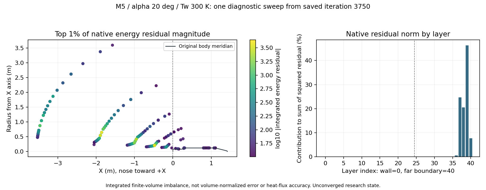
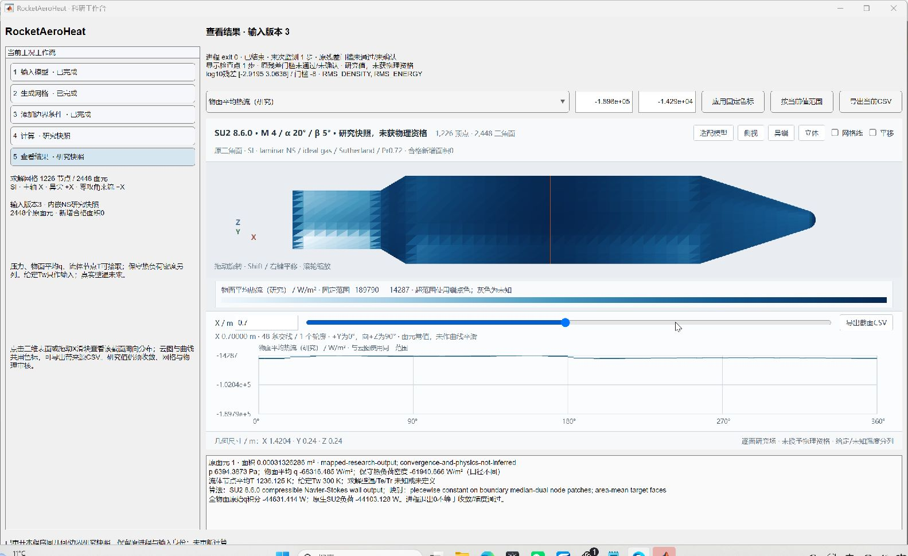

# v110：下游空间残差定位与主工作台收敛身份

2026-10-31。已完成定向测试，随本次提交交付。复用v109的3750步检查点，定位了原生残差范数的主要贡献，并将收敛审核接入主工作台。**未完成三维收敛，新增合格面积0，总目标仍进行中。**

## 数值诊断改变了下一步方向

保持v108完整原生箭体的59122节点/58560体单元/2448原面、M5、α20°、β0°、Tw300K、全部六区及原NS物理条件。只从已有检查点执行一次原生诊断迭代，增加节点残差、网格质量和CFL/线性历史输出；没有重新初始化、延长v109或再跑平板。实际计算使用2线程，3.094秒退出0；这个退出状态仅证明诊断完成。

初次配置因误加8.6.0不支持的`WRT_MESH_QUALITY`而在0.266秒退出1，未执行数值迭代。核对官方`CConfig.cpp`后确认`VOLUME_OUTPUT=(..., MESH_QUALITY)`会自动启用。失败配置、源码和回执全部保留，在新目录修正后运行。

官方`CFlowCompOutput`导出的`Residual_*`来自`LinSysRes`。本次是从3750步状态进行**一次新的离散评价**，不是原3921步或3750步已保存的空间残差；同一输出中的解变量处于迭代更新后，不能把它们当作旧原态。独立词法解析59,122节点，将五个残差的RMS与同次原生历史核对，最大log10差1.91e−8。

| 原生能量残差平方贡献 | 比例 |
| --- | ---: |
| 近壁壳外（层25—40） | 99.9065% |
| 箭体下游X<0 | 99.7423% |
| 最外边界节点 | 7.6930% |
| 正交角小于15°的节点 | 0.01483% |

最大贡献节点为57347（0基编号），坐标约(-1.855758, 0.323892, 0.560997)m，层39、正交角87.30358°，单点占能量残差平方和17.5468%。最差正交角仍为6.975203°，位于层25，**最差网格角所在位置不是当前范数的最大贡献位置**。这不证明低质量单元没有影响，也没有证明外域边界是唯一原因。

统计另按壁面拓扑标签贯穿各层，界面节点等权分摊；“收缩标签约73.02%”指从该壁区延伸出的网格列，许多节点实际已在箭后外域，不能写成收缩壁面热流误差73%。这些是**控制体积分通量不平衡**，大外层控制体会影响原生RMS，未除控制体积，不能推断局部物理误差或称壁热准确。15°只是诊断分箱，不是新增质量验收门槛。

## 可复用审核及实际主UI

新增`auditSU2ResultConvergence.m`读取原配置收敛字段、门槛、起始迭代和完整历史，核对原回执的配置/历史/壁面/重启动SHA。不同的三个身份分别保存：进程终态、末次监测、实际显示检查点。热负荷按原生节点面积口径唯一关联输出时刻，随后用重启动EOS核对壁面p/T；不是拿物面平均q积分代替原生HF。

- v109超时：显示3750步、末次监测3921步；两者原残差门槛均未通过，检查点EOS一致。
- v108已收敛平板：末次23477步通过原−8门槛，但17个输出候选的HF已进入同一平台，单凭负荷无法唯一回溯时刻。因此显示迭代保持未确认，不因进程退出0或残差通过而强行指定末步。以后需原生写出事件的显式迭代绑定。
- 反例覆盖文件SHA变化、稀疏历史、重复热负荷和缺证据。前两者拒绝，后两者保持未知；均不升级资格。
- MATLAB会截断超过字段名长度的JSON路径键，长绝对路径可能碰撞。现在配置SHA及所有输入稳定性检查读取原始JSON键；不通过截断字段取配置散列。
- 便携快照缺少重启动时，只有同一真实进程回执才能从保留的原运行目录补证据；原目录不在时仍明确未确认，不伪造输入快照。

主工作台结果页增加固定三行审核说明；完整面场CSV及截面CSV的身份JSON携带同一审核结果。真实MATLAB窗口已检查，场与截面导出逐项一致。截图用已有v107 M4/20°/5°的第1步研究快照，**不是本轮M5空间诊断或v109超时场**。没有生成假`input_snapshot.mat`冒充v109原工作台运行。

本轮5项MATLAB均实际终态，1成功、4失败：首次测试错误要求平板HF唯一；随后发现长JSON键问题、便携快照漏查重启动、JSON空值回读形状误判。已分别修正代码或测试，并保留所有准确来源。最终`audit110_05`通过且源码稳定。独立Python审核曾因CSV引号前空白失败，修正解析后通过，没有修改物理数据。

当前主流程仍按既有规则拒绝自动接收失败/超时任务，超时审核已有独立测试；**尚未增加主流程显式重开超时检查点的操作**，不把本轮审核能力写成这项操作已完成。

## 下一步直接从这些结果继续

先对原生控制体积作可核对的归一化，并检查下游外层的特征出入流、尾流分辨率及高阶重构响应；在同一3750检查点上选择一个有区分力的离散/边界对照，运行前固定壁压/热流变化、残差和预算指标。可考察短时低阶启动再恢复高阶，不能把永久增加耗散或删尾流当物理解。不要仅凭全域最小角加层，也不要直接延长原任务。诊断不替代真实19752面目标、突起、分离/再附/底热及适用RANS/非定常的验证。

同步补写出事件的显式检查点迭代绑定，以及主工作台同工况超时检查点的受控重开。保留现有五步骤、任意截面及温度身份，不重复v109截面全套检查。2线程、单任务≤720秒、研究输出目标≤100MB和连续两轮无改善复审规则继续。完整单时刻与科研UI仍并列最高优先级，全周期和累计热量后置。
