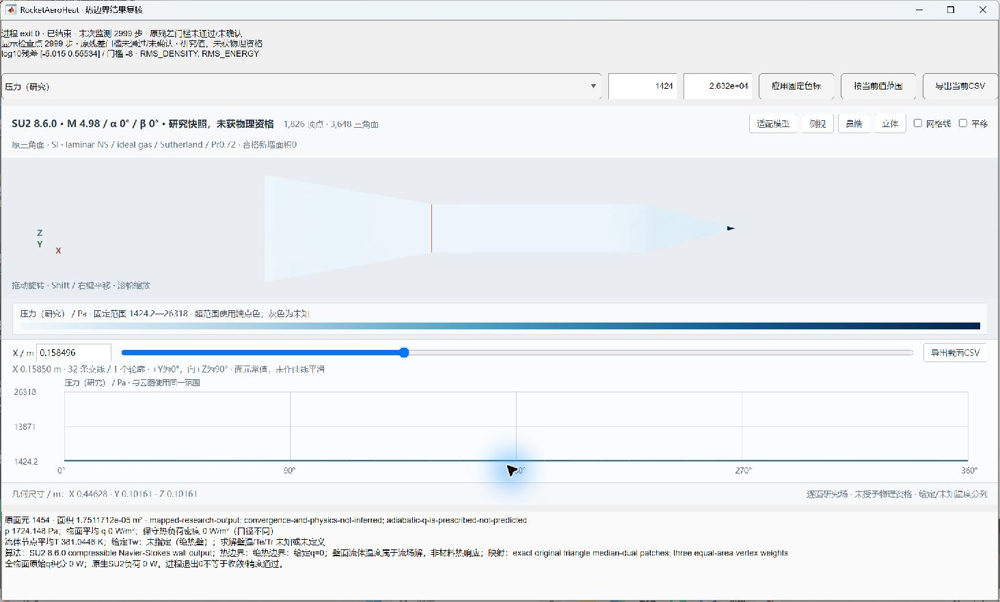

# v114：经典完整模型、热边界身份与面积摘要修正

2026-10-31。定向测试完成，随本次提交交付。经典锥—柱—10°扩张体已经通过主工作台生成混合体网格、运行原生绝热计算并显示、导出原面场。**数值任务正常结束，但未收敛，新增合格面积0；绝热零热流是给定边界，不能作为热流预测或验证。**

## 实现与实际结果

`buildSchaeferFergusonBody.m`按Schaefer/Ferguson原图1的1.80in直径、3.33/8.00/6.24in轴长、10°扩张角生成闭合模型，项目坐标仍为鼻尖+X。由尺寸决定实际鼻锥角，不强行兼用舍入的15°；底面封闭，未复现实验支杆。1826节点、3648原面，面积0.0806590047908197m²，解析体积及周向多边形离散因子独立核对通过。该经典模型用于建立验证链，不能取代真实19752面20°箭体目标。

`schaeferFergusonCondition.m`将M4.98、总温710°R和单位Re=1.6e6/ft按当前理想气体/Sutherland假设换算为静温66.1810654K、静压545.850241Pa。总静态、单位、状态方程与Re一致；静压是反算值，低静温物性/凝结适用性尚未取得验证。

`resolveSU2ThermalBoundary.m`与`attachSU2ThermalBoundary.m`统一三种输入身份：常量等温、绝热及轴向变化Tw。前两者进入原生配置；后者目前只有覆盖、正温度、坐标和插值合同，**在建立执行目录前明确拒绝运行**。固定SU2 8.6.0 Windows包没有pysu2；`MARKER_PYTHON_CUSTOM`本身不读取温度表，不能用它宣称空间热边界已经实现，也不能静默换成Tw300K。

实际经典模型采用24层棱柱、首位移2µm、增长1.25，近壁壳约1.69mm，外域四面体尺寸0.006—0.08m。总51547节点、124564单元，包含87552棱柱和37012四面体。网格构造1.469秒；最小四面体SICN=0.06841，48个小于0.1。边界层量级只用于起始网格设计，不构成近壁热梯度、分离、底面或尾迹分辨率资格。

唯一SU2任务使用2线程、720秒上限，543.110秒完成3000次迭代，正常exit0。末次监测与具名保存场均为从0计数的2999步，SHA和EOS匹配。密度/能量log残差为−5.01499323/+0.55534327，未达到原−8门槛。绝热HF始终为0，不能用其平台认定收敛或唯一推断保存迭代。原生场密度、内能为正，全部原面p/q/流体节点T与独立读取一致；这些仍是未收敛研究结果。

## 主工作台与旧数据

同一五步骤侧栏新增经典模型入口和等温/绝热选择。显式实验来流不使用高度栏换算；更改热边界使已有结果失效。云图、探针、截面和CSV将绝热q=0标为给定条件，给定Tw标为“未指定（绝热壁）”，材料求解壁温保持未知。流体节点温度不称材料壁温解。

实际主流程完成3648行场导出与32段截面导出，独立核对通过。后续直接复开同一保存场验证最终结果组件，修正了探针原先显示“NaN K”的文案；旧v107无热边界字段的等温快照仍正确显示给定300K。没有重算网格或流场。主流程截图在该文案修正前，最终组件截图在修正后，不能将两者混成同一时点的整窗验收。

## 审查发现与修复

混合网格读取器的总面积使用`vecnorm`时漏了逐行维度，导致清单中的`wallArea`错误。现改为逐面求模求和，并与独立Python网格报告强制交叉核对。三份已有网格的只读回归结果如下；原历史清单保留原字节，以本节作为勘误。

| 模型 | 原面数 | 历史清单错误面积/m² | 正确原表面积/m² |
| --- | ---: | ---: | ---: |
| 经典扩张体 | 3648 | 0.00327021383992138 | 0.0806590047908197 |
| 真实箭体 | 19752 | 0.0265285635434870 | 1.96462925657156 |
| 光滑整流罩箭体 | 3432 | 0.0307773858409646 | 0.935370640462043 |

此值只进入清单元数据，原逐面映射和热功率使用各自正确的三角面积。重新写出经典输入后，`mesh.su2`与`case.cfg`逐字SHA均与原输入一致，证明修正不改变求解器输入；没有重跑SU2或改写历史场。

原图8的8个压力符号保留原拾取坐标和叠图，未从理论线生成数据。独立审核发现鼻锥点名义测站与图上圆心差1.936px，超过原1.5px容差；首次审核失败及准确源码保留。现审核输出逐点匹配状态并将该点列为待核查，**没有放宽容差、移动圆心或授予资格**。其余7点在该位置容差内，也不等于实验验证；未计算实验误差，未将低Re整理线当实测点。图11的成组Tw/T0、Taw/T0和St仍未数字化和匹配。

## 测试、交付与下一步

4项MATLAB任务全部终态exit0：几何/热边界合同、主工作台实际任务、最终组件和旧等温复开、三份已有网格面积回归。1项Gmsh与1项SU2任务均正常终态，SU2物理资格未通过。独立Python审核保留首次测站匹配失败，最终审核明确报告1个未匹配点；3648原面与32段CSV一致。源码版本、回执、明确输入和小型证据见[证据目录](validation/v114/README.md)及交付清单。

下一项先打通空间Tw的实际逐节点调用，选择并记录官方Python包装或受控构建的可行方式、版本、许可证和新增运行时预算；须用非均匀温度反例证明没有退回标量，并与等温极限、原热流符号和面映射相符。与此同时复用2999步检查点审查近壁、分离及尾迹离散，只选一个有区分力的收敛改动，不重复相同绝热长跑、CFL/低阶/多重网格扫描。匹配原热流试验的温度输入和公开数据后，分别判断数值收敛与实验差异；不能用绝热零值完成热流验收。

取得经典模型适用范围内的依据后，接回真实20°精确原来流和完整几何，按需要选择层流、转捩/RANS或固定工况非定常。真实箭体、突起、分离/再附和底面仍须各自资格；当前单时刻全面积及科研UI优先，全周期与累计热量后置。

源码、完整MATLAB文件和必要的小型输入/证据同步GitHub，不生成工程包。4组逐字重复输出合并为硬链接，原路径/SHA保持，执行窗口磁盘空闲实增18.506MB，独有迭代状态全部保留。体网格、重启动与运行时仍只在本地，GitHub不是其备份；没有删除独有科学状态或改动OpenCode并发成果。
