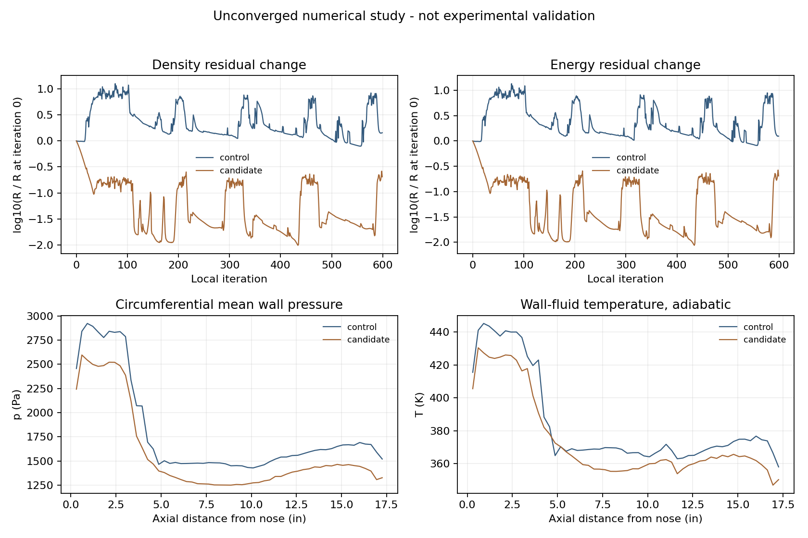

# v116：近壁层延长筛选与配对热试验数据草稿

结论：原面保留、初场迁移和结果显示链路通过了定向检查；**32层候选不采纳为默认，三维物理计算仍未合格，新增合格面积为0。** 本轮不再继续加层、延时或扫描CFL。当前主线仍是真实19,752面、20°箭体完整区域计算和科研工作台。

## 改动与来源

复用v114经典锥柱10°扩张体第2999步场。24层近壁带总厚1.686 mm，几个原节点列最外端的轴向速度仍仅为来流的5.1%—52.7%。这些是未收敛剖面，不能称已求得边界层厚度；它们只给出把粗四面体过渡移离强梯度区的试验理由。

唯一候选保持1826壁节点、3648原面、原24层、2 μm首位移、1.25层间增长和完整远场盒，只延长到32层/10.089 mm。体单元从124,564增至154,590；所有内部三角/四边形面、声明边界、正体积和原面保持通过。最低四面体SICN为0.0783，仍不能称全域网格质量合格。

`transferSU2HybridState.py` 在**旧真实四面体**中插值守恒变量，保留46,906个重合节点；19,377个新节点无最近点回退或外推。独立行列式体积比复算最大归一化差9.96×10⁻¹⁵、线性坐标差2.22×10⁻¹⁶ m。该迁移仅产生初始猜测，未声称严格保守重映射。原场和原网格未改写。

## 配对600步的结果

同来流、绝热壁、官方SU2 8.6.0、原离散与−8残差门槛；每项2线程/上限720秒。对照直接读原2999步，候选读上述迁移场。首步残差受到新网格和插值影响，跨网格绝对残差不可直接当误差比较。

| 指标 | 原24层对照 | 唯一32层候选 |
| --- | ---: | ---: |
| 实际时间 | 120.188 s | 137.047 s |
| 历史末次局部迭代 | 599 | 599 |
| 密度log残差，首→末 | −5.01018 → −4.85324 | −3.38639 → −4.07604 |
| 能量log残差，首→末 | +0.56088 → +0.65549 | +2.20859 → +1.51926 |
| 末/首密度残差比 | 1.4353 | 0.20434 |
| 末/首能量残差比 | 1.2434 | 0.20449 |
| 最后报告非物理重构数 | 2,974 | 4,238 |
| 全域低于10 K节点数，仅诊断 | 4 | 5 |
| 最低温度 | 约1.48×10⁻¹¹ K | 约1.39×10⁻¹¹ K |
| 原面面积加权压力差 | 基准 | 13.0808% |
| 原面面积加权壁面流体温度差 | 基准 | 3.1774% |

两项均正常退出但未收敛。候选的自身残差下降及总焓偏差下降不能抵消极低温度与持续振荡，也不能由本轮证明收敛加速或精度提高。低温节点位于尖锥前方轴线上，最低点X=0.4467140892 m，距鼻尖约0.436 mm。下一项决策应具体处理这些状态的来源及原生能量/重构机制，不再笼统归咎于近壁带厚度。总焓偏差是诊断，不直接等同物理误差或新的通过门槛。

本轮准备程序关闭了具名输出；绝热热功率始终为给定0，无法靠热功率唯一识别保存迭代。已独立核对保存表面与重启动场EOS一致，但工作台仍显示**末监测599、保存迭代未确认**。不伪造身份、不为补具名文件重算；后续绝热配对研究使用已有具名输出能力。

## 原图11数据：读数程序通过，实验输入尚未通过

来源：[Schaefer与Ferguson，1961，NASA原报告](https://ntrs.nasa.gov/citations/20150019680)，原PDF SHA及图11原图SHA保存在小型输入中。图11纵坐标是`St*sqrt(ReD)`且使用对数轴，上图是`Tw/Tt`；圆/方为对应的两组热试验壁温，菱形为实测绝热壁温。不能把图值直接当q。

新增 `readSchaeferHeatTransferData.m` 和 `tests/data/schaefer_ferguson_1961/heat_fig11.json`，记录40条配对候选，其中4条缺测、4条破碎方形符号，保留重叠和原像素。MATLAB与独立Python的线性温度轴、对数St轴、单位及CSV复算一致。

**当前没有一条完整配对同时通过三个符号的1.5像素名义测站核对。** 这意味着本次读图/测站配对仍是草稿，不能据此否定原实验，也不能通过移动原点、删除失败点或放宽旧压力容差制造验证。图1的名义坐标和图11实际绘点位置分开保存；未测14.37/15.01 in的热/壁温符号保持缺失。没有外推鼻端或底面、没有自动形成完整实验壁温边界、没有计算实验误差或q认证。

原报告通常给热传递系数约±20%测量精度；破碎符号更差，不能套用同一数值容差。1.5像素只表示本次读图尺度，不能替代实验不确定度。报告中的“纯层流分离”也不证明整个下游扩张段层流；原文明确讨论再附后的转捩和两支热电偶失效。

低温物性仍须核实。来流66.181 K是现有理想气体/Sutherland按原M、总温及单位Re反算的结果，不是原报告实测静温/静压输入已完全匹配。已找到[NIST Lemmon/Jacobsen输运关联原文](https://trc.nist.gov/refprop/FAQ/NAO.PDF)及[60—2000 K空气状态方程来源](https://www.nist.gov/publications/thermodynamic-properties-air-and-mixtures-nitrogen-argon-and-oxygen-60-2000-k-pressures)。本轮只核查研究方向，没有实现它们、没有认证66 K物性或改变现有引擎。

## 显示、检查与交付范围

- 两组全部3648原面p/q/流体节点温度与独立Python平均一致；各3648行场CSV、32段周向曲线通过。绝热q=0保持给定、Tw未指定、求解材料壁温未知。
- 复用主工作台的生产结果组件完成实际WebGL渲染与导出检查，不新建永久平行UI。本轮没有更改产品布局，也没有重新宣称主五步骤或原生窗口截图全部验收。
- 三项MATLAB均已终态：准备exit0、首次复核exit1、修复后复核exit0；所有任务源稳定。首次复核缺独立研究的sourceRevision，已补明确研究标识和真实jobToken，只重读结果。两项SU2和一项Gmsh正常终态。
- 独立准备审核的两次失败分别为误把SU2舍入坐标纳入逐位状态判等、证据路径未转绝对路径；失败原文保留。修复后独立检查通过，没有修改科学初场来让检查通过。
- 源码、小型输入、表面场与证据同步GitHub；完整体网格/重启动等留本地，没有工程包，不合并OpenCode修改。存储去重回执另列，不能把GitHub同步当大型结果备份。

下一次具体顺序见[当前目标第4节B](PROJECT_GOALS.md)及末尾v116记录。完整单时刻目标尚未完成。
