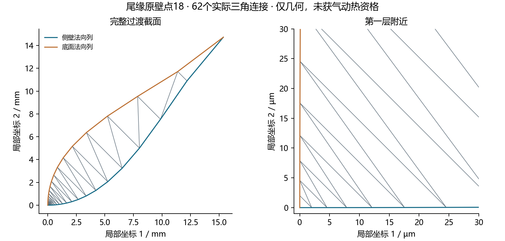

# v133 原壁面尾缘棱柱扇与科研工作台

2026-11-01。真实尾缘的双法向棱柱连接已构造、独立核对并接入主工作台。原19,752个壁面三角形和坐标保持，面积分母仍为1.9646292566m²。固定边界的外域优化未通过，候选不采纳；本版没有运行SU2，新增物理资格面积0。

## 1. 尾缘几何改进

[事前计划](validation/v133/PLAN.md)固定使用v120的mesh32，不增加层数、不磨圆尾缘、不删除底面。原底面中心有约28.8µm的X偏移，按原几何保留，未拍平成数学平面。

在侧壁与底面交界的46条闭合棱边，分别累积两侧原面顶角加权法向，构造双分支近壁列；分裂幅值按`(1-h/H)^2`在原32层内归零，接回原外壳。首末截面用三角形，中间四边形分为两个三角形，形成棱柱扇。非棱边列、原外壳、远场和外四面体保持。

| 指标 | 原mesh32 | 尾缘棱柱扇 |
| --- | ---: | ---: |
| 原壁点／原壁面 | 9878／19752 | 完全保持 |
| 体节点 | 349206 | 350632 |
| 棱柱 | 632064 | 634916 |
| 外四面体 | 164578 | 164578 |
| 总单元 | 796642 | 799494 |
| 参考首层距／外层距 | 2µm／0.0212939427m | 保持 |
| 对应观测点GG仿射矩最大误差 | 0.49004399 | 0.04955689 |

实际构造2.375秒，exit0。独立完整拓扑、体积及局部对偶检查8.953秒：内部面配对／方向、原边界、全部正体积通过；完整流体体积相对闭合误差8.94e−16，棱柱面积向量相对闭合误差最大6.67e−14，全参考棱柱最小Jacobian为5.44e−14且均为正。294个局部梯度节点核对通过；对应双侧观测点WLS条件数最大5.95，第一层侧壁／底面方向余弦分别0.99999999154／0.99999999078。

局部指标比较用相同原壁点和法向层号的两个分支；不是历史流场的RHS或实际松弛增量复现，也不是全域GG精度或近壁热流分辨率认证。v132原7个omega下限点是否恢复仍未测试，不能称只改网格必然解决收敛。

## 2. 外域优化未通过，保留真实失败

[固定操作计划](validation/v133/OUTER_PREFLIGHT.md)采用Gmsh4.15.2的`optimize("Netgen", force=True, niter=1)`，固定内外边界，要求消除17个SICN<0.1单元，并保持原400000节点／900000单元预算。SICN为以等边四面体为参考的带符号逆条件数。

第一次实际调用8.469秒、exit1：原生优化已执行，边界检查通过，随后质量查询报`Unknown element 190903`。拓扑变化后的查询缓存失效；首次优化网格未落盘，不能声称已保存或逐字恢复。

[恢复计划](validation/v133/OUTER_RECOVERY.md)在第二次执行前记录：同输入、同参数仅允许重执行一次，先保存原始结果，再重建查询缓存；用独立SICN公式核对引擎质量。第二次10.203秒、exit1，缓存和独立质量核对已通过，但总单元948509超过900000，最终候选导出中止。原始结果已保存在本地`optimized_recovered/optimized_raw.mat`。

只读后处理确认：第二次313593个外四面体中，原17个低质量单元全部原样保留，最小SICN仍为0.01391226。质量门槛和单元预算均失败，**不采纳、不改默认、不启动流场、不再重试同一优化器**。两次真实调用共18.672秒，没有第三次。原生日志提示`dimTags`局部优化参数尚未接入；本模型只有一个体实体、实际优化volume1，不称多体局部选择已支持。

17个坏单元均在鼻尖外壳附近，中心X为0.06994848—0.07419681m；其中6个四面体的四个顶点全在内壳接口。这解释了固定边界优化的限制，但尚不是原流场残差的唯一因果证明。下一步应修改鼻部**体网格外层包络与连接过渡**，保留原壁面和近壁要求，而非继续调整尾缘梯度或重复Netgen。

## 3. 主工作台与实际验证

原几何导出缺少主工作台所需的`optionsJSON`。在新目录`fan_workbench`只补导出元数据，`hybrid_volume.mat`与原扇形结果逐字相同且共用硬链接；回执明确`geometryRecomputed=false`。未来构造器已补此字段与输入散列锁，但最终整套构造入口没有从头重跑。原实际执行版本另存，不把元数据修复说成几何重新验收。

主五步骤的“生成网格”中显示真实构造方法、未通过的外域质量和物理资格状态；可切换“查看尾缘体网格截面／返回整箭表面”。截面来自原壁点18处的真实体节点与棱柱端面，共64点、62个三角连接。重新生成按钮明确为“重新生成常规体网格”，因为常规生成器尚不能自动复现此研究构造。

一项实际MATLAB任务正常终态、exit0，1547项锁定源码及显式输入稳定：原19752面→62面截面→原面切换、WebGL无错误、边界确认、上游失效和原面身份均通过。没有新流场、压力／热流／温度字段，也没有原生窗口截图验收。读入几何不授予物理资格。

随后独立Python核对截面与实际体节点、面数组和WebGL载荷完全一致；截面积5.391263573e−5m²，离截面误差最大7.68e−14m。下图由实际连接绘制并已目视检查，属于科学几何图，不是UI截图。

解析凸角模型的两个定向测试通过。首次测试误把法向投影／名义层高当方向余弦使用0.98门槛，已改为实际方向与原列比较，并另存投影量；原失败版本保留。独立审计首次因多余括号未执行，准确失败源保留，修复后一次真实审计通过。没有重复运行已通过的几何、MATLAB或流场任务。

## 4. 交付与下一步

源码、计划、真实回执／日志、科学图和准确执行版本随本次提交交付；[交付清单](validation/v133/delivery_manifest.json)绑定散列与版本，[存储清单](validation/v133/storage_inventory.json)按文件身份去重。本轮未删除独有结果，未生成工程包，未触碰历史共享对象库、OpenCode修改或v117被拒清理范围。大型MAT仍只在本地，GitHub同步不等于这些结果已备份。

本轮输出23条文件路径、22个独立文件身份，累计长度30,698,623字节，去重长度18,363,625字节；其中12,334,998字节的几何MAT共用硬链接。此为文件长度，不是实占测量。小型证据约1.53MB，未扫描或清理历史outputs。归档脚本两次准备失败（相对路径、CRLF恢复比较）及准确版本另存，修复后逐字续存已有证据；没有数值重跑。MATLAB实际读取的旧v56配置未列入当时显式输入锁，清单仅补记交付时SHA，不追称该文件有运行期间锁定证明。全源锁记录中的OpenCode资源只记录身份，本轮不并入交付。

下一步以一个有预算的鼻尖外层包络／过渡候选为起点，复用本次尾缘几何与UI。先检查原壁面、近壁尺度、全参考Jacobian、完整拓扑／体积、外域质量及规模；通过后再事前定义相容初场迁移和有限原生对照。保留原−8门槛与失败，不以新网格或exit0替代热流收敛、网格／外域检查和公开验证。

真实20°单时刻全面积仍是主目标：分离再附、底面、突起、可闭合公开热验证及高效物性不能被局部网格研究无限推迟。内嵌成熟引擎路线继续，科研UI同步；给定Tw、流体温度与未知求解Tw分开，累计热量和轨迹后置。总目标仍进行中。
