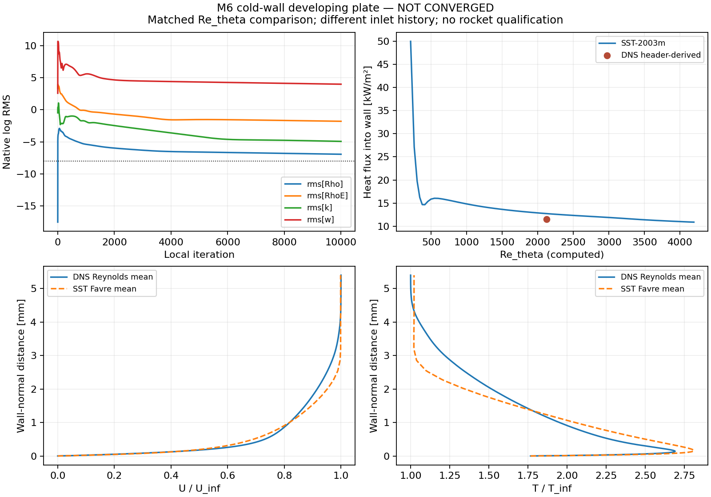

# v129：公开冷壁热流实际对照与SST更新机制复核

2026-11-01。完成一个实际SST发展平板算例及同Re_theta公开DNS对照，补上此前只有参考输入核对的缺项。**热流差+10.78%，但原残差门槛与外缘压力匹配均未过，因此不宣布DNS验证通过；新增箭体物理资格面积0。** 真实20°三维场和默认参数没有改变。

## 条件、身份与实际成本

参考[Zhang/Duan/Choudhari 2018 TMR M6Tw025](https://tmbwg.github.io/turbmodels/Other_DNS_Data/supersonic_hypersonic_flatplate.html)，DOI 10.2514/1.J057296，是DNS而非实验。原文件与v119固定SHA一致。匹配rho∞=0.044kg/m³、U∞=869.1m/s、T∞=55.2K、给定Tw=97.5K、R287、gamma1.4、Pr0.71及原Sutherland律；Mach由速度/温度计算，头部5.84为舍入。

只有下游统计剖面，没有完整DNS入口；本轮采用均匀全湍流入口、前缘发展的SST-2003m，I1%、黏度比10、Prt0.9是研究假设。按Re_theta=2121唯一内插测站，未按热流选择位置，也未把DNS的入口坐标当作本平板前缘坐标。这是带入口不确定性的受限比较，不是原DNS域的完整复现；DNS的Reynolds均值与RANS的Favre均值差别也保留。

MATLAB生成6561节点/6400四边形，80×80单元含上游，L0.35m、上游0.02m、高0.04m、首层0.5µm、流向−X。固定官方SU28.6.0，原生MAX_UPDATE_SST=1和精确Jacobian默认NO保持。唯一原生任务2线程、10000更新、局部9999，**234.703秒正常exit0、输入稳定**；低于720秒预算，没有任何原生续算/重试。事前规则见[PLAN](validation/v129/PLAN.md)。

## 实际结果与拒绝理由

匹配站距本平板前缘0.1300864m。正热流为进入冷壁，给定Tw与流体节点T分开，未知求解Tw仍为NaN。

| 指标 | 实测 | 事前判断 |
| --- | ---: | --- |
| 入壁热流 | 12,726.324 W/m² | DNS头部换算11,487.600，差+10.783% |
| Cf | 0.001906225 | DNS头部换算0.001704124，差+11.860% |
| U/U∞剖面加权RMS差 | 0.022292 | 低于0.05差值筛选线 |
| T/T∞相对加权RMS差 | 9.149% | 低于10%差值筛选线 |
| 壁压偏离目标p∞ | 7.889% | **超过2%，不满足条件匹配** |
| 局部压力梯度指标 | 0.006696 | 低于0.02；小梯度不能抵消压力偏置 |
| 最后200步总热功率极差/均值 | 0.006791% | 低于0.5%；稳定负荷不代表方程收敛 |
| 四方程最终原生log残差ρ/ρE/k/ω | −6.928 / −1.798 / −4.925 / +3.978 | **均未到原−8门槛** |
| y+99分位/最大值 | 0.1270 / 0.1580 | 近壁分辨率筛选通过，不等于网格独立 |

四项结果差值虽然均在事前初筛范围内，五项资格前提有两项失败，因此`eligibleSingleGridScreening=false`、`singleGridScreeningPassed=false`。不能把+10.78%称为已验证的SST模型误差，它混有未收敛、外缘条件和入口历史误差。原DNS头部−Bq=0.14末位舍入本身约±3.57%，这是读数舍入范围，不是实验不确定度。

原剖面首3/4/5点固定多项式导数给出11,501.85/11,561.29/11,573.06W/m²，作为独立参考一致性检查全部保留，没有挑选最接近解的参考。匹配剖面使用原维度y，不用各自边界层厚度缩放掩盖厚度差。

原生热阶段EOS最大相对差8.88e−16，壁热梯度6.23e−16通过既有门槛。5000与9999两个保存场都没有ω下限等价节点，说明本平板的未收敛不能简单归为v128尾缘口袋同一机制；也不能由这一点宣称全部刚性已解决。

## 源码审查改变了什么决策

九份相关源码与固定上游归档逐字一致。`USE_ACCURATE_TURB_JACOBIANS`追加的是交叉扩散系数关于omega的边导数，没有把独立生产/耗散源项变成完整精确Newton；近壁F1趋1时该追加项趋零，实际逐点F1尚未记录。

共同k/ω松弛低于1e−10会取消更新。减小MAX_UPDATE_SST既限制负跳变，也可能更早触发取消，因此不能直接视为既有下限口袋的修复。本轮没有改引擎源码或三维数值默认，保守更新与相容壁法向初态仍待有控制的验证。详见[固定源码复核](validation/v129/SST_SOURCE_REVIEW.md)。

## 测试与失败原文

两项MATLAB全部终态、源码稳定：首项原生完成后测试误用`pressure`而实际字段为`pressureRaw`，退出1；修正后第二项只读复验exit0，65壁节点、模型/温度身份与最终可选物性生成器通过。另一次Python报告写入遇numpy布尔值不可序列化，修正后在新目录重算报告，未重跑流场。准确失败版本及原因见[failure_versions](validation/v129/failure_versions/README.md)。

最终生成器新增可选R/Pr且保持旧默认配置字面值；默认、显式参数及两类非法输入拒绝已由MATLAB测试。4项Python参考/测站检查通过。独立从原CSV重算65列壁面/测站与输出CSV差0；MATLAB VTK回读相对高精度CSV最大差4.31e−7，全部原输入/输出SHA不变，失败资格保持。最终组合入口没有再从头启动；准备和实际调用、修正后的只读后处理分别受测，不宣称第二次完整数值运行。

最终wall.csv明确排除上游16个对称面列，仅含65个真实壁点；comparison02的81列原导出保留为历史，最终使用comparison03。比较数值与已由MATLAB读取的第二版逐项保持，独立核验通过；只改导出选择，不把非壁默认零值当已解壁热。

本轮没有新增主工作台页面或浏览器验收，不重复已有三维组件测试。OpenCode并发修改保留，未纳入本版交付；不称整个工作区与GitHub一致。

## 下一起点

1. 真实20°原面积主线继续。依据v128已有空间场处理近壁初态与正值更新，尾迹能量/鼻部变化率分开，避免把一个SST开关当全域修复；保持分离再附、底面和突起范围。
2. 公开基准须先修正条件匹配：复用本轮5000/9999场，分清前缘发展/远场压力偏置及未收敛影响；不直接再跑同一10000步、不按热流调参。若原DNS入口无法构成封闭验证问题，采用入口/外缘和热测点资料更完整的公开算例，并明确转换理由；不把缺入口永久变成版本循环。
3. 下一项实际运行同时写清所要消除的误差来源、控制、预算和停止条件；继续高效变比热路线，但不把它放在完整域稳定求解前无限等待。已有主UI/热阶段复用，未知值保持未知。

完整单时刻全面积与科研UI仍最高，累计热量和轨迹后置，总目标继续进行中。小源码/输入/证据随GitHub交付，大场保留本地，无工程包、不清旧outputs/对象库或被拒范围；本轮未删除任何文件。目录长度及交付来源见[清单](validation/v129/delivery_manifest.json)，文件长度不等于磁盘实占，GitHub同步不等于大场备份。
