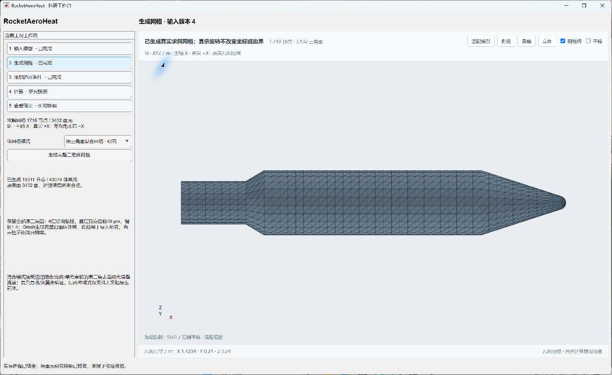
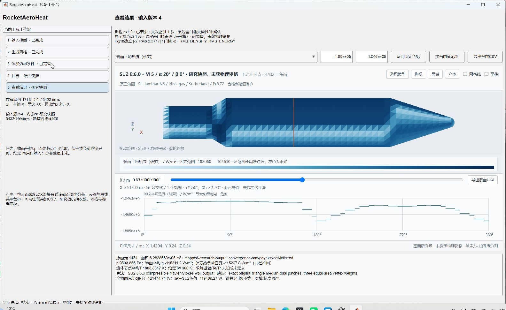

# v113：真实原面与整流罩箭体的混合体网格

2026-10-31。定向测试完成，随本次提交交付。**首次把真实19,752原面箭体和带光滑整流罩的完整模型接入SU2三维黏性导入链路；只运行两步，尚未收敛，新增合格面积0。** 单时刻全面积物理里程碑仍未完成。

## 实现与实际范围

新增`buildSU2HybridVolume.m`、`readSU2HybridVolume.m`和受限时Python网格子进程。完整原三角面不重采样、不变形，以角度加权顶点法向生成6层棱柱，再由固定Gmsh 4.15.2在末层与完整长方体远场之间生成四面体。首层顶点位移20µm、增长1.4；这是导入研究配置，不是已合格边界层网格。外域沿X的尾后/鼻前长度分别为原轴长2倍/1倍，横向半宽为轴长1倍，尚未做外域独立性或来流方向尾迹加密。

壁面保留原V/F和面编号；原三角面上的三个中位对偶片各占1/3，采用准确的面积平均权重，不作最近面补漏。原物面q积分与SU2节点合成面积负荷继续分列。Python检查原面闭合、方向、连通、法向对邻面外伸、棱柱Jacobian在参考单元上的极小值、正四面体及Gmsh接口三角连接/坐标；MATLAB另查全单元内部面双向共享、完整声明边界、体积和面积账。未证明任意自交原面、悬挑、尖翼或厚层整体不相交的通用支持；这些形状仍需专项几何资格，不据两个案例外推。

Gmsh API层允许空腔表面反向/重排，核对无向三角连接集合且禁止节点移动或拆分。原顺序由本项目独立保留。初次真实网格已生成但被过严顺序断言拒绝；修复为连接集合核对并关闭引擎重编号后，通过同一输入。首MATLAB投影因原面整数类型触发`sparse`类型要求，改为明确双精度索引后通过；不改变编号或几何。两次失败及准确代码保存。

## 两个完整模型实际结果

| 项目 | 真实回归几何 | 光滑整流罩箭体 |
| --- | ---: | ---: |
| 原表面三角形 | 19,752 | 3,432 |
| 原面积 / m² | 1.9646292566 | 0.9353706405 |
| 体节点 | 94,514 | 15,311 |
| 棱柱 / 四面体 | 118,512 / 178,622 | 20,592 / 22,482 |
| SU2两步用时 | 4.703 s | 0.781 s |
| 原生最小正交角 | 42.4337° | 38.7716° |
| 最小四面体SICN | 0.01536 | 0.00981 |
| SICN小于0.1的四面体 | 14 | 333 |
| 末密度/能量log残差 | −3.04074 / +3.06978 | −2.76455 / +3.37175 |

两项实际SU2任务均exit0，均明确报告全部体单元与表面定向正确，无自动改序；保存状态密度和内能为正。独立Python从VTK节点场重新求全部原面p/q/流体T和双面积负荷，与MATLAB一致。保存迭代1对应实际两次从0计数的更新。大残差、启动期负原始热流、有限值或正状态都不授予物理资格；原−8门槛未放宽。不同模型的正交角不能作为v108旧2448面网格的同网格加速或收敛比较。

两者都是M5、α20°、β0°、给定Tw300K，但**自由流不是完全同一输入**：真实几何导入固定T∞226.65K、p∞1171.87Pa；主工作台整流罩采用项目30km大气T∞约226.509K、p∞约1197.03Pa。前者仅验证真实几何接口，不是旧v56/v104同工况物理回归。下一次真实解应直接绑定原来流数据，不沿用这个近似大气输入作对照。

原整流罩峰高0.0192m逐节点完整保留。它是连续径向图上的光滑整流罩，没有独立相交壳体；不等同于薄翼、马蹄涡、分离位置或热峰已验证。

## 同一科研工作台

原五步骤保留。在工程表面网格步骤增加“当前表面 → 内嵌SU2混合网格”，原面原样接入；在模型步骤增加带整流罩原生箭体。混合模式与原法向/历史射线模式并列，原两模式和旧快照默认语义保持；普通STL重网格算法未改。上游模式改变仍使网格及下游结果失效，不能把任意表面送入轴对称模式后悄悄换模型。

主工作台实际生成整流罩完整网格、确认边界、异步运行两步、显示p/q/流体节点T及逐场来源/未知温度，并导出3432行面场和33段周向交线。导出截面在整流罩中心X=0.747m，逐行与原MAT核对；随后拾取面1454使显示截面变成该面中心X≈0.637m，截图与此前导出位置不同，均绑定同一保存场。实际窗口的立体按钮及网格/结果切页已检查。

## 公开验证选择及本轮限制

详见[公开基准核查](validation/v113/BENCHMARK_SELECTION.md)。优先选Schaefer/Ferguson的M4.98、15°锥—柱—10°扩张体低Re纯层流分离工况作为下一项独立经典模型；原始图1、8、11已经逐页查看。压力对应平衡近绝热壁，热流对应瞬时非均匀壁温，不能用当前统一Tw300K同时宣称两项验证通过。低Re分离区压力有理论引导整理线、热流有较大不确定度，须分别标注。没有数字化实验点或给出实验误差。

四项MATLAB任务全部终态，3成功/1投影类型失败；正式Gmsh子任务3项终态，2成功/1连接顺序断言失败；SU2实际任务2项成功但物理均未通过。最后复用原网格验证报告SHA、换面拒绝及精确三角权重与旧裁剪路径一致，不重算流场。真实19,752面无需再做相同两步导入；后续不得把接口接通变成无限重复的验证前置。

下一步直接推进上述经典模型及与原图匹配的热边界，先解决标量Tw之外的绝热/空间壁温输入；用有依据的近壁厚度、首层热梯度、外域和尾流指标完善本混合网格，之后在预算内验证收敛与p/q。对真实20°、转捩和分离再附按物理需要选择层流、RANS或固定工况非定常，不以模型切换掩盖未收敛。已有主工作台接入直接复用；单时刻全面积与科研UI仍为最高优先级。

源码、完整MATLAB文件、原几何小输入和证据随GitHub交付，无工程包。Gmsh运行时本地安装且另计容量，保留上游GPL-2.0-or-later及例外文本；未上传DLL。网格、重启动等大数据仍本地，GitHub不是这些文件的备份。存储核验见证据索引。
