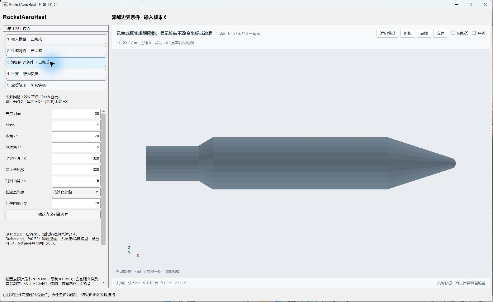
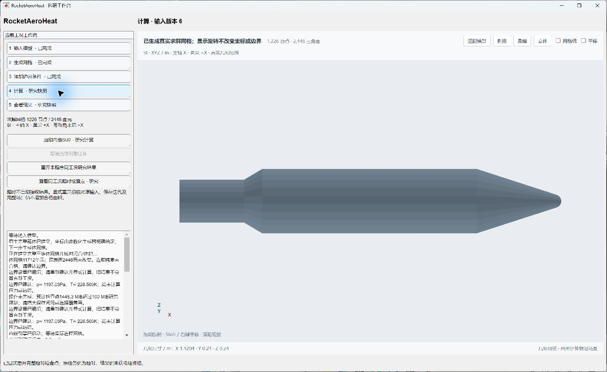
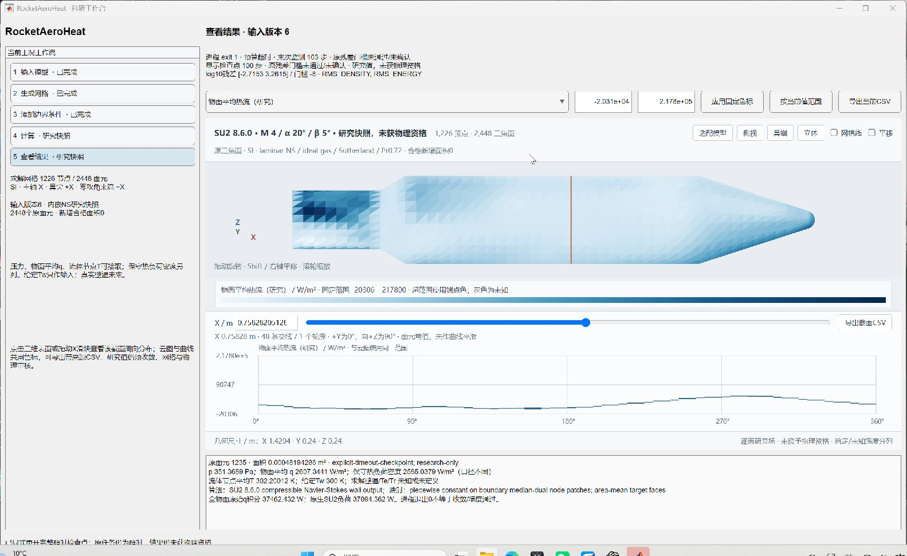

# v112：多重网格筛选与主工作台超时检查点

2026-10-31。定向测试完成，随本次提交交付。**真实单时刻全面积里程碑尚未完成，新增合格面积0。** 本轮完成检查点操作和Windows回执竞争修复；多重网格数值候选未通过，默认MGLEVEL=0保持不变。

## 先依据已有证据选择候选

v111原CFL上限5的600步历史中，线性返回计数0／1／2／3分别为360／88／130／22次，线性相对残差均小于1e−5。官方BCGSTAB在从0计数的循环内更新解后判断收敛，直接返回索引，因此0不等于没有求解。原配置没有撞到10次上限；不据此盲目提高上限或更换预条件器。高CFL失败分支曾18次返回10，不能移用为原默认配置的瓶颈证据。

官方实现另确认：等温壁速度强施加、能量通过Tw构造的法向导热通量弱施加；流体壁节点T不必在每一步精确等于给定Tw。MUSCL重构出现负压／负密度或负Roe声速平方时，会局部退回单元值；消除该警告不等于物理结果改善。摘要与摘录见[官方来源](validation/v112/upstream/README.md)。

据此只试验一个一层粗网格FAS V循环，检验粗层修正对近壁—外层尺度差异的帮助。没有重跑v111的对照，也没有重跑旧归一化、平板或外域。运行前[计划](validation/v112/PLAN.md)固定600外循环／360秒／2线程，以及密度和能量log残差均改善≥0.3的筛选门槛。

## 多重网格没有改善当前算例

保持原3750检查点、59,122细节点／58,560体单元／2,448原表面三角形及M5、α20°、β0°、Tw300 K。SU2实际建立7,787粗控制体；采用V循环、pre=(1,2)、post=(0,0)、correction smooth=(0,0)、限制／延拓阻尼0.5。粗层算子与限制／延拓属于新迭代方案，细层AUSM/MUSCL和物理条件未改。并非只改一个标量，也不将600外循环当作相同运算量。

| 指标 | 已存单层对照 | 一层粗网格候选 |
| --- | ---: | ---: |
| 用时 | 105.594 s | 176.391 s |
| 末步密度log残差 | −4.53950 | −4.14296 |
| 末步能量log残差 | +1.58392 | +1.95839 |
| 原生节点热负荷 | 22,394.58 W | 21,726.65 W |
| 原物面热功率 | 22,601.25 W | 21,933.35 W |

密度／能量log残差分别恶化0.39654／0.37447，用时增至1.670倍。全部保存密度／内能仍为正，但这不代表数值精度合格；末250步热负荷仍变化−2.9262%。原面面积加权相对L1差：压力0.18939%、热流5.38242%、流体节点T0.002400%。这些是两个未收敛场的差，不是相对实验误差。原−8门槛未放宽，仍未通过。

MATLAB与独立Python均核对全部原面映射、双面积口径、同态EOS及原生具名599步。该模型仍是原生无突起研究箭体，不能替代真实19,752面目标。候选否决，不增加粗层、延时或扫阻尼。

## 同一主工作台新增可操作流程

“添加边界条件”现在可选择默认覆盖写或按迭代保留，并设置保存间隔。运行前按节点规模估计检查点体量；超过100 MiB时在创建任务前拒绝，建议调整间隔／覆盖写。该值是保守文本体量估计，包含基础与具名副本，**不包含网格、输入快照、内存或磁盘分配开销**；不能当作实测总存储。旧快照无这些字段时不擅自补字段，旧成功快照的同工况复开／再确认回归通过。

“计算”步骤新增“查看同工况超时检查点 · 研究”。超时结果不会自动接收；用户显式选择原运行目录后，核对原输入快照／网格／配置SHA、当前模型／工况、原投影及完整壁面／重启动。只有保存迭代与HF/EOS均确认，才进入独立研究状态。缺证据、时刻未知、不同工况、运行中／其他失败／取消任务拒绝。普通成功结果入口仍拒绝超时回执。旧v109缺少工作台输入快照，不伪造该文件绕过限制。

新增研究重开不续算、不求壁体温度、不授予工程面积资格。实际小型射线网格M4、α20°、β5°任务5.078秒超时，显示检查点100步、末次监测103步，原状态保留。2,448行面场CSV和48行周向截面CSV与原MAT独立核对；导出携带同一收敛身份，给定Tw300 K和未知求解Tw分列。实际原生窗口检查了结果→计算→边界切换、显示和新控件。

这些截图是本轮真实M4超时UI场，**不是M5多重网格场或真实19,752面箭体的合格结果**。

## 修复实测发现的回执读写竞争

第一次UI测试遇Windows `PermissionError / WinError 5`：MATLAB读取`engine_process.json`时，Python的原子替换短暂受阻，异常使监督器退出。原有`finally`会回收其拥有的子进程，但异常使最终回执未落盘，原文件残留`running`。独立核对原监督器及子进程均已不存在；未重写原回执，也没有伪造原引擎退出码。这次任务不能计为正常超时或成功终态。

现在原子替换对短暂占用有限重试，旧JSON仍完整；首次运行中记录也纳入子进程回收保护。持续失败会保存实际子进程终态及`supervisorError`，原目标仍不可写时另存`engine_terminal_fallback.json`，以非零监督器退出供工作台报告失败，不自动接收场。真实Windows文件共享锁分别验证短暂竞争、持续占用、旧回执完整及备用终态路径；未用模拟求解冒充实际任务。

修复后新UI任务正常超时并显式重开。三项MATLAB任务全部停止：两项成功、一项上述失败；失败源码及原文保留。文件锁测试第一次仅因系统默认GBK读取UTF-8异常消息而失败，修正测试解码后通过；未改变物理数据。

## 交付、存储和下一步

11组完全相同的基础／具名文件及测试网格已合并硬链接，全部路径及SHA独立通过；实收24,940,544字节，未删除独有结果。所涉本轮目录独立文件长度约73.42→48.51 MB（含历史输入链接），不是整个outputs实占。源码、小型输入／壁面／映射／历史、截图和失败证据同步公开GitHub；大体场、完整重启动和运行时仍仅本地，无工程包。OpenCode和历史共享对象库保持。

**停止在同一3750检查点上继续扫描CFL、低阶、粗层数或阻尼。** 下一步把数值开发重心转向完整几何可用的体域／边界层／尾流网格接口，保留真实19,752原面及突起特征，选择一个有公开压力和热流依据的经典模型验证物理链路。现有原生层网格作回归，不能继续用它代替真实目标。结合Reynolds数、转捩和分离结构明确层流、RANS或固定工况非定常需求；固定工况非定常不同于被后置的全轨迹热历史，采用时须预先规定物理时间／内迭代／统计及网格验收，不能将旧稳态不收敛重新命名为通过。已有工作台检查点与展示直接复用，每完成一个可接受区域即接入。总目标继续，单时刻全面积与科研UI仍并列最高优先级。
