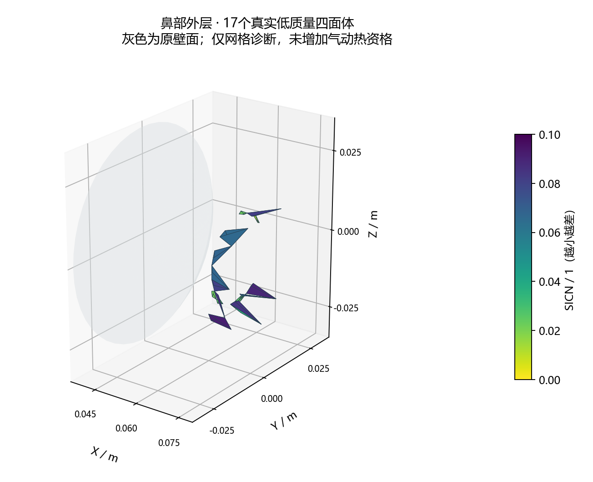

# v134 鼻部外壳候选与主工作台低质量单元定位

2026-11-01。两个鼻部外壳候选均未通过，未替换v133网格；新增的主工作台网格定位、探针与独立质量复核通过。原19752面及1.9646292566m²面积分母不变，本轮没有SU2运行，新增合格热流面积0。

## 1. 两个候选的实际结果

原外壳在鼻部X>0.04m的1798条内边中有315条局部凹折，对侧点越出面最大174.65µm。815个鼻部原壁点的参考球面拟合RMS为11.469µm；它只是体网格包络参考，不是改写原壁面或物理曲率。单纯径向投影到球面仍有316条凹折，说明光滑参考几何不能替代三角连接检查。

[首个事前计划](validation/v134/PLAN.md)保留原外壳连接与参考YZ位置，仅用HiGHS求有界X修正，最小化相对参考的最大偏移，总位移限1mm。815个变量节点、2534个凸性约束。真实准备1.062秒exit1，优化器报告不可行；没有新棱柱或外域生成。这个受限问题失败不证明所有三维移动方案均不可能。原门槛不放宽，未重复求解。

[第二个独立计划](validation/v134/MATURE_SURFACE_PLAN.md)使用Gmsh4.15.2球面CAD与Relocate2D，5次内部平滑步，固定圆边界及原三角连接；对631节点／1214面进行一次实际原生操作。独立方案事前限制总位移2mm，没有按结果调节。进程0.984秒exit1，原生平滑已完成并保存原始曲面，但最大位移64.7865mm、85节点超过2mm；检查区域仍有462条凹折，最大25.4185mm，因此拒绝。未构造过渡棱柱、未调用三维重建或SU2。

该失败说明**当前曲面导入及重定位组合不能使用**，不等于证明Gmsh全部曲面算法无效。周期参数及原连接的相容性尚未独立分离；不能把猜测写成唯一原因。日志提示指定实体优化未接入，本模型只有一个有三角网格的球面，不能声称多实体局部优化已受控。两份原始失败及准确源保留，不再重试同配置或堆平滑次数。

## 2. 主工作台的真实网格诊断

“生成网格”新增“定位低质量体单元”。从实际四面体连接独立计算SICN，显示17个单元的68个外露三角面，并以1398个原壁面作为灰色空间参考。色标固定0—0.1，SICN越小越差；灰色原壁面不具有体质量，不混同未解物理值。点选有色单元显示原体编号、SICN和中心X/Y/Z坐标，标明等边参考Jacobian算法及几何诊断身份。

原表面、尾缘扇截面、质量预览在同一工作台切换。上游网格改变清除旧预览；旧版本的探针消息被拒绝。返回普通几何时清除场量色标及研究字段说明。原工程及内嵌物理场均没有被改写。

两项实际MATLAB任务全部终态，源码和显式输入稳定：第一项在灰色参考面测试失败（10mm选区小于21.294mm的外壳偏移，参考面为空）；按真实近壁层总高度修正选区，第二项exit0。工作台WebGL、17个单元/数值、探针桥接、背景面身份、旧版本拒绝、切换及上游失效通过。探针测试使用真实接收函数与合成点击消息，**没有新的原生鼠标或窗口截图验收**。

Python按Jacobian奇异值独立复算全部164578个四面体，选中集合与原单元编号完全一致；17点与MATLAB余子式实现的最大差2.84e−16。顶点、显示三角形和1398个原面来源逐项一致。图为真实数据的科学可视化，不是UI截图；第一版轴标签裁切保留，第二版只读修正布局并已目视检查，没有数值重算。

## 3. 路线取舍与下一步

以下查阅的是官方能力说明，尚不代表本项目的集成或物理资格：

| 路线 | 可用依据 | 当前取舍 |
| --- | --- | --- |
| Gmsh4.15.2 Delaunay混合过渡 | [官方手册](https://www.gmsh.info/doc/texinfo/gmsh.html)说明Delaunay可生成含金字塔的混合网格，边界三角面须被体网格恢复 | 优先复用已安装版本，允许外层连接变化；先补棱柱／金字塔／四面体的相容过渡，避免再固定整层外壳进行平滑 |
| CGAL四面体重网格 | [官方手册](https://doc.cgal.org/latest/Tetrahedral_remeshing/index.html)提供局部选择及约束边界的重网格能力 | 属备选；需新增C++工具链、域及约束映射，不能把纯四面体优化直接套在棱柱域上 |
| MMG各向异性适配 | [官方度量文档](https://www.mmgtools.org/documentation/mmg3d/documentation_mmg3d_metric.html)支持各向异性度量及边界法向约束 | 适合后续基于流场或近壁尺度适配；当前还缺可靠混合网格转接，不能用纯四面体常规质量替代近壁方向分辨率 |

下一轮先实现**允许鼻部外层连接变化的相容混合过渡**，优先固定版本Gmsh Delaunay及必要金字塔接口。原壁面、受保护近壁节点、尾缘扇和面积分母保持。若只局部重构鼻部，块侧面的四边形必须真实配对，不能用重合独立壳体冒充连接。新增单元类型须进入写出、读取、定向、正Jacobian、面配对、体积审计和原面映射。

先用一个小型非退化过渡检查实现，再在明确预算内处理真实鼻部。各向异性过渡的方向尺度与质量标准需在运行前说明；不得把17个原坏单元简单改名为“过渡层”规避原SICN门槛。原外域门槛与失败继续保留。完整几何通过后才定义初场迁移和有限原生流场对照，不保证单靠网格即可解决omega下限点。

这项网格工作服务真实20°全面积求解；分离再附、底面、突起、可闭合公开热验证及高效物性继续，不能无限用局部网格版本替代区域计算。科研UI并列优先；累计热量/轨迹后置，总目标仍进行中。

## 4. 交付

准确输入、真实失败／成功回执、源码版本、独立复核及科学图见[交付清单](validation/v134/delivery_manifest.json)。本轮未删除独有数据、未生成工程包，未改历史对象库或被拒清理范围。OpenCode修改保持独立；源码、小型证据与目标同步公开GitHub。存储统计见[本轮清单](validation/v134/storage_inventory.json)，文件长度不等于磁盘分配。

本轮输出文件长度1,671,247字节，小型证据归档1,978,375字节（清单自身另计），没有大型流场或矩阵新增。45份证据逐字核对；两个MATLAB任务各1554项锁定源/输入绑定，首次失败版本另存。新小型原始曲面与UI预览随证据交付，上游完整体网格和历史物理场仍仅在本地，不能因本版同步而声称它们已备份。
