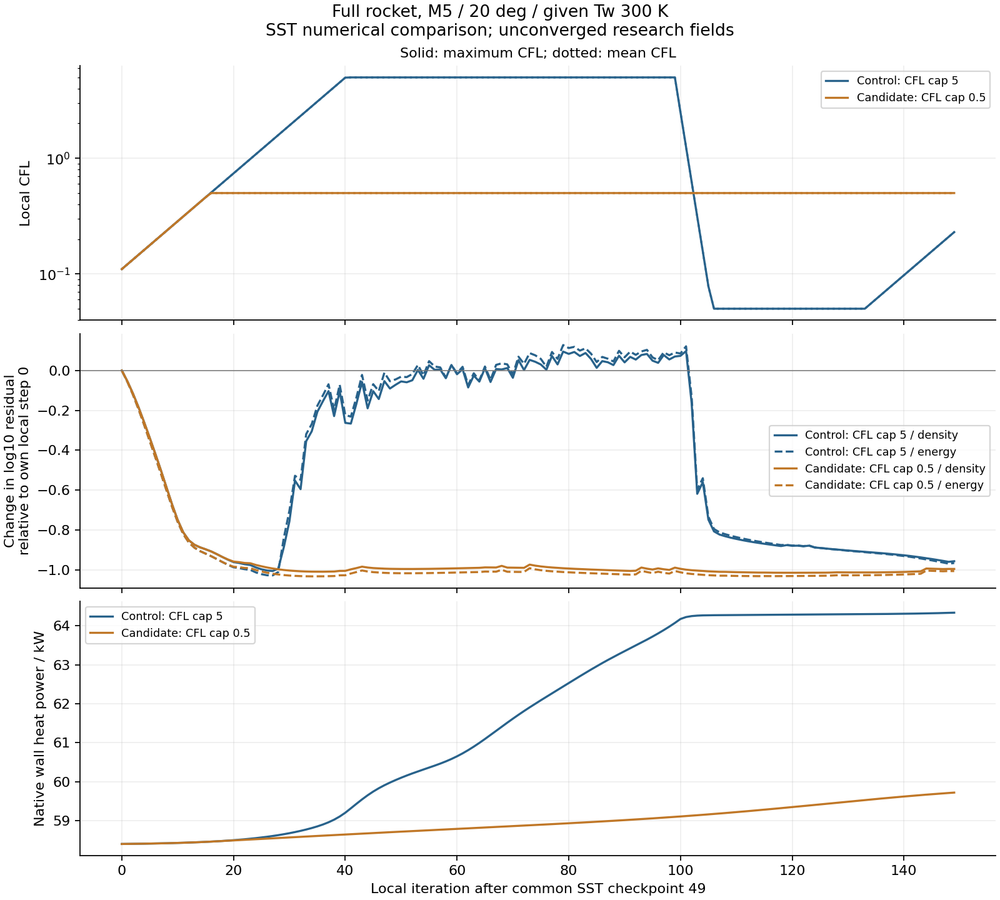

# v127：完整箭体SST推进上限对照，低CFL候选未采纳

2026-11-01。按[v126](SU2_SST_MULTISTEP_V126.md)及[事前计划](validation/v127/PLAN.md)，本版对真实完整域做了一项同源数值方案比较。**上限0.5候选未达到预定残差收益，保持默认不变；原−8仍未过，新增物理合格面积0。** 不自动延时或重试。

## 实际计算与身份

原19752面、349206节点/796642单元、1.9646292566m²，M5/30km/α20°/β0°/给定Tw300K保持。官方SU2 8.6.0、SST-2003m、定比热、Sutherland、I0.01/μt比10/Prt0.9，全湍流仍是假设。两个分支使用同一v126局部49初态，原生字节SHA一致；各自新局部0—149，不称累计199或不中断等价。

唯一方案变化是`CFL_ADAPT_PARAM`上限5→0.5，初始0.1、下降/上升因子0.5/1.1、下限0.05保持。两者都增加已有CFL/时间步和流动/湍流线性求解历史，输出75/149。独立数值对照身份严格限制允许的变化；普通同配置重启动仍拒绝未声明的CFL改变。

| 实测 | 控制，上限5 | 候选，上限0.5 |
| --- | ---: | ---: |
| 实际150更新耗时 | 325.516 s | 320.937 s |
| 原生终态 | exit0，输入稳定 | exit0，输入稳定 |
| 末25步平均密度log残差 | −5.030563 | −5.116579 |
| 末25步平均能量log残差 | +1.088977 | +0.993403 |
| 末25步平均k／ω log残差 | −1.679267／+6.734420 | −1.556604／+6.732041 |
| 75→149原面热流L1变化 | 5.49939% | 2.34593% |
| 末25步热功率变化 | +0.0725145% | +0.533299% |
| 原生热功率 | 64335.4101 W | 59721.0604 W |
| 原三角面平均q积分 | 64558.1048 W | 59932.0648 W |
| y+99分位 | 0.822106 | 0.853123 |
| 终态重构回退警告计数 | 4963 | 3655 |
| 负热流面积比例 | 24.1980% | 26.7727% |

总原生耗时646.453秒，均在各600秒预算内；准备/独立审核另计，无Gmsh或编译。两个场的全节点EOS最大相对差均1.33e−15，高精度热梯度分别2.55e−10/1.50e−10，VTK梯度分别4.88e−7/4.92e−7，通过原门槛。壁热的原生积分和原面平均积分继续分列，不混用面积口径。

## 为什么不采纳低上限

候选末25步密度/能量平均log残差只改善0.0860152/0.0955735，未达到事前各0.3的要求；其余六项筛选通过。两组最终原面热流面积加权L1差仍为10.5493%，两组均未收敛，因此不能把差异叫离散误差、数值精度改善或物理参数敏感性。

控制组CFL达到5后，在局部100起逐步减半至0.05，随后又增加；候选最大CFL保持0.5。上图第二栏只展示各自相对局部0的残差变化，不是绝对物理误差。控制的热功率平台部分伴随推进变慢，候选热功率还在持续演化；“残差低/热功率短窗稳定”均不足以授予完整流场资格。

实际流动线性求解最多3次/1次，报告的最差线性log残差均低于−5；没有本轮证据表明提高线性迭代次数会解决问题。湍流原生迭代计数为0不等于没有湍流更新，k/ω仍在变化。最小局部时间步约1.04e−13/2.09e−13秒，只有全局范围，没有空间位置，不能直接将其归因于某个低质单元或鼻部。

固定版`CSolver::AdaptCFLNumber`还依据非线性历史的振荡和总变化调整CFL，控制组百步附近的下降与该窗口一致，但没有逐点松弛/分支日志，不能伪称已记录全部内部决策。`comparison.json`中的`maximumCFLDropIterations`只筛单步降幅严格大于50%的事件；本轮逐次减半不在其中，实际下降以完整CFL历史为准。

[已有状态的只读极值诊断](validation/v127/evidence/state_extrema.json)进一步定位了鼻前/鼻端异常候选：控制的最大总焓节点286416位于(0.057249, −0.000843, −0.007891)m，约为来流含k总焓的1.1193倍；源/控制/候选超过1.1倍的节点数分别0/1/0。控制最大T为1440.056K，位于(0.047990, −0.002995, −0.014978)m。总焓使用同阶段`ρE/ρ+p/ρ`，没有混入更新后的k。它是节点诊断，不是新增接受门槛或面积覆盖；黏性输运、未稳定初场、局部离散及重构的作用仍待分清，不能仅由极值宣布违反守恒。

## 工作台与输入完整性

新增同一主工作台的“查看同表面/工况的SST数值对照”入口，按原配置/网格/清单/实际回执、物理条件和独立热状态审核读取。两种方案的源局部49、新局部149、CFL上限与伪时间重置进入算法说明和收敛说明；只读查看不启动求解，也不伪造旧UI冻结快照。

两个已运行清单的`flight.iterations/outputEvery`沿用了源50/25，这是复制元数据缺陷；实际原生配置和历史均为150/75及末149，输入原文保留。查看器从已锁定实际配置取运行控制，旧清单值单独保留。准备器已修正未来清单，并独立核对物理字段和原清单均未改变，没有为了元数据重跑求解器。

独立格式/来源保护4项及旧多步接口4项检查通过；清单修复另有独立检查。首次绘图因原生CSV表头空格触发`KeyError: Max CFL`，只修正读表并重绘，失败源码/记录保留，不算数值失败或新增求解。主UI与导出终态证据见交付清单；本轮不新增主求解启动或原生截图验收，OpenCode资源修改保持独立。

本轮一项MATLAB实际任务终态exit0、全部锁定源码稳定。两个方案在主工作台只读接收通过，逐个19752行/92段导出与原VTK及原三角面独立比较，最大场量归一化差1.10e−13；错误Tw301K请求被拒，旧v126普通SST重启动快照兼容，求解壁温保持NaN。OpenCode查看器/截面资源的准确SHA写入[交付清单](validation/v127/delivery_manifest.json)，本版不提交它们的并发修改，不称整个受测工作区已与远端一致。

## 存储与交付

全部任务终态后仅合并四份逐字重复的终态别名，55项原路径/SHA保持，独有结果删除0。副本长度减少401116226字节；执行窗口磁盘空闲实增401121280字节，约401MB。目录集合去重长度由1.46575GB变为1.06464GB，含254.17MB与旧场共享的网格/初态；约810.47MB独有新数据保留，不能将回收副本说成这一轮磁盘净增加空间。

去重前路径逻辑长度1.71992GB，小于事前1700MiB（约1.78258GB）预算；不同口径不能混算。[存储回执](validation/v127/evidence/storage_receipt.json)、源码、准确历史版本、输入/历史和小型验证资料同步GitHub；大型CSV/MAT仍只在本地。无工程包、未清全局outputs、共享历史或被拒的旧缓存。

## 下一起点

不再同源150步/CFL上限扫描、重复格式测试或靠加层/盲续时堆版本。先复用已定位鼻前/鼻端节点及两个终态，定位真实完整域内受限的局部推进/残差：固定引擎已有`TIMESTEP`（流动/湍流Delta_Time和CFL）及`RESIDUAL`输出组，应先核对其阶段、是否积分残差以及与RMS的关系，再在一次有预算的必要诊断中取得空间信息，关联近壁/激波/后体/尾迹及单元质量。不能将没有该信息的旧场补造局部值；诊断必须服务一项明确改进，不成为无限输出格式研究。

同时推进条件匹配的公开热流与有物理尺度的残差/守恒检查。现有TMR M6Tw025仅输入校核通过，须匹配物性、Pr、壁温、入口剖面和测站后才做流场对照；DNS不是实验，也不授权箭底/突起。完整域分离/再附/底面、转捩及高效变比热仍未完成。原失败和−8门槛保留，新的归一化标准须事前定义，不追溯把本版变成合格解。

单时刻全面积与科研UI仍最高优先，累计热量/轨迹后置。总目标进行中。
