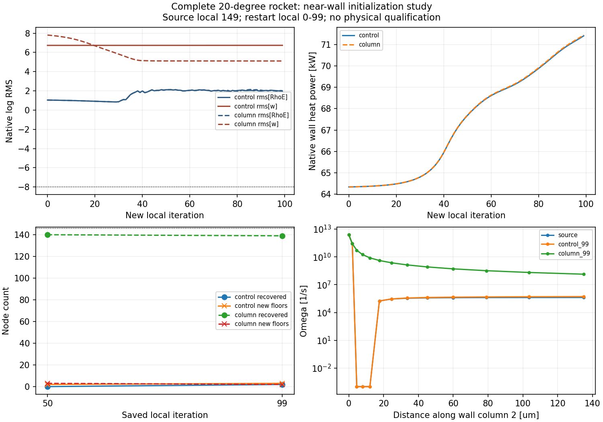

# v130：完整箭体近壁初始化对照

2026-11-01。真实20°完整域的近壁k/ω扩散—耗散初猜改善了湍流残差，但没有消除下限停滞和新下限位置。**候选不采纳、不改默认、不自动续算；原收敛门槛未过，新增物理合格面积0。** 这是数值初始化研究，不是完成全表面气动热。

## 保持的几何、物理与运行身份

原19752面、9878壁节点、面积1.9646292565715553m²全部保留；349206节点/796642单元、32层、首层2µm，外部17个低SICN四面体仍未获网格资格。M5、30km、攻角20°、侧滑0°、给定Tw300K；官方SU2 8.6.0、SST-2003m、定比热理想气体、Sutherland、I1%、黏度比10、Prt0.9保持。全湍流是研究假设，转捩未知。

控制和候选都来自v127控制局部149，重置CFL后各100次更新，保存局部50/99。源149与新99分别记录，不累计成不中断续算。两项均2线程、exit0且输入稳定：控制263.985秒，候选264.500秒，总528.485秒，分别未超360秒/总720秒。没有重编译、重建Gmsh、增加步数或第三次原生运行。

## 初猜做了什么

对每个可分辨壁列，取原壁剪估计y+首次达到1的层作为端点，最多第12层。两端保持源值，内部解常壁面运动黏度、平面、无对流/生产的近壁极限：

`nu * omega'' - 0.075 * omega^2 = 0`

`nu * k'' - 0.09 * omega * k = 0`

模型常数和壁面极限依据[TMR SST](https://tmbwg.github.io/turbmodels/sst.html)，有限初始化算法由本项目推导。它忽略横流、变黏度、曲率、生产和角点影响，只提供初态；后续仍解原完整SST方程。采用非均匀三点离散、正值阻尼Newton及原生k下限1e−10的活跃集互补解，不提高下限或关闭引擎保护。

9878个壁列共修改65508个内部节点，35个节点取原k下限；其他283698节点、全部端点和其他字段保持。仅同时补偿`rhoE_new = rhoE_old + rho*(k_new-k_old)`。独立有量纲斜率复算omega局部误差3.154701e−13、k互补缺陷8.961101e−12，均低于1e−10；热内能最大相对变化2.220446e−16。报告中的`rhoEnergyAdjustmentL1`只是各节点能量密度改变量绝对值之和，单位J/m³，没有乘控制体体积，不能称为总能量或热负荷。

源primitive列按原字节保留，属于源输出的热阶段；原生重启动使用守恒量和k/ω，不能将保留primitive列称为新初始化温度。后续原生场继续采用具名的“流动primitive先于湍流更新”合同。

事前计划与加严检查分别见[PLAN](validation/v130/PLAN.md)、[原下限](validation/v130/NATIVE_FLOOR.md)及[局部残差](validation/v130/LOCAL_RESIDUAL.md)。column的37个k低于原下限，column_bounded的局部omega误差未过，column_local在线搜索阶段失败，三者均未启动SU2。最终使用column_final；合成测试的一次备用下降范数失败也保留。详见[准备失败及准确源](validation/v130/preflight_versions/README.md)。准备/检查没有完整累计计时，不能宣称预计300秒已被实测验证。

## 实际筛选结果

| 事前指标 | 实测 | 判断 |
| --- | ---: | --- |
| 末20步omega平均log改善至少1 | 1.627941 | 通过 |
| ρ/ρE/k平均log不恶化超过0.3 | −0.017812 / −0.017905 / +0.021554，正为改善 | 通过 |
| 原146点在50和99均高于100倍下限 | 140/146、139/146 | **失败** |
| 两次保存均无原集合外新下限点 | 新增3点、2点 | **失败** |
| 原面热流面积加权L1差不超过5% | 0.0674411% | 通过 |
| 候选y+99分位不超过1 | 0.834771 | 通过 |
| 原热内能保持 | 2.220446e−16 | 通过 |

候选50步原6点仍下限，新3点；99步原7点仍下限，新2点。控制对应仅0/2个原节点恢复到100倍下限以上。不能用恢复比例改善或总下限数减少替代“全部恢复且无新位置”的既定门槛。

候选最终原生log残差ρ/ρE/k/ω为−4.103560/+2.023671/−1.407565/+5.108784，原−8全部未过。候选50→99原面热流L1仍变化8.38898%，最后25步原生热功率变化2.90421%。两方案最终热流很接近，不能由此称各自已收敛。

两组全节点同阶段EOS最大误差1.33e−15；高精度壁热梯度最大误差分别3.44e−10/6.61e−10，原接口门槛通过。接口通过不授予物理资格。

剩余原下限点在法向第3–4层，仍在本次已初始化内部；新增下限点在第14/15层，超出对应第12层端点。由原节点编号和既有列结构可复核，见[层号记录](validation/v130/evidence/remaining_node_layers_audit.json)。这支持继续检查完整更新和邻接区域；它没有证明某一个源项、激波、分离或网格缺陷是唯一原因，不能直接加初始化层数冒充修复。

## 公开热流条件的只读复核

复用v129 M6平板5000/9999，无新平板求解。固定s=0.1300864364m处壁压比由1.095375降到1.078892；9999时离壁10/20mm压力比仍1.072758/1.092693，顶部40mm为0.997837。壁压变化与近壁外侧压力偏置同时存在。

两个保存场的流向壁热L1变化0.146664%，热流接近并不消除压力/入口条件不匹配。仅两份场不能分离前缘发展、外边界、网格及未收敛误差的因果贡献；不称已定位唯一原因，不重新宣布DNS验证通过。原DNS缺完整入口，不再直接延长同一10000步或按热流调参。见[只读报告](validation/v130/evidence/dns_pressure_review.json)。

## 科研工作台与交付

一项实际MATLAB任务终态exit0，全部锁定源码/显式输入稳定。主工作台只读接收两方案，算法标签、热内能补偿身份、源149/新99、原19752面、X=−1.5m的92段周向曲线、WebGL渲染与探针通过。给定Tw300与未知求解Tw=NaN分列；错误Tw301拒绝，旧普通SST及v128口袋结果兼容。没有重跑主求解启动、取消或原生截图验收。

独立从原生VTK和原三角面核对两份CSV，场量最大归一化差4.36e−14，截面端点仍在原三角面内，来源标签/迭代身份保持。4项最终Python初猜测试通过；三份未运行准备、一项合成测试失败及准确源码如实保留。

只合并本轮四份终态逐字别名，81项原路径/SHA保持、独有结果删除0；执行窗口磁盘空闲实增401145856字节。合并前路径长度2291229909字节，低于2200MiB；去重文件长度1661604050字节，含254193896字节旧共享输入，约1.407GB新独有数据仍保留。新增少量清单另计，最终统计见[交付清单](validation/v130/delivery_manifest.json)。这些文件长度不是磁盘实占，回收副本也不是整轮净减少。

源码、测试、小型证据与目标随GitHub交付，大场仅本地，无工程包。OpenCode的工作台资源按受测SHA记录但不并入本版；不称整个工作区与远端一致。没有触碰全局outputs、历史共享对象或v117被拒清理范围。

## 下一起点

1. 停止相同100步、初始化深度/下限/阈值扫描和直接续算。本候选仅保留研究身份。复用原7点、第14/15层新点及v128尾迹/鼻部证据，检查更新前候选增量、共同松弛和触发下限的离散项/尾缘边界；选择有控制、成本和停止标准的一项稳健正值更新或几何/离散改进。不能把“更多诊断文件”当进展，也不能用减小MAX_UPDATE_SST或精确Jacobian开关替代机制验证。
2. 公开验证转向可闭合的入口/外缘和热测站问题。先核对已有公开资料是否足够；M6现有场留作受限比较，若缺入口则换资料完整的算例，不再重复同一平板。新残差归一化与独立守恒/负荷标准须事前定义，不追溯改写原−8或本轮失败。
3. 真实20°完整原面积、分离再附、底面、闭合突起和统一科研UI继续最高优先级；高效变比热继续，HEOS RANS未适配仍拒绝。复用已有主流程，累计热量和轨迹后置。总目标仍进行中。
