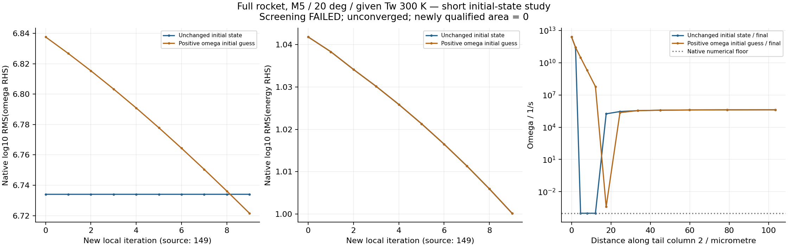

# v128：定位尾缘湍流停滞，局部正值初猜未通过筛选

2026-11-01。本轮执行目标4B，完成一次完整域空间诊断和一项有对照的初场改进试验。**定位了此前全局残差看不见的尾缘ω下限停滞；图调和初猜未达到事前收益，不采纳、不改默认、不自动延时。原−8仍未达，新增物理合格面积0。**

## 完整几何与实际成本

原19752面、9878壁节点、349206体节点、796642单元、面积1.9646292566m²保持；M5/30km/α20°/β0°/给定Tw300K，SU2 8.6.0 SST-2003m、定比热、Sutherland、I0.01、μt/μ10、Prt0.9保持。全湍流仍是假设，32层/首2µm及外域仍未资格。

| 实际任务 | 起点与更新 | 原生耗时 | 终态 |
| --- | --- | ---: | --- |
| 空间诊断 spatial01 | v127控制149 → 新局部0，一次更新 | 68.687 s | exit0，全部输入稳定 |
| 原初场控制 | 同一控制149 → 新局部9，10次更新 | 77.703 s | exit0，全部输入稳定 |
| 修正初猜候选 | 同一149，仅146点ω改为正值初猜 → 新局部9 | 78.438 s | exit0，全部输入稳定 |

总原生224.828秒；每项2线程且未超事前各180秒预算。源149与各新局部号分列，CFL重置0.1，不称累计或不中断等价。无Gmsh/编译，没有额外原生重试。[原诊断计划](validation/v128/PLAN.md)、[初猜对照计划](validation/v128/POCKET_PLAN.md)及[候选启动前舍入修正](validation/v128/POCKET_ROUNDOFF.md)分别保留。

## 空间证据改变了什么判断

1. 最小本次伪时间步2.07604e−13秒位于尾端壁节点42，X=−2.828291m；不在此前鼻前总焓极值处。它没有相邻外四面体，不能把全局小dt直接归因于17个低SICN外单元。
2. 能量积分右端平方的95.6813%位于只连接外四面体的节点，按X几何分带66.7727%位于箭体下游。最大能量右端节点330834在(−3.165158,0.453278,0.003531)m，最近壁距离约0.48814m，最差相邻四面体平均比质量约0.44290；该指标不是SICN，也不能据一点替所有外单元授权。
3. ω积分右端平方的99.9999992%来自法向1—4层，单第2层占95.8665%；尾缘峰值节点19758的ω=1e−4，而相邻第1层约2.63e11。源场有111个与下限字面相等的节点，另35个处于明确浮点舍入界内，均在尾缘2—9层。
4. 改用体积加权局部变化率平方sum(R²/V)后，壁面加1—4层占能量约56.6347%，纯四面体外节点仅0.18464%。积分残差与局部变化率强调的区域不同，不能只盯最大原生log，也不能仅由局部小体积宣布网格不合格。

上面“层”“下游”等都是几何分组，不是已解的分离/激波识别。鼻前/鼻端既有异常仍保留；它们没有因本轮定位尾缘而消失。[空间结果](validation/v128/evidence/spatial_analysis.json)记录七方程完整分组及节点坐标。

## 场量语义与独立核对

固定源码输出LinSysRes，隐式flow将其取负并加入截断误差，湍流取负；本例MGLEVEL=0。它是各子系统更新前形成的积分离散右端，保存的守恒状态已更新，既不是新状态重新评估的缺陷，也不是线性求解剩余或物理误差。DIMENSIONAL/SI参考量为1，三维ρ、动量、ρE右端单位分别kg/s、N、W，ρk与ρω分别W、kg/s²。壁面约束行仍在，不能直接把右端之和称作独立全局守恒账。

Delta_Time与Turb_Delta_Time对应刚执行的伪时间步；CFL与Turb_CFL在流动/湍流更新后已为下一次调整。此次局部0实际起始CFL0.1；不能直接用保存dt/保存CFL解释同阶段谱半径。

七方程sqrt(sum(R²)/N)复算log与原生历史最大差4.3914e−10，低于事前2e−8。中位对偶体积按棱柱子体积与四面体V/4构造，总体积相对差4.44e−16；单位棱柱/四面体解析核对通过。CSV坐标15位小数科学记数与原网格逐ID最大相对舍入5.55e−16，独立舍入界8eps；未做最近邻改号。

另外报告以L/U∞和来流输运变量为参考的体积加权变化率，仅作诊断，无新物理门槛。三个场的全节点EOS均1.33e−15，高精度壁热梯度最大4.55e−10、VTK梯度最大4.97e−7，均通过原合同。未改变旧−8失败。

## 初场试验为何不采纳

固定CTurbSolver按k/ω相对增量取共同松弛，小于1e−10时置零；SST默认MAX_UPDATE_SST=1.0，也允许负向更新达到当前值。源码与观测支持下限停滞机制，但本轮没有保存逐点LinSysSol/松弛，不能伪称全部内部决定已记录。

候选只对146个近下限非壁节点解log(ω)图Dirichlet延拓，边权1/网格边长，其他邻点固定。几何、ρ、动量、ρE、k及其他节点/字段精确保持；它是启发式初猜，未改变原生下限或保护。图方程相对残差3.62e−16、锚定与正值/最大值原理通过。

最初111点准备把35个舍入等价下限当成边界锚，已在候选启动前改为8eps判据。该111点目录及源版本保留，`NOT_RUN.json`表明引擎运行0次；没有把它记作失败流场或额外对照。修正后仍存在极近下限但在该界外的锚，本文不再事后扩大选择器。

| 事前筛选/实测 | 控制 | 候选 | 结论 |
| --- | ---: | ---: | --- |
| 末5步平均ω log右端 | 6.734061 | 6.750120 | 候选反高0.01606，未改善1log |
| 末5步平均k log右端 | −1.683191 | −1.457722 | 恶化0.22547，未超0.3筛选界 |
| 146点中末态ω>100倍下限 | 0 | 94（64.38%） | 未过95% |
| 全域下限等价节点 | 146 | 66 | 总数下降不等于问题解决 |
| y+99分位 | 0.8222425 | 0.8222425 | 通过此项筛选 |
| 原面热流积分 | 64592.5772 W | 64593.2862 W | 原生积分另列 |

候选51个原口袋节点仍在下限，还新增15个口袋外下限节点，清单见[下限演化](validation/v128/evidence/floor_evolution.json)。因此报告“总数下降”时不能声称没有新增下限位置。两场原面热流L1差1.04660e−5，即0.00104660%；密度/能量末5步均值基本相同。6项筛选中2项失败，不采纳。仅10步，没有25步稳定窗，不以短窗热功率相近宣称稳定物理解。

图中候选ω残差下降，并不能替代事前控制比较；新初猜产生的短暂调整也不能当作原问题已收敛。箭底/尾迹、全湍流/转捩、高效变物性及公开热流仍未闭合。

## 生产接口、工作台与失败记录

显式空间诊断合同只允许一次更新及准确36列，普通25列和同源字节保护保持。初场研究有独立身份和逐字段变换核对，不能伪装成普通续算。主工作台既有SST对照入口同时接收本轮初场方案，探针、曲线与导出显示真实初猜来源及源149/新9；不另开永久页面。

一项MATLAB任务终态exit0，所有锁定源码稳定；双19752行、各92段截面、未知求解Tw=NaN、错误Tw301拒绝及旧SST兼容通过。独立CSV与原VTK/三角面最大场量归一化差7.58e−14；实际新主求解启动/原生窗口截图不重复验收。OpenCode查看器修改保留并按受测SHA记录，本版不提交其并发修改。

17项当前Python定向检查通过（空间5、初猜4、旧非紧凑4、旧数值保护4）。先前只读后验曾被第二处旧输出字段判断拒绝，首次空间分析又因文本坐标要求二进制完全相等拒绝；准确失败源码/原因保留。修正后只读复核通过，没有重跑原生任务，也未放宽EOS/壁热或物理门槛。

## 下一起点

停止本轮一次空间诊断、10步口袋试验及选择器阈值扫描，复用现有场。当前证据不支持先统一增加层数，也不支持仅凭总下限数降低就继续此候选。下一项完整域数值改进应处理相容的近壁k/ω正值初态与更新机制，先核对默认MAX_UPDATE_SST=1允许触底、精确湍流Jacobian的实际覆盖范围以及壁法向初态依据；更保守更新只是待验证候选，不能默认为已有效或随意关闭原生保护。

尾迹能量积分残差与鼻部局部变化率仍是独立问题。依据已存完整场做尾迹/激波与网格诊断，结合适当归一化、局部有符号壁剪/热流和物理守恒检查。新标准事前定义，不能追溯改写旧失败。公开TMR M6热流条件匹配与高效变比热继续；不让局部启动修补成为新的长期前置。真实20°全表面、分离/再附/底面/突起及统一科研UI仍最高；累计热量/轨迹后置，总目标保持进行中。

## 存储与交付

六份终态别名经核对后合并，76项原路径/SHA保留，独有结果删除0；执行窗口磁盘空闲实增692854784字节，约693MB。目录去重文件长度由2.04345GB降至1.35060GB，含254.19MB旧场共享输入，仍新增约1.09641GB独有科学数据，不能称整轮磁盘净增加空间。合并前路径累计2411882770字节，比事前2300MiB（2411724800字节）超157970字节，约0.151MiB；小幅超出也如实记录，不追改预算。详见[存储回执](validation/v128/evidence/storage_receipt.json)。未运行111点准备保留，不清全局outputs、共享对象库或v117被拒缓存。源码/小型证据同步公开GitHub，无工程包；大场只在本地，推送不等于大场备份。准确测试/原生源码绑定见[交付清单](validation/v128/delivery_manifest.json)。
