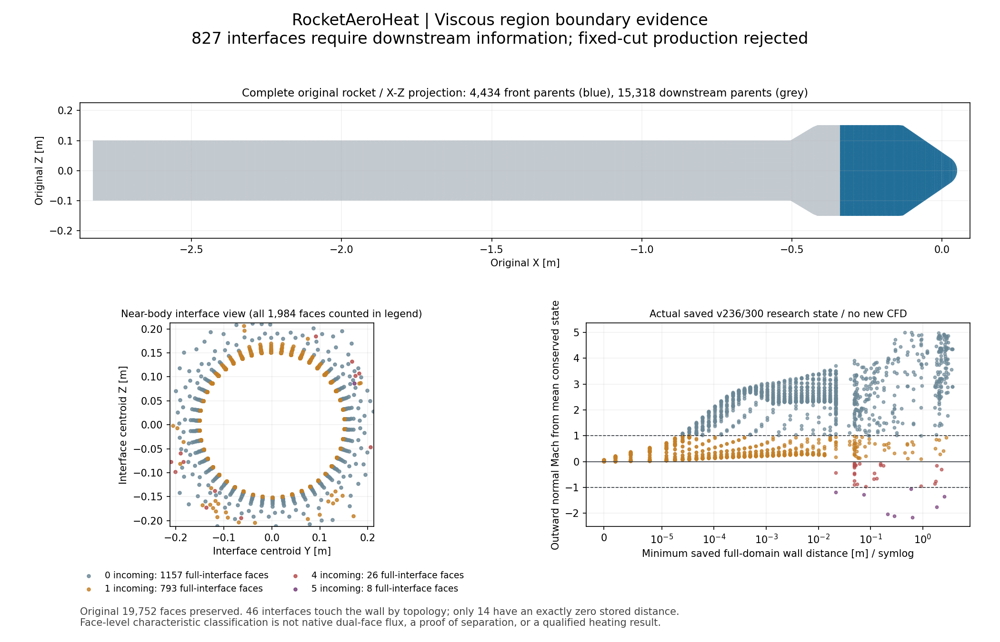

# v244：真实黏性区域包与内部反馈决定

2026-11-16。**已导出可复用的前体区域几何、原场映射及完整接口证据；当前人工切口不能直接作为生产出口。** 本版没有新CFD更新、构建或原生查询，没有新增合格热面积。相较v243，下一项由泛化的“局部黏性出口”落实为保留下游的同一物理域内部耦合，并明确FAS多重网格的整体相容控制候选。总目标active，工程全面积和科研UI仍并列最高。

## 实际区域包

复用v233准确母单元索引，生成`outputs/v244_validation/region02/region_geometry.su2`与`region.npz`：76,550节点、160,304单元（141,888棱柱及18,416四面体）、4,434原壁面、2,186物理外场面和1,984内部接口面。它是保留原坐标/原单元的几何导出，不是重新生成网格。32层2µm及历史尾缘资产未改；全模型19,752面/1.9646292565715553m²分母不变。

原v236/300完整六量研究状态按全局号逐位提取，独立二进制读回核对2,602,700个标量。原完整域壁距一并保留，但未在截断域重新计算或证明截断域壁距适用。独立文本读取、所有区域单元回到母单元、完整边界面集合/无重漏均通过。文件里的`unclosed_internal_interface`明确标记未闭合接口；没有生成可盲启动的物理配置。旧300场不作新重启动或外压供体。

## 接口实际需要什么

在每个原多边形界面上，用原节点守恒量平均后恢复相态热力学状态，并以从前体指向下游的几何法向分析五个对流特征。独立审核采用扇形三角法向、原Cp表积分Cv及Brent反解，最大缩放差5.6704e−14。

| 进入前体的对流特征数 | 界面数 |
|---:|---:|
| 0 | 1,157 |
| 1 | 793 |
| 4 | 26 |
| 5 | 8 |

共827面需要下游信息。法向Mach范围−2.14879至4.99996。46个与物理壁相接的接口全部有一个进入前体的声学特征。**这是原多边形/保存研究态的分类，不是原生节点双控制体边界通量，不是实测分离证明，也没有包含全部黏性与SA扩散条件。** 人工界面锯齿法向和未收敛源场同样影响分类，不能把34个具有反向速度的界面直接叫作真实回流区。

原报告曾用壁距严格等于零识别接触，得到14；拓扑实际是46，其他接触面的最小壁距仅有最高2.4533e−18m的舍入量。原报告原样保留。更正报告在`audit02/corrected_region_report.json`，严格零值数与拓扑接触数分开；修正函数已对真实保存数组执行，并与独立集合交叉检查一致。没有把物理状态或壁距裁成零。

## 成熟实现核对与采用决定

准确已构建源的特征Riemann实现有静压出口分支、进入特征选择及一般EOS黏性secondary传递，但现有身份15配置只准许环境PT特征边界，静压选项仍被守卫拒绝。即使解开配置守卫，也没有得到实际下游外压。SA的Riemann静压分派会调用自身量外推的BC_Outlet，并省略边界扩散；它不是双向黏性/湍流供体接口。v234失败的MZ17滑移组合继续关闭。

因此拒绝本切口的直接全出射、p∞、零梯度或冻结旧研究压力方案。采用**同一成熟物理域保留真实下游，前体/下游划分先作为观察索引**。`coupling01/connected_provider.json`绑定原705,490单元/335,726点完整网格、160,304/545,186单元责任及全部19,752壁面；没有新增内部物理marker、不要求外部CFD导入，也没有给旧整域追加运行许可。

原生单区通信能处理流动状态、梯度及SA/涡黏度，全局壁面ADT具有全局收集路径；准确来源已归档。但MPI没有安装/构建或实际测试，也**不作为收敛修复或降低总内存的保证**。本机原单区约2.153GB采样峰仅作既有资源参考，不重新询问大内存电脑。

原完整域的旧失败不能因边界闭合就忽略。下一具名收敛候选为成熟FAS聚合多重网格：保留原细网格作为生产网格，在粗层处理误差。已绑定准确的限制、强迫项及延拓调用源；尚未实际验证相态Air粗层状态、无滑移投影、SA阶段和能量零点相容，不能认定已采用成功。它不同于继续增加旧步数，但同样必须经一个整体控制后才可能准入真实发展，不扫描层数/CFL/通量或写新通量Jacobian。

## 科研显示与失败保留

图已实际查看，保留全箭体投影、原区域责任、近体界面分类及法向Mach—壁距关系；明确是v236/300研究态，没有新热解。未改共享WebGL、未作浏览器或MATLAB验收。

首准备2.734秒退出1，声速字段名错误，几何/原场提取已存；只修字段后新目录3.578秒通过。首独立审核120.188秒因预算结束退出15，代码在每个接口重复解压完整母面表；改为一次缓存，原数学不变，独立恢复2.422秒通过。首源/未完成目录/回执均保留，未重跑任何CFD。元数据14→46另列，不能追改原报告。

监督离线累计7.093秒，审核/科研出口124.141秒（含超时），峰398,389,248字节，1CPU；归档另计，开发/交互定向读取另述。固定运行入口收口后关闭，必要新控制另预算。小证据公开GitHub，大几何和原场子集留E盘；并发公开基准资料及其目标补充保留本地，不混入本次提交。下一步见[执行点](validation/v244/NEXT_DECISION.md)。
