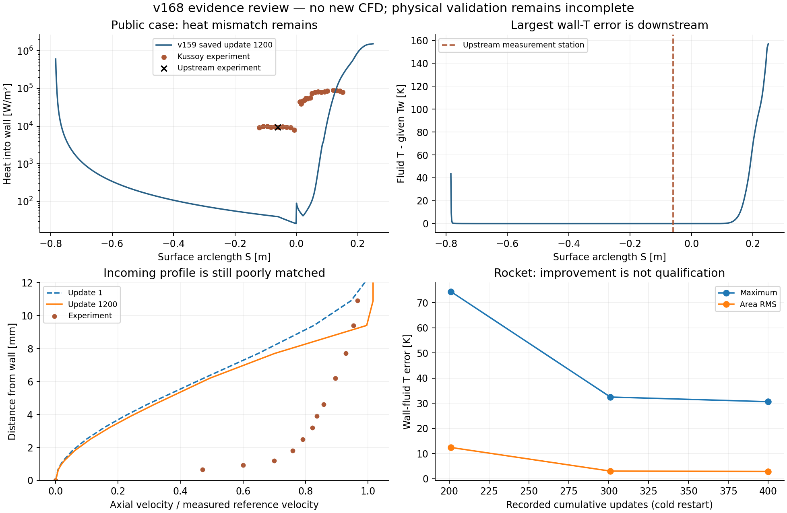
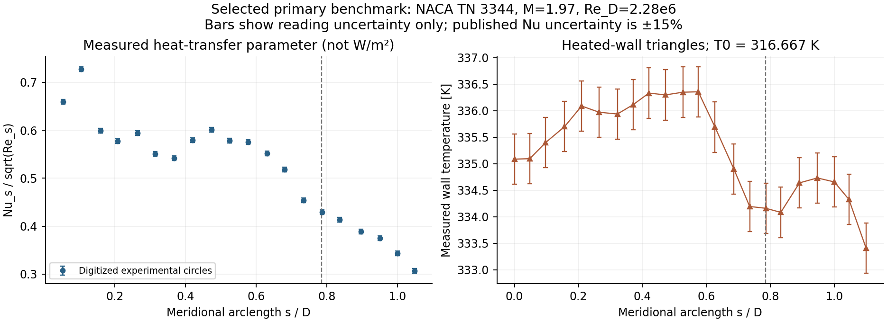

# v168 壁热证据复审与公开验证路线调整

2026-11-06。已完成既存场复审和替代公开实验的数据准备，**未新增CFD、引擎构建、MATLAB或主UI测试，新增物理资格面积为0**。v167候选仍不采用、不接续，默认包不变。

## 复审得到的实际结论

复用v159的13帧和v167的3帧。公开源文件与已交付证据SHA一致；三维温度/热流来自既有严格审核CSV，按原全局节点编号回到精确原网格。第一次2.875秒因错误地要求7位VTK坐标与原MAT逐字相等而退出，准确脚本和日志保留；恢复使用原审核1e−6m映射门槛，最大距离4.835e−7m，第二次3.047秒exit0。面积和位置一律采用精确网格，没有改动原物理几何。两次主分析合计5.922秒，低于事前120秒预算。

| 位置/量 | 实际证据 | 判断 |
| --- | --- | --- |
| v159上游测站，项目X=+0.06m | 给定Tw311K，流体T311.0004543K；q39.6116W/m²，实验9300W/m² | 壁温几乎相等仍有99.574%的热流偏差，不能靠改温度显示解决 |
| 同站近壁邻点 | 两个夹住测站的原壁点159/160，法向距离5.138915e−6m，邻点T311.00768—311.00770K | 实际导热温差只有约0.0077K；重算热流与保存值相符 |
| 最大公开壁温误差 | 全局节点32520，X=−0.23492206m、S=0.24999883m，流体T468.117911K | 位于下游末端，和上游热流失配不是同一位置；不据此推定唯一病因 |
| 上游速度剖面 | 离壁0.65mm时U/Uref=0.00833，实验0.47；2.5mm时0.1113，实验0.791 | 初末剖面差异很小，入口发展/近壁状态尚未匹配实验，单改壁温不足以闭合 |
| v167真实整箭 | 最大温差74.414→32.458→30.606K；面积RMS12.397→2.989→2.873K | 存在改善，但原残差/热稳定/y+及公开验证未过，不授予全域资格 |
| v167末帧极值 | 最大温差节点9717，X=+0.04880004m；最大y+节点8406，X=−0.09993829m | y+99=1.57308，原≤1条件仍未满足 |

v167末帧按原三角形平均温差统计，超过1K和5K的面面积占比为39.61%和7.59%。这是本次定位统计，不是新增/放宽的验收条件。三维全部原19752面和1.9646292566m²分母保持。

## 边界算法核对

准确执行源按v159构建树核对，提取了CNSSolver、CNSVariable和CFluidIteration的实际片段。弱等温壁把给定Tw用于法向导热通量，能量行仍由守恒方程推进；静止壁速度行强制无滑移。导热系数取同阶段分子项和湍流项，公开末壁湍流项近零。能量隐式对角是已有近似预条件，不能因其不等于完整残差的精确Jacobian就判定为新错误。

SetPrimVar由rhoE/rho−|u|²/2−当前k求热内能并读取物性；保存的Flow_Primitive_K用于核对该阶段。流动与SST分步推进，不能拿另一阶段的k反推保存温度。此核验没有取得原生分项壁面RHS或历史增量，保存的总残差不提供唯一因果。

[SU2维护者对弱等温壁的说明](https://github.com/su2code/SU2/discussions/1746)与当前源码定义相符。**不强行覆盖壁节点温度，不删除能量方程，不以界面显示正确替代守恒/热流验证。**

## 当前公开适配的处理

关闭v159这套M7.11截断入口/SST初场作为当前热验证推进入口，不再追加同配置1200步或扫描初猜/通量/CFL。原实验资料、13帧、26项4通过/21失败/1待验以及v152等历史失败全部保留；不是宣布Kussoy实验本身无效，也不是证明入口是唯一失败原因。

计算入口与局部实验测站是不同状态，原单位Re差−9.51717%仍保留。原实验总温比的分母没有新的一手证据，继续为未知，不能用888.889K计算入口总温或863.575K推导值代替。

## 已选定的替代实验

采用**NACA TN 3344，M=1.97、Re_D=2.28×10⁶的电加热半球—圆柱层流实验**，先验证从均匀来流、完整鼻部到柱段的压缩性壁面热交换，减少未知来流边界层历史。它是超声速热交换验证，不替代高超声速、湍流、分离或真实20°箭体验证。

一手来源：[NASA NTRS报告](https://ntrs.nasa.gov/citations/19930084172)。已下载原字节PDF，SHA256为`b63d630c30e833167acc9c033acfe7244b9cac4fc1921d5d1543e5a4c38dae58`；文件包含436字节历史前缀，首次仅按首字节检查时拒绝，随后识别内部PDF头，原文件未改。pypdf恢复交叉引用，Poppler成功渲染并逐图查看Table I、Figure 1(c)、3(a)、4(b)。24MB原报告仅本地；小型原图、点选像素、标定和CSV进入仓库。

| 条件 | 本次锁定内容 |
| --- | --- |
| 外形 | 半球半径0.0508m、直径0.1016m，图示鼻尖至柱端5英寸，尾环厚1/8英寸；攻角0°±0.1° |
| 介质和流动 | 干空气、层流；均匀上游来流，不指定未知湍流剖面，不开启SST匹配该实验 |
| 独立来流条件 | M1.97、Re_D2.28×10⁶、总温570°R=316.666667K，见Table I最后一行 |
| 本程序相容换算 | 固定理想Air/OTH与Sutherland模型下T178.107574K、p26135.374956Pa；这是由公开M/Re/T0和所选物性推导的状态，不冒称原始实测p/T |
| 壁面 | 电加热不锈钢壳；Figure 3(a)最高Re三角符号22点，图读Tw333.409—336.354K；不是严格常温，不能默认300K或直接使用低Re圆圈 |
| 热测量 | Figure 4(b)最高Re带中心点圆圈20点，量为局部Nu_s/√Re_s，不是W/m²；s为从鼻尖起的母线弧长 |
| 不确定度 | 原文Nu约±15%、Re约±1%、温度约±0.5%；图读误差另列，四点网格标定交叉核对通过 |
| 热流方向 | 电加热壁高于恢复温度，热量从壁面流出；项目“入壁为正”时q应为负，正换热系数不能直接当正入壁q |
| 范围限制 | 实验未给底面/支撑件热流；温度最后测站以后的边界延拓、计算出口/风洞影响、物性对照和网格独立性须在求解前定义 |

原文Nu_s=h·s/k_e、Re_s=rho_e·U_e·s/mu_e，h=q_out/(Tw−Tr)。公开参数来自电功率测量、局部外缘量及原文恢复温度修正；不可用来流Re_D或轴向X替换局部定义。原文指出鼻部s/D<0.35的未加热表面温度受固体导热影响，不能直接把这条温度曲线当真实Tr。后续应实现可审核的原文归一化/段平均及外缘、恢复温度定义；当前不伪造直接实测的有量纲热流。

资料已整理为[数据合同](../tests/data/naca_tn3344/contract.json)、20个热交换参数点和22个壁温点；保留图读身份，没有把论文理论曲线当实测。第四网格点误差分别约0.00125/0.00139和0.00108/0.000106；原热读值误差±0.005、Tw比值±0.0015单列。Mach/Re/总焓相容误差≤3.94e−16；独立论文cp积分误差3.01e−10，满足既有v153纸面系数2e−8口径。**数据可复查不等于新基准已求解或实验验证通过。**

## 代码与交付边界

现有`su2IdealAirInterface`把轴对称包绑定到SST-Vm，`prepareSU2AxisymmetricAir`固定Tw311K并排除轴线节点；不能把新实验直接套入旧入口。下一步应补具名层流轴对称、鼻尖/轴线和实测Tw分布合同，优先复用成熟引擎已有边界能力。仅当独立小例证明引擎缺项才做最小适配，不先重写通量、隐式求解器或全量重编。

两次独立审核失败分别是误把验收布尔字段当计数、错误地把同核高精度门槛套到论文圆整系数；准确脚本和日志均保留。最终2.313秒exit0，独立旋转面积积分最大差7.11e−15K，论文声速Mach差5.17e−12。所有失败均是本轮只读审核问题，无数值任务重跑；原物理门槛一项未改。

主五步骤和WebGL复用v167已过证据，本轮没有新鼠标/截图或UI实现声明。源码、目标、小证据和图读数据同步公开GitHub；不生成工程包，不删除独有场，不动OpenCode工作。下一起点见[执行决策](validation/v168/NEXT_DECISION.md)。
