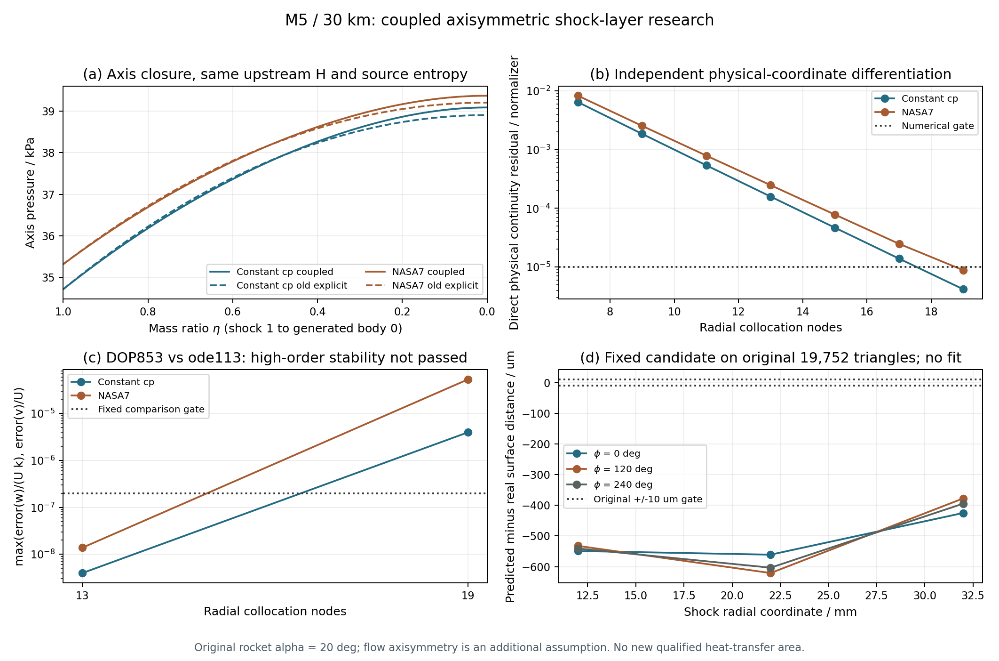

# v100：耦合激波层驻点修正与数值稳定性边界

**已测试数值研究；区域模型未收口。** 原显式压力在轴线上的能量不一致已由新的连续式—法向动量闭合解决。新的局部反算仍有高阶、缩放和外侧域限制，真实原面体形未匹配，正式热流覆盖仍为66.5626327424%，新增0。Q41仍19接受/82主NS，未稳态，本轮没有重跑该链。

## 实现和实际计算

新增五个计算模块及一个保存研究导出器，均为中文模块注释的完整MATLAB文件。使用`z=r²`、`u=r*w`及同一投影流线入口熵；n/w/v共同推进，保留流向法向速度导数。批量RH和焓恢复根使用同一cp积分约定、温域/焦点/声速守门，不裁温或补速度。

七次实际MATLAB任务均已终态。首轮两物性smoke通过；完整范围首轮在外侧域拒绝，第二轮在缩放门槛拒绝，原日志/源码/检查点保留。无量纲积分并加密至19节点后，以明确的未通过项完成诊断运行，`completeValidation=false`；退出0不代表全适用域或物理解通过。最后两次是保存研究的导出，没有新流动积分或体形拟合。

一次全工程哈希快照记录了两个无关界面文件的并发变化；当时全部MATLAB源码保持稳定。导出期间还出现外部新增的特征保留测试，其旧原文不在本轮档案中；本轮不修改或交付这些外部文件。来源审核对实际计算/导出闭包核验864项精确版本，保留原全工程哈希表并明确区分范围，不能声称所有无关并发文件的历史原字节已备份。

## 验证结论

- 两种物性的7至19节点共14组主矩阵完成代数、能量/熵与正常激波后同熵驻止极限检查。`primaryMatrixValidated`不代表14组都通过独立守恒/稳定性验证。
- 独立热力复算最大相对差1.57e-13；19节点直接物理连续式残差分别4.16e-6/8.80e-6，轴向动量残差6.60e-8/1.12e-7。归一化与完整曲线见方法文档和图。
- 13节点独立DOP853速度核对通过，但其直接连续式残差未过1e-5；19节点直接守恒通过，但独立速度核对未过2e-7。两类结论并列保留。
- 2.3倍长度缩放压力差4.89e-7，未过原2e-9；36mm外侧域在两种物性的19节点右端评估中拒绝。它不是已接受流场声速面的位置证明。
- 原19,752面上九条几何射线命中，固定候选最大距离差620.728µm，超过原10µm门槛；相对原壁面最大法向速度比例8.88%。没有新拟合、实验验证或边界层外缘资格。

详细方程、表格、范围和一手来源见[方法说明](../../COUPLED_SHOCK_PATCH_V100.md)。



## 科研工作台

新增四组粗/细对照、52条法向列和1,092个保存站点，使用原整箭及原鼻部三角面开放片。每个值含方法、原面号/重心和状态。未知热流、给定/求解壁温、外缘及恢复温度保持空值及unknown身份。

Node核对20个流程事件、全部1,092站点/CSV行、52列导出和24项过期/无关消息拒绝。独立数值导出审核逐值匹配全部站点、原V/F及52条射线，最大距离差0；相机/放大范围修改前后物理列完全相同。旧v98视图的112站点/47列回归通过。

实际浏览器核验五步骤、粗/细切换、完整19,752面与鼻部范围、三维点击、滑块、方法展开和真实CSV下载。实际点击NASA7 N19第8列第9站（eta=0.6），压力34.24683kPa、层内温度1203.897K，关联原面18849。21行实际下载逐值核对通过。保存一条MutationObserver错误，签名与旧记录相同；不宣称控制台干净或已完全归因。截图见`browser/overview.png`和`browser/methods.png`。

该页查看已保存研究，步骤切换不重算。它没有新增完整实时主程序的导入/求解能力，也不是全面积壁面云图。

## 复现

使用仓库已有小型输入，无需外部CFD或大型旧outputs：

```powershell
python scripts/runMatlabResearch.py myCoupledPatch "addpath('tests'); testAxisymmetricShockLayerPatch(fullfile(pwd,'outputs/my_coupled_patch/result'),fullfile(pwd,'tests/data/shock_layer_transport/parabolic_shock_layer_evidence.mat'));" --folder outputs/my_coupled_patch --input tests/data/shock_layer_transport/parabolic_shock_layer_evidence.mat
python tests/auditAxisymmetricShockLayerPatch.py outputs/my_coupled_patch/result/axisymmetric_patch_evidence.mat outputs/my_coupled_patch/myCoupledPatch_process.json --report outputs/my_coupled_patch/result/audit.json
```

诊断会保留未通过项。若后续平台在Cauchy敏感范围中触发不同拒绝，应保存原输入和日志，不能通过改门槛强行产生相同结果。网页导出：

```matlab
setupEngineeringShockLayer;
exportCoupledShockPatchStudy( ...
    fullfile(pwd,'outputs/my_coupled_patch/result/axisymmetric_patch_evidence.mat'), ...
    fullfile(pwd,'outputs/my_coupled_patch/result/audit.json'), ...
    fullfile(pwd,'outputs/my_coupled_patch/view'));
```

以本地HTTP服务打开该`view/workbench/index.html`。同一目录不得覆盖。`tests/data/coupled_shock_patch/axis_reference.json`是约120KB的数值参考和来源摘要，不是生产入口或完整场备份。完整25.6MB MAT仍在本地忽略区；本轮不上传大型计算输出、ZIP或重复工程副本。

## 保留与清理

完整最终MAT及所有独有早期/失败证据保留。其余三份已被最终MAT完全替代的本轮检查点共19个变量，按类型、形状和数值原字节逐项核对后删除，磁盘空闲实增25,231,360字节，约25.2MB。部分变量位于最终报告相应字段，映射列于`storage/plan.json`；原检查点路径已失效，应读取最终MAT，不能假装旧路径仍在。一次只读比较的Python列表处理拒绝在删除前修复，未修改科学数据。

`raw/`保留实际进程、原字节日志、修订源码、独立审核和导出回执；`provenance.json`列出计算版本；`view_audit.json`、`ui_test.json`及`browser/`给出实际界面证据。源码、测试、必要小型参考和验证记录按约定同步GitHub。

下一步为真实壁面—共同激波的边值/直接激波拟合闭合，不再仅靠加高Cauchy阶数或给激波加形状自由度。区域方法、分离/再附/底面和统一科研UI持续推进；累计热量、轨迹及跨流态阶段后置，全目标保持active。
