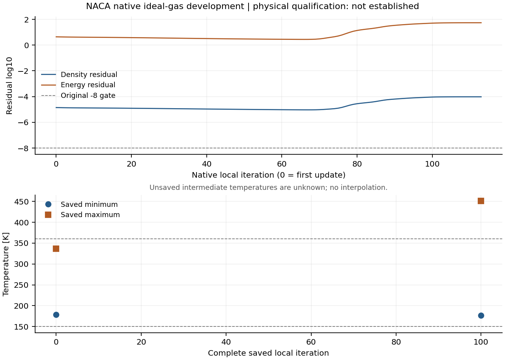

# v174 验证索引

本轮实现、实际结果与限制见[主记录](../../NACA_NATIVE_IDEAL_GAS_V174.md)，后续按[唯一下一起点](NEXT_DECISION.md)。总目标进行中，整箭新增物理资格0。

- [事前计划](PLAN.md)：模型差额度、小例、单对象输出修复和唯一实际候选的次数/时间/温区/输出预算。
- [合同审查](CONTRACT_REVIEW.md)、[原生分派审查](RUNTIME_REVIEW.md)、[构建前审查](BUILD_REVIEW.md)。第一阶段遗漏实际首帧override门控，原审查及后来失败保留。
- [保存场守卫](DOMAIN_GUARD_PLAN.md)：Windows双文件拒写锁、连续历史、异步助手与终态补扫。
- [完整证据清单](evidence_manifest.json)：准确执行源、准备/构建/求解/热审/筛选/独立核对/图/失败；SHA相同证据引用既有归档。大网格、初场、原生体场/表面、运行时二进制只在localOnly登记，没有上传或复制工程包。
- [本轮无损去重](storage_receipt.json)：6别名、12路径、123398289字节，独有删除0，首次未变更场文件的预检失败保留。

主要实际任务为small02（原生exit0但缺首帧、pipeline失败）、small03（正常0/2/3，后两帧温域失败）与real01（温域守卫真实请求停止，0/100完整，最后113无全场）。exit0、接口通过和物理资格分别报告。

温区只在完整保存位置作标记，不插值未知中间温度。图的精确来源和生成过程见证据清单中的plot_final01。
