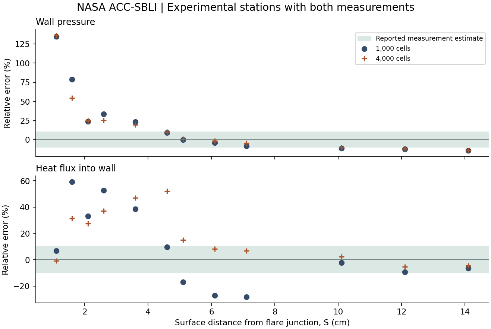

# NASA 圆柱—扩张段风洞模型的壁压与热流同站比较

**结论。** 当前内部计算能给出这个轴对称试验段全固壁的压力和热流，但对 12 个有双变量测量的弧长位置，两者同时落在各自实验误差估计内的只有 1 站（1,000 单元）和 2 站（4,000 单元）。两套网格满足条件的位置没有重合。本次复用实际数值稳态，没有新增 CFD。自绘箭体新增合格面积为 0 m²。[逐站表](evidence/tmr_joint/wall_stations.csv) · [运行与数据身份](evidence/tmr_joint/summary.json)

## 模型与测量范围

采用 NASA TMR 收录的 Kussoy–Horstman 加热干空气风洞实验。轴对称截断域包含圆柱与 20° 扩张段，模型攻角为 0°，给定等温壁为 311 K。计算入口 M7.11 和实验局部参考 M7.05 分别保留。实验壁压和加热量的无量纲分母分别为 576 Pa 和 9,300 W/m²。实验热流列记录文献报告的壁面加热幅值；计算列保留项目正向入壁的有符号热流。S 为沿壁弧长，扩张段起点为零。这个实验可检验侧壁相互作用。整枚火箭的鼻、底和攻角横流各有不同的验证要求。[实验及网格](https://tmbwg.github.io/turbmodels/axiswblim7_val.html) · [NASA 实验报告](https://ntrs.nasa.gov/citations/19890010729)

按实验原表的十进制弧长配对。压力原表 27 行，末站重复后为 24 个独立位置；热流 27 个位置。两表合计 39 个不同弧长，其中 12 个位置兼有两种量，全部在扩张段。上游圆柱段的压力与热流按各自测站比较。共同弧长只说明名义测量位置一致。报告中的两项 ±10% 为实验估计，资料未给联合置信区间。点数不换算成验证面积。[实验条件和不确定度](../../../tests/data/tmr_mach7/contract.json)

## 内部计算结果

数值来源为项目保存的轴对称 SA-noft2 计算、Sutherland 输运和 Dirichlet 切向壁热梯度。按每个测站所在原壁段取值，保留热流正负号。两份 MAT 均有对应的正常终态和原稳态残差证据。对 4,000 单元解，按原网格的两端坐标重新计算 **80 个固壁环带**的旋转面积，总和为 **0.7265222893 m²**。导出包括原壁面编号、几何端点、环带面积、壁压、入壁热流、给定壁温和保持空值的固体壁温。[80 个环带结果 CSV](evidence/tmr_joint/wind_tunnel_wall.csv) · [既有三维工作台](../../../outputs/v67_validation/comparison_workspace/index.html)

| 12 个共同位置的对照 | 压力在 ±10% 内 | 热流在 ±10% 内 | 两项均在范围内 | 两项均在范围内的位置 |
|---|---:|---:|---:|---|
| 1,000 单元 | 4 | 5 | 1 | 4.6 cm |
| 4,000 单元 | 3 | 6 | 2 | 6.1、7.1 cm |

有一处差异可以直接解释。两套网格均将 4.6 和 5.1 cm 两热流测站落入同一个原壁段，结果以面上常值保存。两站实验估计区间互不重叠，一侧上限约 61.79 kW/m²，另一侧下限约 66.88 kW/m²。同一个面值不可能同时落入两者。这个事实限定了该处的比较分辨率；其余位置的偏差原因仍待确认。[独立逐项复核](evidence/tmr_joint/independent_check.json)

## 公开数值参照

另从 NASA TMR 下载了 161 行 WIND-US/SA 壁面比值数据，按相邻弧长线性插值到 12 个共同位置，表内保留原行号、两端位置和权重。相对于实验公布比值，压力和热流的平均绝对相对差分别为 **21.10%**、**9.86%**。这项独立比较使用公开无量纲分布。WIND 的上游实际 SI 值仍未知，该文件只用于对照。项目内部结果仍来自自己的计算。[官方 WIND 数据](https://tmbwg.github.io/turbmodels/Axiswblim7_validation/axiswblim7_wind_wall_sa.dat) · [插值与比值明细](evidence/tmr_joint/wind_shape_at_stations.csv)

## 与自绘模型的关系

本轮还核对了自绘原面上已有的两类外缘热流缺口。在合计 0.576324 m² 中，已有工程压力的是 936 面、0.095708 m²；其余 4,547 面、0.480616 m² 的壁压为给定值。若仅补齐这两类面积的热流，主工况压力和热流的同面工程交集最多增加 **4.87 个百分点**，实际新增为零。这解释了选用同站双变量判据的原因。[原面条件统计](evidence/external_state_gap_by_pressure.json)

后续仍以同一工况的壁压、热流和适用温度为交付。公共模型的下次求解应能区分上述两热流测站，同时保留本轮全体独立测站和全部压力判据。既有未收敛的 v150、v159 工况原样封存。既有两份数值稳态的逐项比较和 80 环带面积复核可以直接复用。[本轮计划与输入](PLAN.md)
