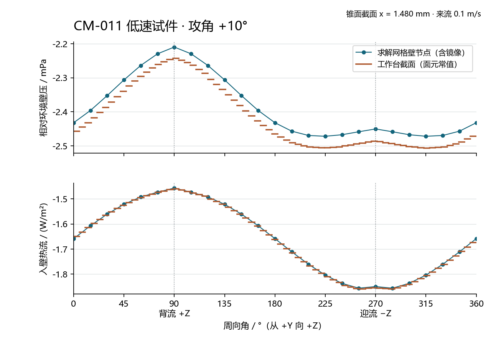

# +10° 低速 CM-011 试件的全表面压力和热流

来流速度 0.1 m/s、空气 300 K、给定壁温 300.1 K 时，CM-011 等温缩比试件的 **14,140 / 14,140** 个原面都有本工况三维计算的压力和热流。原三角面面积共 **3.734979×10⁻⁵ m²**，总入壁热功率 **−111.163 µW**，即试件向气体放热。试件直径为 3.949 mm，Re_D 约 25.18。自绘模型的同面工程覆盖仍为 0.846754 / 1.964629 m²（43.10%），本轮新增 0 m²。[三维工作台](../../../outputs/v274_validation/workbench03/workbench/index.html) · [原生终场与分区结果](evidence/steady.json)

## 同一截面上实际算出的差异

在事先选定的锥面圆周 **x = 1.480026 mm** 上，横向来流从 −Z 指向 +Z。以下压力均为壁面绝对压力减去 101325 Pa，表中以 mPa 表示。工作台周向角从 +Y 转向 +Z，270° 对应横向来流侧，90° 对应另一侧。符号为负的入壁热流表示放热。

| 量和取值位置 | −Z 侧，270° | +Z 侧，90° | −Z 减 +Z |
|---|---:|---:|---:|
| 原生壁节点相对环境壁压，mPa | −2.4503 | −2.2097 | −0.2407 |
| 工作台原面截面壁压，mPa | −2.4863 | −2.2423 | −0.2440 |
| 原生壁节点入壁热流，W/m² | −1.8492 | −1.4563 | −0.3929 |
| 工作台原面截面入壁热流，W/m² | −1.8545 | −1.4596 | −0.3949 |

在这条锥面环上，−Z 侧壁节点的放热强度约高 **27.0%**，相对静压略低。两种取值在压差和热流差的方向上一致。原生点来自求解网格的一条母线站，工作台则在相同 x 处读取相交三角面的面常值。截面恰好经过原网格环，工作台沿 +X 侧取值，因此两条曲线有可见偏移。图中蓝线连接真实求解节点以及它们的镜像，橙线为工作台的 69 个截面段。此分布只对应这个小型低速舱体的所选锥面位置。[截面 CSV 与取值复核](evidence/export.json)



## 几何、方法与全壁能量账

冻结来流为 [−0.0984808, 0, +0.0173648] m/s，对应 α=+10°、β=0°。XZ 平面两侧互为镜像。程序内部生成整个 Y≥0 半域，沿 −90° 到 +90° 取 12 个单元，两个半平面共用一个对称边界标记，在轴线上允许 +Z 速度。体网有 15,325 个唯一节点、13,248 个六面体和 576 个轴旁三棱柱，法向 24 层、外域半径 12D。全表面用两份半域结果表示。周向和母线均按实际原面坐标映射，保留原始编号及 14,140 面分母。[几何回执](evidence/geometry.json)

SU2 8.6.0 内部求解三维定常不可压层流动量和能量方程。压力从原生壁压恢复至 SI 并单列相对环境值；热流取自等温壁原生 Fourier 通量。工作台分别保存给定壁温、壁节点流体温度和首层流体温度。固体壁温、外缘温度与恢复温度保持未知。壁节点流体温度范围为 300.099829–300.100236 K，首层流体节点为 300.095765–300.099348 K。气体全域保存了最低 299.999761 K 的轻微欠冲。

| 壁区 | 原面数 | 原面入壁热功率（µW） | 入壁热流范围（W/m²） |
|---|---:|---:|---:|
| 小端球帽 | 157 | −0.635 | −4.939 至 −3.505 |
| 锥面 | 4,991 | −45.489 | −4.334 至 −1.460 |
| 肩部 | 5,555 | −22.682 | −7.101 至 −3.699 |
| 迎风盾面 | 3,437 | −42.357 | −5.495 至 −3.277 |

原生求解正常结束于本地索引 3546，共 3547 次更新。最后 20 步压力、三速度和焓的最大对数 RMS 依次为 −10.842、−11.840、−12.013、−11.922 和 −8.371；热监视量的相对极差为 1.35×10⁻⁹。两个半平面的法向速度均小于来流的 1.8×10⁻¹⁶，固壁节点速度为零。官方与只读观测的单步都从同一三维保存态启动。观测读取的五个状态逐节点与重启动文件完全相同，两程序单步后状态最大差为 1.14×10⁻¹³。[原生运行与观测回执](evidence/processes.json)

同一装配阶段折合整壁，壁面放热 **109.894317 µW**、远场流出显热 **109.894323 µW**，壁面减远场约 **−5.63 pW**（壁面放热的 −5.12×10⁻⁶%）。远场使用本次实际净质量通量扣除参考焓；镜面质量与显热增量均为零。独立按体网弦面三角积分为 −110.378 µW，按显示的完整原三角面积分为 −111.163 µW。体网弦面总面积比其粗母线旋转面积低 0.693%，各自由不同积分面积与权重定义。原生收支检验只验证本次离散计算的边界平衡。该攻角的空间和近壁敏感性、匹配的实验精度尚未确立。[能量账](evidence/energy.json) · [装配读数](evidence/stages.csv)

## 使用与复核

从项目根目录的 MATLAB 运行下式，会自动从均匀来流和给定壁面条件开始，生成体网并调用项目内的求解器。

```matlab
[model, report, page] = runCM011TunnelCase([], 'inclined');
disp(page)
```

打开离线工作台，选「相对环境壁压」或「入壁热流」，在截面 X 中输入 `0.0014800255546678404` m。其他截面可用滑块或点选。图、面元探针和 CSV 都有各变量自己的单位与方法。若需读取本机已冻结的同工况原生场及其独立能量观测，可运行以下命令。

```matlab
[model, report, page] = runCM011TunnelCase([], 'inclined', ...
    'outputs/v274_validation/half01', 'docs/validation/v274/evidence/energy.json');
```

以三维原生表面坐标重新匹配方位和母线弧长，独立复算了 14,140 面上的压力、热流和壁节点温度。另核对首层温度、场的来源、给定值和未知值、完整面积及功率。对照工作区和已发布工作台的截面例程，所选截面得到相同的闭合轮廓和同面取值，并按导出 CSV 逐行核对。浏览器鼠标操作本轮未实测。[导出复核](evidence/export.json) · [原生壁面场](evidence/wall.vtk.gz)

另以 MATLAB 常用入口从空目录重算，未提供任何 CFD 文件。生成的网格、配置、初场、正常终场重启动、壁面场、体场、迭代历史和逐面 CSV 与首次求解逐字节一致。首次原生计算用时 212.00 s。MATLAB 从空目录到页面导出共 230.28 s，内含第二次原生计算 207.51 s，采样进程组峰值约 823 MiB。独立边界观测编译和链接共 4.81 s，官方单步与观测单步共 2.23 s。存档回读和页面复验单列在进程回执；开发与归档未单独计时。[从零计算的对照](evidence/entry.json) · [原生求解配置](evidence/case.cfg)

版本基线为 `273e599d`。v273 的零入射网格字节、几何汇总、原面结果和能量账在共享代码调整后复核一致。29 个保护文件、54 个工程文件和两对候选分别核对。GitHub 收录体积较小的壁面、曲线和验证证据；两次计算的完整体场、检查点、MAT、离线页面及运行库留在本机。[工作台压力 CSV](evidence/pressure_section.csv.gz) · [热流 CSV](evidence/heat_section.csv.gz) · [本地文件及 SHA-256](evidence/local_assets.json)
