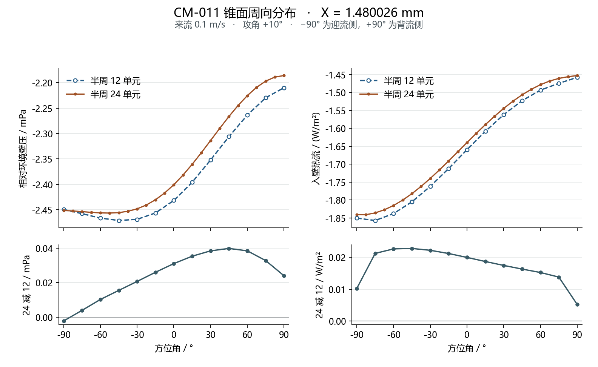

# CM-011 低速试件的周向网格敏感性

半周角向单元从 **12** 加密到 **24** 后，四个截面的迎背风压力差和热流差均保持各自的方向。锥面 X = 1.480026 mm 处，迎流侧比背流侧多放热 **0.3932 → 0.3881 W/m²**；全表面放热功率由 **111.393949 µW** 变为 **111.572675 µW**，相差 **0.1604%**。两次计算均覆盖同一组 **10,080 / 10,080 个 STL 原面，3.733866804 × 10⁻⁵ m²**。压力变化最大的一组面集中在肩部。[本机 24 单元三维结果](../../../outputs/cm011_import_19155e25-a004-4d68-b8cd-7679e38b5200/run_aa5a941f-f3dc-4973-9e22-b488ec942d14/workbench/index.html) · [定量比较](evidence/comparison.json)

上排使用两个终场的原生壁节点，沿母线插值到同一个 X。下排只取共有的 13 个方位。该图的压力单位是 mPa。角度从 +Y 指向 +Z，−90° 位于迎流侧，+90° 位于背流侧。入壁热流保留负号，表示给定 300.1 K 的壁面正在向 300 K 的气流放热。

## 四个固定截面与整个壁面

每个截面在 13 个共同方位上比较表压与热流。下表为每站的最大绝对变化。事前门槛为 0.0002 Pa、0.15 W/m²，总功率变化门槛为 1%。四个截面与总功率均满足各自门槛。[运行合同](PLAN.md)

| 区域 | X，mm | 表压最大变化，Pa | 热流最大变化，W/m² | 12 → 24 单元的区域入壁功率，µW |
|---|---:|---:|---:|---:|
| 小端球帽 | 0.040226 | 0.00003374 | 0.04149 | −0.650334 → −0.655985 |
| 锥面 | 1.480026 | 0.00003978 | 0.02277 | −45.670429 → −45.632935 |
| 肩部 | 3.014218 | 0.00016682 | 0.08929 | −22.623413 → −22.919268 |
| 迎风盾面 | 3.419230 | 0.00001584 | 0.00954 | −42.449772 → −42.364487 |

全壁逐面对照发现，**肩部 202 个原面**的表压变化达到或超过 0.0002 Pa，占全表面面积 **0.765%**。最大变化 **0.00023058 Pa** 位于第 **664** 面。全壁热流最大变化 **0.14370 W/m²** 位于第 **8227** 面。最大放热位置在两次计算中都是肩部第 **9611** 面，局部入壁热流为 **−7.07772 → −7.10880 W/m²**。面积加权 RMS 变化为 0.00005221 Pa 和 0.03484 W/m²。截面和功率稳定的结论限于这两种周向网格；肩部压力、流向及近壁分辨率、外域敏感性和实验精度各自仍有待验证。[202 个面的坐标、编号与两组原值](evidence/sensitive_faces.csv.gz) · [全壁极值及四区面积](evidence/comparison.json)

## 工作台与输入身份

MATLAB 中打开 `rocketAeroHeatWorkbench`。选择米制 [CM-011 原面](../../../cases/CM011-alternate-SI.stl)，「原坐标 → m」设为 1，确认朝向后，在「生成网格 → CM-011 低速半域 → 半周角向单元」选择 12 或 24。边界步骤选择「CM-011 · +10° 等温」。页面及导出记录实际求解分辨率。改动该设置会撤销旧体网、边界确认与结果。实测这次五步工作流从冷态求解并在宿主中绘制 10,080 面，得到 3,030 个可见像素采样，WebGL 错误码 0。通过选面事件核对了第 1701 面，未测试实体鼠标操作。[工作流回执](evidence/workflow.json)

源自同一个 NASA CM-011 光滑缩比外形，直径约 3.949 mm，来流 0.1 m/s、攻角 +10°、零侧滑、环境压力 101325 Pa。两次均采用 SU2 8.6.0 定常三维不可压层流动量和能量方程，压力来自原生相对壁压，热流来自等温壁 Fourier 通量。体网保留 49 个母线站、24 层径向单元及 12D 外域。24 单元解的 29,425 个节点中，15,325 个与旧解逐坐标重合，全部冷启动值已核对；两份原面文件和配置字节相同。本轮只运行了一次新的完整流场。旧解回读的六列逐面值全部逐值一致。首次要求旧摘要完全相同的断言未通过；复核发现唯一差异是原面积分末位约 3 × 10⁻²⁰ W，见两份保留数值。[输入核对](evidence/inputs.json) · [旧结果回归](evidence/regression.json) · [原型图纸](https://ntrs.nasa.gov/citations/19670027745)

锥面工作台曲线每种网格都由同一圈 150 个原面交线段组成。按实际线段端点在全周 24 个相同物理方位回读，图上面常值的表压最大变化为 **0.00003955 Pa**，热流最大变化为 **0.02183 W/m²**。另用待发布版本自带的截面和查看器代码复核了这些取值。原面编号、数值、单位和算法均随导出保留。[12 单元表压](evidence/coarse_pressureGauge.csv.gz) · [24 单元表压](evidence/fine_pressureGauge.csv.gz) · [12 单元热流](evidence/coarse_heatFlux.csv.gz) · [24 单元热流](evidence/fine_heatFlux.csv.gz) · [发布版复核](evidence/release_web.json)

## 终态与热收支

正常保存索引为 3577，共 3,578 次迭代；完整初场、每 500 步的重启与表面帧及正常终点均已保留。末 20 步五个分量各自的最大 log RMS 全部低于 −8，焓为 −8.3736，壁热相对极差为 2.33 × 10⁻⁹。给定壁温、壁节点流体温度与首层流体温度分别记录。固体壁温、外缘温度和恢复温度保持未知。[正常终场](evidence/steady.json)

原生壁面放热为 **110.903869 µW**，远场显热流出为 **110.903882 µW**，同阶段差额为 **−12.60 pW**。独立观测核对了同一终场的原始输入、官方和观测内核各一步后的场及真实对称边界增量。原面显示使用原 STL 面积与映射场积分，得到 **111.572675 µW**；原生收支使用求解器自身的边界通量，两者的积分权重单独保留。[能量观测](evidence/energy.json)

原生求解用时 444.05 s，包含网格生成、原生求解、绘制和状态回归的 MATLAB 进程组用时 483.17 s，采样峰值 1.91 GiB。原生监督进程组采样峰值约 251 MiB。只读观测编译与链接共 4.71 s，两次单步共 3.78 s。开发、资料核对与归档未单独计时。完整场和本机证据合计约 164 MiB，Git 仅收录源码和紧凑结果。29 个保护文件、54 个工程文件及两对候选均已核对。[运行回执](evidence/processes.json) · [本机资产与校验值](evidence/local_assets.json)

自绘模型在本轮新增同面工程面积 **0 m²**，目前仍为 **0.846754 / 1.964629 m²（43.10%）**，压力与热流均有独立验证的面积为 0 m²。[当前交接](../../CURRENT_STATE.md) · [下一项](NEXT_DECISION.md)
