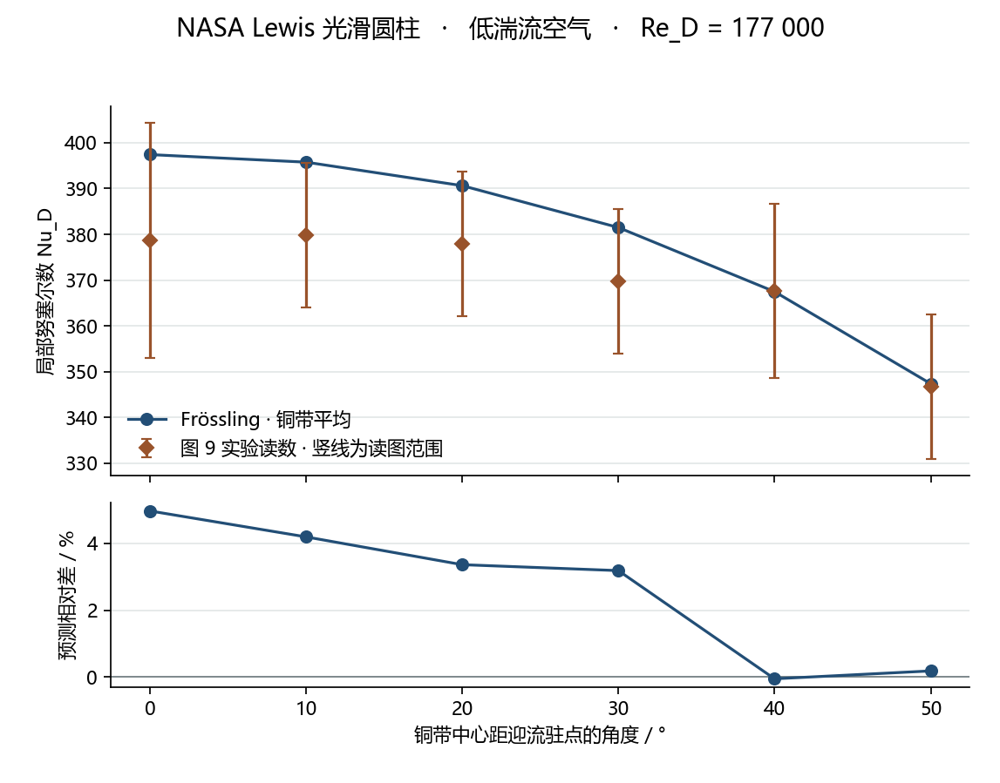

# NASA Lewis 光滑圆柱的六站换热对照

直径 66 mm 的光滑圆柱在空气横流、Re_D = 177000、低湍流条件下，Frössling 圆柱公式预测的铜带平均努塞尔数与六个实验图读值的**相对均方根差为 3.26%**。最大相对差在迎流驻点，为 **+4.97%**。50° 站的预测值为 347.35，实验图读值为 346.71，相差 +0.18%。该实验给出了附着区的局部换热对照；这次图表缺少逐站绝对热流所需的热物性和壁温差，绝对壁压也未知。[完整测站表](evidence/stations.csv) · [本机三维结果](../../../outputs/v278_validation/gui01/workbench/index.html)



| 驻点起算角度 | 图 9 菱形 Nu_D | 两次读图的定位范围 | Frössling 铜带平均 | 预测相对差 | 原表 III 回归值 |
|---:|---:|---:|---:|---:|---:|
| 0° | 378.6 | 352.9–404.3 | 397.43 | +4.97% | 398.2 |
| 10° | 379.8 | 364.0–395.6 | 395.77 | +4.19% | 413.5 |
| 20° | 377.9 | 362.1–393.7 | 390.63 | +3.36% | 409.7 |
| 30° | 369.7 | 353.9–385.5 | 381.49 | +3.19% | 391.6 |
| 40° | 367.7 | 348.6–386.7 | 367.47 | −0.05% | 369.8 |
| 50° | 346.7 | 330.9–362.5 | 347.35 | +0.18% | 353.7 |

每站相对差按「预测 / 图读实测 − 1」计算。六站中心读数的绝对相对差均小于报告给出的全体试验数据平均误差尺度 5.7%，也低于其最大误差尺度 7.8%。原文未发表这六站各自的误差条。图中的竖线只描述读图敏感性，不能由此推定模型在整壁或任一工况具有 3.26% 的预测精度。

## 原始实验和计算方法

NASA TM-83557 图 5 的无冰换热圆柱直径 6.6 cm、跨度 15.2 cm。各铜带轴向长 6.6 cm、宽 0.51 cm，处于风洞中部。用于生成冰形的圆柱直径为 5.1 cm，是另一件试件。光滑、低湍流情况下来流未安装扰流格栅，原文记录背景湍流度低于 0.5%，图 9 图例取 0.5%。每条铜带单独调节加热功率，使各带保持相同表面温度；设置背面和端部护热。作者从电功率中扣除辐射与绝热间隙的散热，以带面积和壁面至绝热壁温之差求 h。辐射项在多数工况低于总热量的 2%，间隙损失约 10%–20%，本文使用作者已修正的 Nu，不重复扣除。式 (9)–(13) 给出绝热壁温、恢复因子、Eckert 参考温度、Re 和 Nu 的定义。[NASA 原报告，印刷页 2–4、表 III、图 9](https://ntrs.nasa.gov/citations/19840006395)

图 9 的六个菱形是本次对照的直接来源；表 III 的 A、B 来自多工况幂律拟合。二者保留为不同列。读图以 240 和 360 dpi 分别渲染同一张扫描页，用两组坐标刻度拟合二维仿射变换，校正横纵轴倾斜。第一次按菱形中心取点，第二次按上下顶点的中点复读，最大差为 1.91 Nu。驻点标记与纵轴及理论线重叠，所取定位范围比其他测站宽。范围包含两次读数、各自最大标定残差和已登记的像素扰动；它们来自同一原图。完整标定与原图裁片可复查。[含图例的图 9](evidence/figure9.png) · [六个取点](evidence/markers.png) · [像素、刻度及定位范围](evidence/calibration.json)

计算使用 NACA TM 1432 印刷第 20 页空气圆柱展开式。取 x = s/D = θ/2，θ 为从驻点起算的弧度。四次截断给出 Nu_D = √Re_D (0.9449 − 0.5100 x² − 0.5956 x⁴)，空气 Pr = 0.7。Frössling 采用的是 Hiemenz 在 Re 约 19000 时测得的外缘分布。本次沿用该外缘假设，代入本试验 Re，限定在文献所述的 0°–55°，不使用图 9 或表 III 调整系数。将名义 5.1 mm 带宽视为周向弧长，积分范围为每站中心 ±4.4274°。带平均相对中心点值的最大绝对变化为 0.2493 Nu。独立按物理弧长进行数值积分，与 MATLAB 解析带平均的最大差为 5.12 × 10⁻¹³ Nu。[Frössling 原文](https://ntrs.nasa.gov/citations/20030068788) · [数值核对](evidence/checks.json) · [事前合同](PLAN.md)

## 工作台中的面积与结果身份

运行 `rocketAeroHeatWorkbench`，在「输入模型」中点「计算 NASA 圆柱换热对照」。同一主窗内的「风洞测站对照」页给出六站预测、读数及误差，切到「三维结果工作台」可选面或以 X 滑块读取周向截面。该按钮显式运行风洞基准；关闭对照并回到输入步骤后，原来的计算状态仍可继续使用。也可直接运行以下两行。

```matlab
[mesh, stations, report] = runLewisCylinderBenchmark();
exportAerothermalWeb(mesh, fullfile(pwd,'outputs','lewis_cylinder_view'));
```

| 面积身份 | 面积 |
|---|---:|
| 暴露圆柱侧壁，解析 / 三角离散 | 0.03151646 / 0.03151606 m² |
| 有模型 Nu 预测的中央跨度、迎流 ±55°，220 / 2160 面 | 0.00418141 m²（暴露面积的 13.27%） |
| 六条铜带的名义测量面积总和 | 0.00201960 m² |
| 两个风洞安装端面的几何面积总和，单列 | 0.00684239 m² |
| 同时算出绝对壁压和绝对入壁热流的面积 | 0 m² |

X 为圆柱轴，+Y 为迎流驻点，+Z 为正角方向。侧壁按 1° 相邻角度构建面带，每带的两个三角面显示同一个模型带平均。中央跨度内使用二维对称预测；实测值只在六条铜带表格中显示。端部附近和背侧的 Nu 保持未知。未求出的热流、壁温或压力不会由 Nu、给定电功率或邻近面补齐。整壁入壁热功率仍未知。

主窗口中 WebGL 实际绘制 2160 面、15702 个可见像素采样，错误码为 0。第 1 个未知面及第 721 个预测面经选面回调核对，未使用实体鼠标。中跨实际截面有 720 个三角交线段，220 段带有 Nu 计算值。独立用三角坐标逐面复算了适用范围、外法向、面积和带平均值，检查了截面 CSV 的未知值与方法列，并用 Git 发布基线的网页程序复验。既有 CM-011 加密网格的 10,080 面数据脚本重新生成后与原版相符。[中跨截面 CSV](evidence/section.csv.gz) · [工作台回执](evidence/workflow.json)

本版从 v277 提交 `6c9c4364` 开始。主窗口与数值回归用时 24.08 s（含 MATLAB 启停与显示），采样峰值 1.90 GiB；旧结果回归用时 12.97 s。工程式直接求值，无新 CFD 迭代。资料整理、开发、读图及归档未单独计时。原始 PDF 和完整工作台留在 E 盘，源码、六站数据、图和小型证据跟随 Git 发布。已核对 29 个保护文件、54 个工程文件及两对候选。[进程回执](evidence/processes.json) · [本地文件与来源校验值](evidence/local_assets.json)

自绘箭体本轮新增同面工程面积 0 m²，原有覆盖仍为 **0.846754 / 1.964629 m²（43.10%）**。圆柱的六站检验只支持这个给定工况的局部无量纲预测。[当前交接](../../CURRENT_STATE.md) · [下一项](NEXT_DECISION.md)
