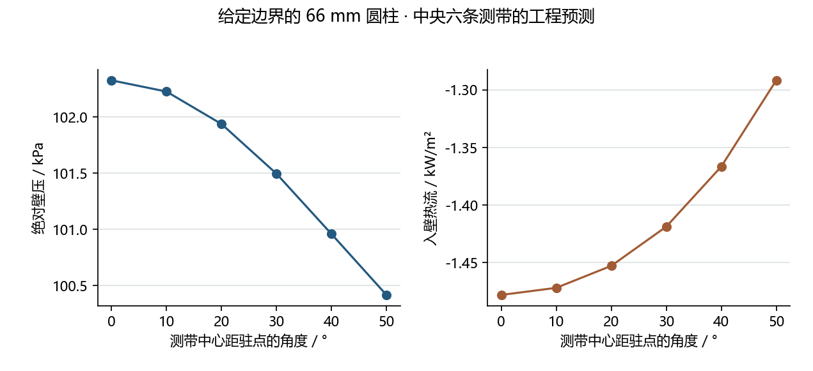

# 给定热边界的 66 mm 风洞圆柱

新研究工况给定上游静压 **101325 Pa**、空气静温 **293.15 K** 和圆柱壁温 **303.15 K**。保持 Re_D = 177000，求得来流速度 **40.9333 m/s**。在完整暴露侧壁的 2160 个原面中，中央迎流区 **220 面**同时取得工程壁压和有符号入壁热流，面积 **0.00418141 / 0.03151606 m²（13.27%）**。这部分向空气放热 **5.88454 W**。余下 **0.02733465 m²** 仍缺适用工程结果，整壁工程热功率未知。[本机离线工作台](../../../outputs/v279_validation/gui03/workbench/index.html) · [独立复算](evidence/checks.json)

全周三维求解首次在该圆柱、完整风洞截面及两个安装端上保存了一步实际非定常场。2160 面上的映射值已能在工作台查看。120 次内迭代后，九个方程均未达到预定残差，脱涡统计尚未开始。这组场以「未收敛试算」标记，新增合格面积 **0 m²**。自绘模型仍为 **0.846754 / 1.964629 m²（43.10%）**。[三维原始指标](evidence/trial.json) · [原运行合同](PLAN.md)

## 使用入口

在 MATLAB 运行 `rocketAeroHeatWorkbench`，打开「输入模型 → 计算 NASA 圆柱换热对照 → 给定边界工况」。填写压力、静温和壁温，再点「计算工况」。工作台同时显示工程覆盖、已算区域功率和完整表面的缺项。修改输入会撤销旧云图。在上述默认工况下可点「载入未收敛三维试算」，再从变量列表选择诊断壁压或热流。改变壁温后该归档不再适用。原六站实验页保留其原始数据。

```matlab
[mesh, stations, report] = runLewisCylinderCondition(101325, 293.15, 303.15);
exportAerothermalWeb(mesh, fullfile(pwd,'outputs','lewis_dimensional_view'));
```

## 工程量与实验能说明什么

采用低速理想干空气，密度由上游静温和静压计算。由质量通量雷诺数、Sutherland 黏度和 TM-83557 的 Eckert 参考温度联立求来流速度。换热定义的绝热壁温为 **293.84744 K**，物性参考温度 **298.30344 K**，导热系数 **0.0263867 W/(m·K)**。近室温输入范围为 280–310 K、90–110 kPa，同时满足该试验风洞的 46 m/s 上限。用 CoolProp 7.2.0 Air 在 280–311 K、90–110 kPa 的 672 个节点独立复核，密度、定压热容、黏度和热导率的最大相对差分别为 0.057%、0.194%、0.470%、0.973%。[物性采样与最差点](evidence/properties.json)

中央测带及其迎流附着区沿用 Frössling 空气四次式。h = Nu_D k / D，q = h (Tad − Tw)，正向入壁。温差取自**本次研究设定**。压力使用同一文献所列 Hiemenz 圆柱外缘速度多项式，经不可压 Bernoulli 关系求壁压近似，对每个 1° 面带分别积分速度平方。其外缘分布源自另一雷诺数，当前没有匹配的壁压实验。NASA 图 9 六站验证的是 Nu；论文未给该次测站的绝对温度与压力边界。两次工况的证据各自保留。[原六站对照](../v278/RESULTS.md) · [Frössling 原文，第 20 页](https://ntrs.nasa.gov/citations/20030068788) · [NASA 风洞试件与量热定义](https://ntrs.nasa.gov/citations/19840006395)



220 个面带三角面上的绝对壁压为 100193.24–102333.43 Pa，入壁热流为 −1478.46 至 −1250.28 W/m²。六条实际铜带的宽度约 8.85°，其平均值另算。0° 带为 **102327.16 Pa、−1478.08 W/m²**，50° 带为 **100415.53 Pa、−1291.85 W/m²**。改给 283.15 K 冷壁并重新满足目标 Re 后，同一面积的积分为 **+6.56853 W**；在 Tw = Tad 的极限，积分数值约 3.6 × 10⁻¹⁴ W，220 个有限值仍计入已算。固体温度始终未求解。[六条测带](evidence/stations.csv) · [边界和工作台回归](evidence/workflow.json)

## 三维试算与安装端的热流

官方 SU2 8.6.0 使用三维不可压非定常 RANS、SST-2003m、Langtry–Menter 转捩和定密度能量方程。全周 72 个角向、40 个径向、24 个跨向单元，合计 **69,120 个六面体、73,800 个节点**。近圆柱与跨向端壁首间隔为 8 µm。圆柱为等温无滑移壁，风洞顶底与两侧安装壁均为绝热无滑移壁。入口位于上游 5D，出口位于下游 12D，均为新算例的数值截断。入口 Tu=0.5%、湍黏比 5、解析初始速度及弱尾迹扰动是设定值。出口零表压固定数值压力零点，映射绝对压力时将入口中心点对应到给定上游压力。恒物性不可压能量解与工程恢复温度基准的差异仍需单独评估。[网格](evidence/mesh.json) · [完整配置](evidence/case.cfg)

| 首个物理步末端 | 结果 |
|---|---:|
| 实际物理时间增量 | 8.06190 × 10⁻⁵ s |
| 内迭代次数 | 120 |
| 压力 / 焓的 log RMS | −4.667 / −0.965 |
| 湍动能 k / 比耗散率 ω 的 log RMS | −4.126 / +1.353 |
| 满足 log RMS < −8 的分量 | 0 / 9 |

**安装端交线上，通用节点输出的零热流属于绝热安装壁。** 144 个交线节点同时属于两个固壁标记。SU2 的 COutput::LoadDataIntoSorter 对同一个节点依次写入各固壁标记的表面数据。依据 CFVMFlowSolverBase 的等温壁定义，在保存终态中取圆柱法向相邻温度、给定壁温、法向距离和导热系数，重建了圆柱一侧的通量。1656 个非共享节点与原生值最大差 **1.08 × 10⁻⁹ W/m²**。在 144 个共享节点，圆柱侧的试算值为 **−765.60 至 −699.69 W/m²**。以原生对偶边界面积积分得 **−21.6448573777 W**，与同时刻的圆柱监视值相差约 **2.3 nW**。这是同阶段壁标记的读数复核，整个风洞的跨边界能量账仍待验。[源场、数值范围和监视值](evidence/trial.json) · [九分量原始历史](evidence/history.csv.gz)

试算场沿原生 5° 方位及 25 个实际跨向位置双线性插值，在每一个显示三角面的角向/跨向参数域中分片积分。2160 个原面均返回诊断压力和热流，原面面积积分为 **−21.67208 W**。该数值保留试算身份；工程台账仍只积分 220 面。试算尚无合格的物理步、时间统计、空间误差或实验精度结论。[实际原面坐标与试算值](evidence/trial_faces.csv) · [工作台试算截面](evidence/trialHeatFlux_section.csv.gz)

## 可复现性与交付

首次原生调用因初场文件序号多一位而退出，未推进物理时间。修正文件名后，同一初场完成了一次物理步。首次输出回放发现 CSV 与精简 ASCII 重启共用同一个写入器，仍缺两个转捩辅助量。最后关闭精简输出，完整体场保留这两列。两次输出回放均从同一初场开始，九个主场、壁面及历史复核一致，三次成功运行只对应**一个**物理时间间隔。扩展重启文件按 SU2 读取器实际所需的主量与辅助量次序生成，双精度往返逐值一致；尚未以此文件继续下一个物理步。首次离线审核对输入和输出的十进制坐标要求逐位相同而停止，复读后最大差为 5.56 × 10⁻¹⁷ m，节点编号精确一致，更正了审核容差。[原始回执](evidence/processes.json) · [首次审核记录](evidence/initial_audit_error.txt)

独立数值积分复核工程压力和热流，最大差分别为 1.46 × 10⁻¹¹ Pa、6.83 × 10⁻¹³ W/m²。实测主窗口 WebGL 绘制、输入失效、冷热壁、错配试算拒绝和选面事件；未测试实体鼠标。中跨 720 个交线段中，工程压力和热流各有 220 段有值，单独的未收敛试算字段有 720 段有值。发布基线的网页代码与并发工作区代码对共同导出列的读数相同。[工程压力截面](evidence/pressure_section.csv.gz) · [工程热流截面](evidence/heatFlux_section.csv.gz)

三次同一步的原生求解分别用时 36.05、36.48 和 36.83 s，读入失败用时 1.45 s。最终工作台回归含 MATLAB 启停约 25.4 s，采样峰值约 2.00 GiB。开发、网格生成和归档未单独计时。完整网格、初场、体场与重启留在 E 盘。仅对本版已终结目录中经逐字节验证的相同大文件共享硬链接，各原路径保留，减少重复文件长度 85,611,534 字节。后续使用新目录写计算结果。29 个保护文件、54 个工程文件及两对候选已核对。[本地资产与恢复依据](evidence/local_assets.json) · [下一项](NEXT_DECISION.md)
